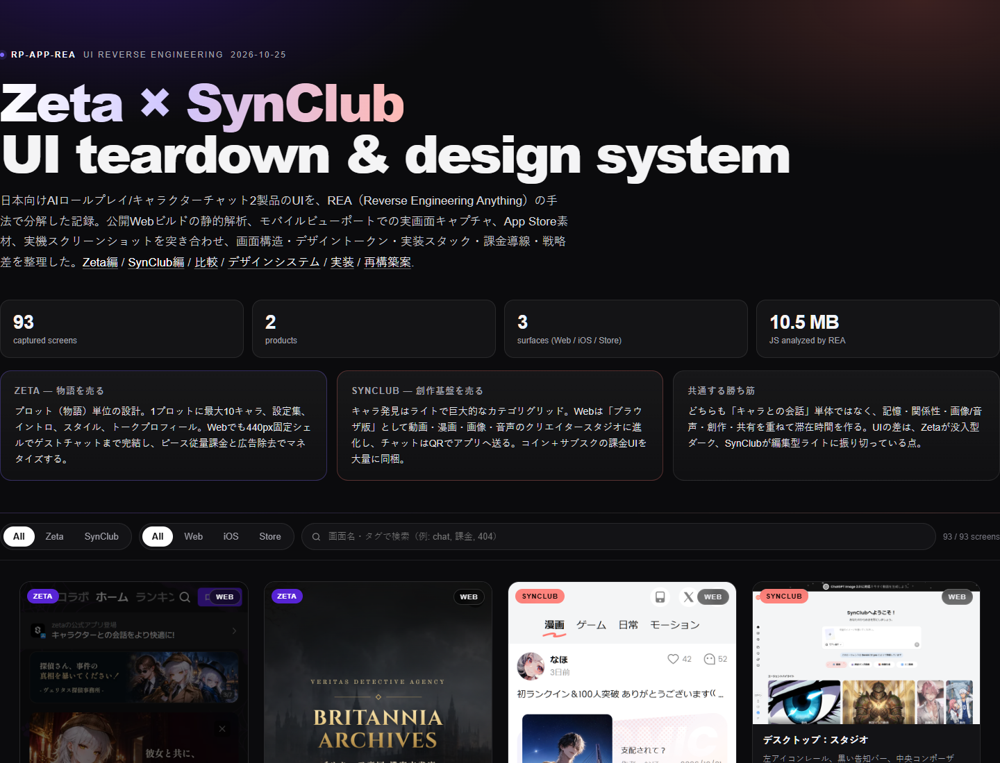

# RP-app-REA — Zeta / SynClub / MiraiMind / CrushOn UI リバースエンジニアリング

日本向けAIロールプレイ/キャラクターチャット **4製品**（Zeta / SynClub / MiraiMind / CrushOn.AI）のUIを、公開Webビルド・ストア素材・実機キャプチャから分解した記録です。画面のスクリーンショット**140点**、デザイントークン、ルート/コンポーネント目録、実装スタックの分析、再構築ブループリントを収録しています。

> 解析対象は未認証で到達できる公開面のみ。ログイン回避・認証情報の窃取・非公開APIの叩き込みは行っていません。UGC本文は公開用に一部レダクト/選定しています。CrushOn.AIはNSFW前提のため、18歳未満向けではありません。



---

## 30秒サマリー

| | **Zeta** | **SynClub** | **MiraiMind** | **CrushOn.AI** |
|---|---|---|---|---|
| ポジション | 日本のNo.1 AIチャット。推しとの会話・夢小説 | やさしく寄り添う AIキャラチャット・ノベル | 「話す」から「通じ合う」へ。音声＋永久記憶 | AI girlfriend / character AI chat。NSFW前提 |
| 原子 | **プロット（物語）**。最大10キャラ＋設定集 | **キャラクター**＋発見投稿 | **キャラクター＋シナリオ＋心の声** | **キャラクター**＋NSFWタグ |
| Webの役割 | アプリ代替。**440px固定**、ゲストチャット可 | **ブラウザ版クリエイタースタジオ**。QRゲート | 獲得＋**5リクエスト**の限定チャット | SEO＋限定チャット＋**7段階サブスク** |
| ビジュアル | ダーク `#151516` × 紫 `#6728FF` | ライト `#FFF` × コーラル `#FF7870` | ホワイト × パステルグラデ | マーケは黒紫／アプリは白 |
| 課金 | ピース＋zeta pass＋広告除去 | コイン＋サブスク | 金平糖チャージ | Coin/Diamonds＋7プラン |
| 技術 | Next.js/React/Tailwind | Nuxt/Vue/Element Plus | Vue/Vite/Ant Design Vue | Next.js/React/Mantine |

**一番おもしろい差分**：4社とも「AIキャラとの会話」を売りながら、UIの原子が違います。Zetaは**物語**、SynClubは**キャラクター**、MiraiMindは**声と心の声**、CrushOnは**課金プランとSEO**。同じ機能でも、画面の順序・課金の言葉・Webの役割がすべて変わります。

---

## 収録物

```
RP-app-REA/
├── index.html                 # 140画面のギャラリー（フィルタ/検索/ライトボックス）
├── ux.html                    # 4製品のUXフロー比較（タップ/時間/ゲート）
├── data/
│   ├── screens.json           # 各画面のメタデータ + SHA-256
│   ├── tokens.json            # 4製品のデザイントークン
│   ├── routes.json            # 観測/ゲート/バンドルのルート目録
│   ├── components.json        # React/Vueのコンポーネント目録
│   ├── features.json          # Zeta vs SynClub の27項目比較
│   ├── features-4apps.json    # 4製品×30項目の比較マトリクス
│   ├── ux-metrics.json        # UX実測値（タップ/時間/タップ領域/文字サイズ）
│   ├── ux-flows.json          # 4製品のファネル/フローグラフ
│   └── app-metadata.json      # ストア/HTTP/バンドルのメタデータ
├── docs/
│   ├── 01-zeta-teardown.md
│   ├── 02-synclub-teardown.md
│   ├── 03-comparison.md       # 4製品の比較＋Zeta vs SynClubの深掘り
│   ├── 04-design-system.md
│   ├── 05-implementation.md
│   ├── 06-rebuild-blueprint.md
│   ├── 07-evidence-index.md
│   ├── 08-method-and-limitations.md
│   ├── 09-miraimind-teardown.md
│   ├── 10-crushon-teardown.md
│   ├── 11-ux-reverse-engineering.md
│   └── 12-ux-patterns.md
├── evidence/
│   ├── screenshots/{zeta,synclub,miraimind,crushon}/{web,mobile}, appstore/*
│   ├── ux/                   # ファネルのステップ画像＋生ログ
│   ├── dom/structures/*.json  # テキストを除いたDOM構造アウトライン
│   ├── tokens/*-observed.json # 実測した色/フォント/角丸の出現頻度
│   └── rea/README.md          # REA Evidence IDと実行条件
└── analysis/design-tokens.css # 4製品のトークンをCSS変数化
```

ギャラリーは `index.html` をブラウザで開くか、GitHub Pages でそのまま閲覧できます。

---

## 主要な発見

### 1. Zetaは「物語の台本」、SynClubは「キャラのカタログ」

Zetaの詳細画面は ヒーロー→紹介→プロット（キャラ定義）→イントロ→コメント→関連 の順で、作者の**システムプロンプト**まで公開されます（`zeta_z40_profile_scroll_3600.png`）。UIは「読む→入る」の導線です。

SynClubはキャラクターカードの集合で、カテゴリは `学園・青春` `ヤンデレ` `背徳感` など**感情語**。チャットは背景イラスト＋音声の**劇場**です。UIは「探す→演じる」の導線です。

### 2. MiraiMindは「声」と「心の声」で没入を作る

MiraiMindのチャットは、`▶ 6″` の**音声バブル**、`(内心：…)` の**心の声**、`進む` の**物語進行**が三位一体です（`mm_06_chat_reply.png`）。ユーザーが何も入力しなくても物語が進むため、チャットというより**ビジュアルノベル**に近い。白＋パステルの明るいUIも4社で唯一です。

### 3. CrushOnは「課金」と「SEO」で回す

CrushOnのアプリは白くて普通のメッセージUIですが、料金プランは**7段階**（無料〜インペリアル）、年額47%オフ、メッセージクレジット、モデル階層、記憶容量、同時チャット数まで比較できます（`co_17_desktop_pricing.png`）。マーケティングは黒×紫のネオンで、8M+キャラのSEOページ・クリエイター記事・性格ビルダーを量産。**プロダクトとマーケティングのトーンが分裂**しています。

### 4. ゲスト体験の設計が4社で違う

| | ゲストの限界 | その後の導線 |
|---|---|---|
| Zeta | チャット可（短命ルーム） | ログインシート／アプリDL |
| SynClub | 不可 | QRゲート |
| MiraiMind | **5リクエスト** | アプリDLモーダル |
| CrushOn | 導入は閲覧可、送信はログイン | ログインバナー／認証ゲート |

ZetaだけがWebで完結します。SynClubとCrushOnは最初から止め、MiraiMindは**価値を体験させてから**止める。この差は、Webを「プロダクト」と見るか「漏斗」と見るかの差です。

### 5. 季節テーマ / イベントはコンポーネント差し替え

Zetaは `HalloweenNavigationBar` `HalloweenTabBarIcon` `HalloweenHomeDecoration` `VeritasIntroPage` を持ち、ハロウィンやブランドコラボを**UIスキン**として差し替えます。MiraiMindは金平糖のハロウィンボーナス、CrushOnはランキングのパステルカードで季節感を出します。

### 6. アクセシビリティは4社とも「これから」

- Zeta：Lighthouse a11y **0.76**。アイコンボタンが英語の `aria-label`、`maximum-scale=1`
- SynClub：**0.90**。カテゴリタブが `div`、カードがURLなし
- MiraiMind：Ant Design依存。画像alt・フォーカスの検証が弱い
- CrushOn：`rc-dialog` は良好だが、カードがリンクでない箇所、10pxタグ

---

## UX REA — 最初の会話までの距離

UIの形だけでなく、**最初のAI応答に到達するまでのタップ・時間・ゲート**を同一条件（390×844 / 同一プロンプト）で測定しました。詳細は [`docs/11-ux-reverse-engineering.md`](docs/11-ux-reverse-engineering.md)、ビジュアルは [`ux.html`](ux.html)、パターン集は [`docs/12-ux-patterns.md`](docs/12-ux-patterns.md)。

| 指標 | Zeta | SynClub | MiraiMind | CrushOn |
|---|---|---|---|---|
| チャットまでのタップ | 2 | 不可 | **1** | 3 |
| 送信までのタップ | **3** | 不可 | **2** | 4 |
| カード→チャット | 2.13s | — | **1.05s** | 2.09s |
| 送信→AI応答 | 3.19s | — | **2.96s** | ログインで停止 |
| ゲスト送信 | 可（短命） | 不可 | **5回** | 不可 |
| 44px未満のタップ領域 | **90/122** | 0（要素なし） | 2/7 | 11/28 |
| 12px未満のテキスト | 6 | 0 | 0 | **94** |
| ヒューリスティック | 34/50 | 26/50 | **35/50** | 31/50 |

一番大きな発見は、**SynClubのフィードにセマンティックなクリック要素が0個**（カードは `<section>` + JS）であること。次に、**CrushOnは入力してからログインを求める**こと。MiraiMindは最短導線だが、**5回制限を事前に表示していない**。Zetaはゲストで完結するが、**タップ領域の74%が44px未満**です。

### UXの詳細

- [`docs/11-ux-reverse-engineering.md`](docs/11-ux-reverse-engineering.md) — ファネル、ゲート4類型、応答時間、マイクロコピー、ヒューリスティック、推奨アクション
- [`docs/12-ux-patterns.md`](docs/12-ux-patterns.md) — 15パターンの実例・推奨・仕様
- [`ux.html`](ux.html) — 4製品のフローを横並びで比較するビジュアルレポート
- [`data/ux-metrics.json`](data/ux-metrics.json) / [`data/ux-flows.json`](data/ux-flows.json) — 生の測定値とフローグラフ
- [`evidence/ux/`](evidence/ux/) — ステップごとのスクリーンショットと生ログ

---

## ギャラリーの見方

`index.html` を開くと、アプリ（Zeta/SynClub/MiraiMind/CrushOn）とサーフェス（Web/iOS/Store）でフィルタできます。カードをクリックすると原寸、URL、SHA-256、寸法が出ます。

- **Zeta**：ホーム、ランキング、検索、プロット詳細、ゲストチャット、クリエイターセンター、AIプロットアシスタント、イベント、404
- **SynClub**：ランディング、キャラフィード、カテゴリ、発見、クリエイタースタジオ、画像/ボイス、共有チャット、404、デスクトップ
- **MiraiMind**：Discover、検索、チャット（音声/心の声/進む）、キャラ情報、アプリゲート、ログイン、言語、金平糖チャージ、公式サイト、Play Store
- **CrushOn**：オンボーディング、ホーム、ランキング、検索、料金プラン、ストア/コイン、ログイン、受信箱、チャット、マーケティング、性格ビルダー、デスクトップ

---

## 方法と証拠

- **REA（Reverse Engineering Anything）** で生産JSバンドルを静的解析

| 製品 | ファイル | バイト | ASTノード | findings | Evidence |
|---|---|---|---|---|---|
| Zeta | 109 | 5.88MB | 1,702,775 | 119 | `ev_cf67c9…` |
| SynClub | 38 | 4.59MB | 997,030 | 2,727 | `ev_5a12c6…` |
| MiraiMind | 22 | 4.47MB | 1,203,611 | 518 | `ev_5d2ca8…` |
| CrushOn | 106 | 7.67MB | 1,954,108 | 10,221 | `ev_2dd124…` |

- **実画面キャプチャ**：Playwright + システムChrome。Webは 390×844 / DPR2 / ja-JP / Asia-Tokyo、デスクトップは1280–1440px
- **デザイントークン**：本番CSSのユーティリティ定義と computed style を突き合わせ
- **モバイル**：App Store / Google Play 素材＋ユーザー提供のiOS実機キャプチャ
- **インフラ**：HTTPヘッダ、PWAマニフェスト、robots.txt、sitemap

詳細は [`docs/08-method-and-limitations.md`](docs/08-method-and-limitations.md)。

### 限界

- REAのセマンティック解析は結果バジェットの制約で**部分的**。UIの主張は本番CSS/DOM/静的文字列と実画面で裏取り
- 未ログインで到達できない画面（購入フロー、SynClubの `/chat` `/subscription`、CrushOnのストア/アカウント）は**実物を撮影していません**
- MiraiMindのデスクトップWebは**空白**。モバイル専用と判断
- CrushOnはNSFW。UGCは公開用に一部ブラー/選定
- UIは日々変わるため、2026-10-25時点のスナップショット

---

## 注意

- 本リポジトリは**UI構造の分析**を目的とし、各社のロゴ・キャラクター画像・文章の権利は各社に帰属します。
- キャラクター説明やチャット本文などのUGCは、公開用に**一部を選定・モザイク処理**しています。Zetaの実機キャプチャは提供者の同意のもとで収録しました。
- 認証回避は行っていません。未ログインでリダイレクトされる画面は、**バンドル/CSS内の存在表明**にとどめ、推測と明記しています。
- CrushOn.AIは18歳以上向けです。本リポジトリは成人向けコンテンツの提供を目的としません。

---

## ライセンス

分析テキスト・構造化データは CC BY 4.0。スクリーンショットは各権利者に帰属し、本リポジトリのライセンス対象外です。

---

*Built with REA (Reverse Engineering Anything) — static evidence, runtime observation, and explicit unknowns.*
