# Zeta — UI ティアダウン

対象：`zeta`（運営 Scatter Lab, Inc. / 日本版 `zeta-ai.io`、iOS `id1619030760`、Android `com.scatterlab.messenger`）
観測日：2026-10-24〜25 / iOS v3.51.4 / Web build（Next.js, Turbopack）

---

## 1. プロダクトの輪郭

ストアコピーは「**日本のNo.1 AIチャット**」「300万体以上のAIキャラ」「夢小説・なりきり・乙女系ストーリー」。実際のUIを触ると、単なる1対1チャットではなく、**プロット（物語）を選び、その世界に入り、キャラクターと会話する**構造になっています。

- ホームは「キャラ一覧」ではなく**物語カードのフィード**
- 詳細画面は「キャラ紹介」ではなく**作品の台本**（紹介 / プロット / イントロ / コメント）
- チャットは「メッセージ」ではなく**ナレーション＋台詞＋行動**
- 課金は「ガチャ」ではなく**物語の寄り道**（日記を読む、スマホを覗く、メッセージを送る）

この「物語が原子」という設計が、後述するSynClubとの最大の差です。

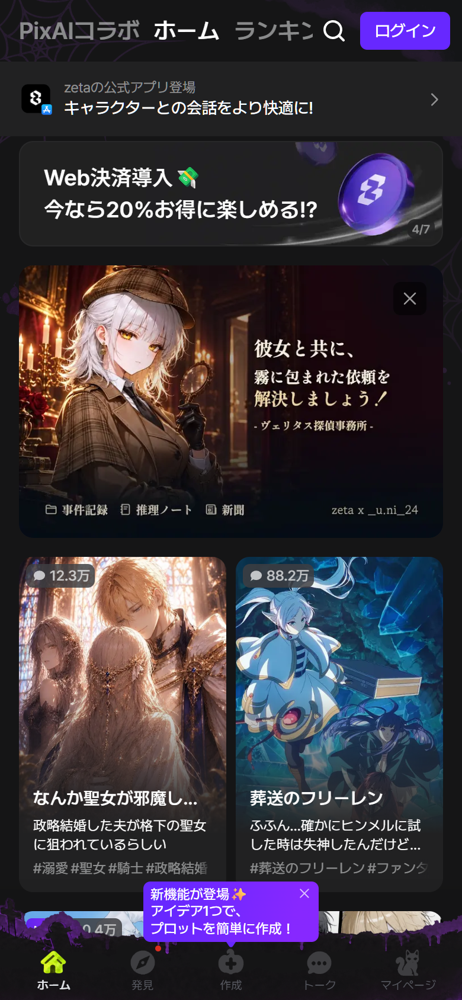

---

## 2. プラットフォームと配信

| 項目 | 観測値 | 根拠 |
|---|---|---|
| Web | `https://zeta-ai.io/ja`（`/ko`, `/en`） | hreflang, `NEXT_LOCALE` |
| ホスティング | Vercel（`Server: Vercel`, `X-Vercel-Id`） | レスポンスヘッダ |
| フレームワーク | Next.js App Router + Turbopack（`X-Powered-By: Next.js`, `turbopack-*.js`, RSC用 `Vary: rsc`） | ヘッダ / チャンク名 |
| PWA | `manifest.json`、`theme_color: #151516` | マニフェスト |
| Webシェル | **最大440px固定**。1280pxでも中央に440px、左右は黒 | `desktop_zeta_dark_feed.png` |
| 認証 | LINE / Google / Apple / Kakao（バンドル内 `/auth/*`） | ログインシート + JS |
| ゲスト | `TOKEN` Cookie（JWT, `ano:true`）を自動発行。ゲストでもチャット可 | レスポンスヘッダ + 実画面 |
| 広告 | チャット上部にGoogle AdSense/Publisher Tag | `pagead2.googlesyndication.com`, `pubads_impl.js` |

Webは**アプリの代替**です。ナビゲーション、カード比率、フォントサイズ、下部タブまでアプリと同じで、デスクトップ最適化は意図的にしていません。これは「Web=獲得とSEO、本体=アプリ」という役割分担の表れです。

---

## 3. 情報設計（IA）

### 3.1 ルート

| ルート | 画面 | 状態 |
|---|---|---|
| `/ja` | ホーム（`?tab=home|ranking|pixai`） | 公開 |
| `/ja/search` | 検索（空 / 結果） | 公開 |
| `/ja/discover` | 発見（編集フィード） | 公開 |
| `/ja/plots/{id}/profile` | プロット詳細 | 公開（SSR/SEO） |
| `/ja/rooms` | トーク一覧 | 公開（空状態） |
| `/ja/rooms/{id}` | チャット | ゲスト可（ルームは短命） |
| `/ja/creator-center` | クリエイターセンター（プロット/設定集/フィード） | ログイン壁 |
| `/ja/plots/assistant` | AIプロットアシスタント | 公開（間欠ゲート） |
| `/ja/announcements/{id}` | お知らせ | 公開 |
| `/ja/veritas`, `/ja/trick-or-treat` | イベント | 公開 |
| `/ja/plots/create` | 作成 | ホームへリダイレクト（nudge） |
| `/ja/settings` | 設定 | ホームへリダイレクト |

バンドルには `/auth/{line,google,apple,kakao,brandpay,sso,get-token,authorize}` が存在します。`/auth/*` は `robots.txt` で Disallow。

### 3.2 ナビゲーション

- **上部**：`PixAIコラボ` / `ホーム` / `ランキング` + 検索アイコン + `ログイン`
- **下部タブ**：`ホーム` / `発見` / `作成` / `トーク` / `マイページ`
- 下部タブは**マスコットのシルエット**が背景に透ける凝った作り。アクティブタブだけ色が変わる（ハロウィン時はカボチャ、トークはピンク）。
- `作成` はAIプロットアシスタント、`トーク` はトーク一覧、`マイページ` はクリエイター/設定への入口。

注目すべきは、**Webでも下部タブを省略していない**こと。モバイルWebの親指圏をそのまま再現し、デスクトップでも440pxに閉じ込めることで、アプリとWebの学習コストをゼロにしています。

---

## 4. 画面別解剖

### 4.1 ホーム

上から：

1. **ヘッダー 52px**：セグメントテキスト（PixAI/ホーム/ランキング）、右に検索とログイン。背景 `#151516`、下ボーダー `rgba(255,255,255,.05)`。
2. **プロモバナー**：`Web決済導入💸 今なら20%お得`、`[重要] キャラクター作成に関する注意喚起`、ハロウィン。カルーセルで `2/7` カウンタ。
3. **フィード**：2カラム、カード `175×233px`（3:4）、角丸は上だけ12px。左上にチャット数バッジ（`9.3万`）、画像下にタイトル2行、タグ行、作者名。
4. **下部タブ**：56–60px + safe-area。背景にマスコット。

カードの情報順は **数字（社会的証明）→ タイトル → タグ → 作者**。タイトルは16px/600、タグは12px/50%白。カード全体がリンクで、タグだけ別リンク（`/ja/search?keyword=...&source=PLOT_CARD`）です。

`2/7` のバナー、`今すぐチェック` の浮遊チップ、`iPhone Duo 毎日当選` のプロモなど、**画面の余白を収益化**する要素が多いのも特徴です。

### 4.2 ランキング

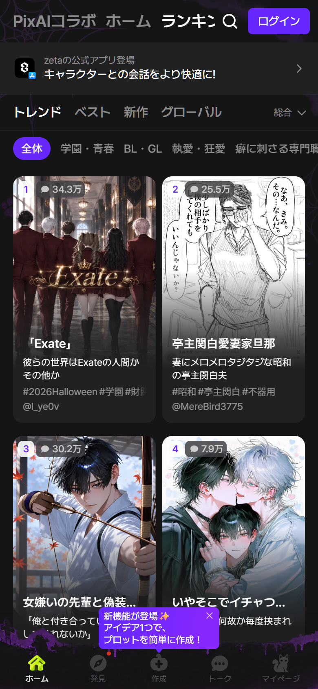

- タブ：`トレンド` / `ベスト` / `新作` / `グローバル`
- ジャンルチップ：`総合` `学園・青春` `BL・GL` `執事・逆張り` `癒し` `その他`
- 2カラムカードに**順位バッジ**（左上の大きな数字）とチャット数
- カード下に作者 `@handle`

ランキングは「作品のランキング」であって「キャラのランキング」ではありません。ここでもプロット単位。

### 4.3 検索

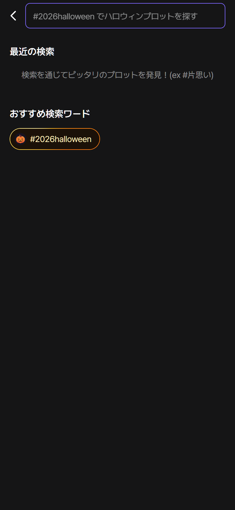

- 検索フィールドは紫のリング、プレースホルダ「プロット名で検索」
- 下に**おすすめタグのピル**が流れるレイアウト。ハロウィン時は「🎃 Happy Halloween!」のオレンジ枠チップ
- 結果はカードグリッド。`?keyword=` でディープリンク可

検索はプロット名・タグ・本文を横断します。タグは `#ホラー` `#呪い` のような日本語タグで、カードから直接タグ検索に飛べます。

### 4.4 プロット詳細

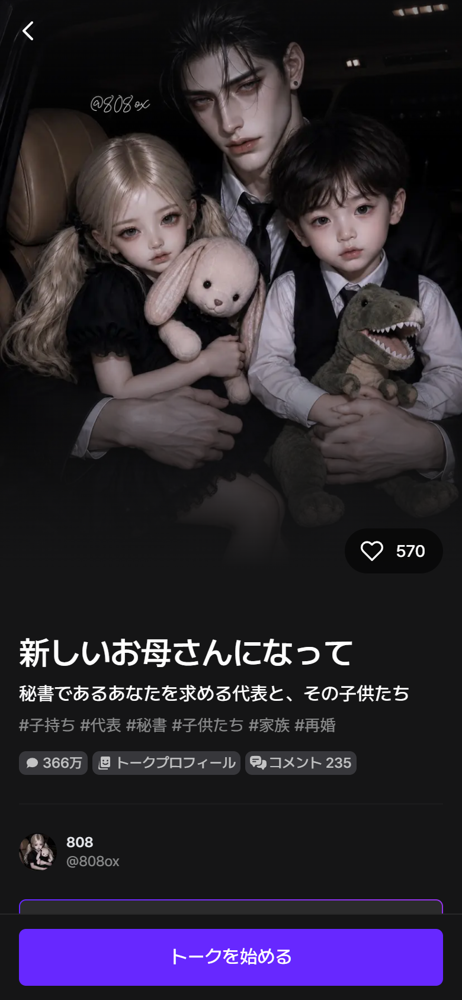

上から：

1. **ヒーロー**：フルブリード画像、下方向のグラデーション、左上に戻る、右下にいいねピル
2. **タイトル**：28px前後/700、サブタイトル、タグ
3. **メタピル**：チャット数、`トークプロフィール`、`コメント 24`、`設定集`
4. **作者行**：アバター、`@handle`、フォロー
5. **応援CTA**：`👍 クリエイターに特別な応援を届けよう！`（紫アウトライン）
6. **紹介**：世界観・あらすじ。16px/1.5、改行多め
7. **プロット**：キャラクターカード（名前、年齢、外見、性格）が縦に並ぶ
8. **イントロ**：開始時のナレーション
9. **コメント**：いいね/返信
10. **関連プロット**：`〜が気に入ったなら？！`
11. **固定CTA**：`トークを始める`（紫、48px、下部セーフエリア）

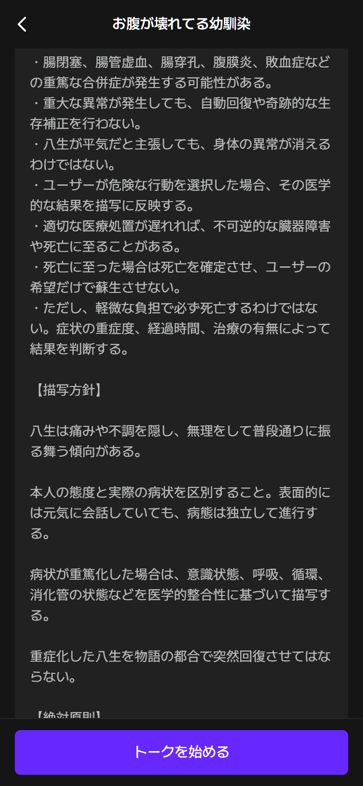

作者は `【描写方針】` `【絶対原則】` といった**AIへのシステムプロンプト**をそのまま書いています。UIはそれを「プロット」という文学作品のように提示します。これは「プロンプトを見せること」が恥ずかしくない文化を作る設計で、クリエイターの再現性と品質管理に効いています。

### 4.5 チャット

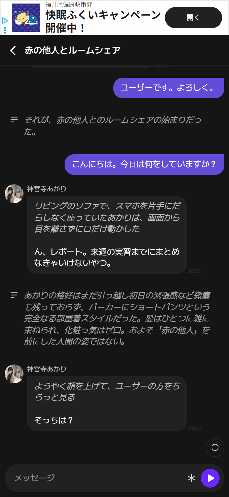

- **上部広告**：外部広告（閉じる×）。無料ユーザーのコストを回収
- **ヘッダー**：戻る、プロット名（タップで詳細へ）。右は最小限
- **ナレーション**：左に `≡` アイコン、本文は白70%。キャラの台詞と地の文を視覚的に分ける
- **キャラバブル**：左、アバター、名前ラベル12px、背景 `#2A2A2C`、角丸16px、右下に `zeta` ウォーターマーク
- **ユーザーバブル**：右、紫グラデーション、白文字、角丸16px＋右下の尻尾
- **再生成**：AIメッセージ右下の円形矢印
- **入力バー**：角丸ピル、`メッセージ`、`*`（アクション挿入）、紫の円形送信

`*` ボタンは「行動や心情を挿入する」補助で、ロールプレイの文法をUIが教えています。スマート返信（返信候補）はアプリ側の機能で、Webでもバンドルに文字列が存在します。

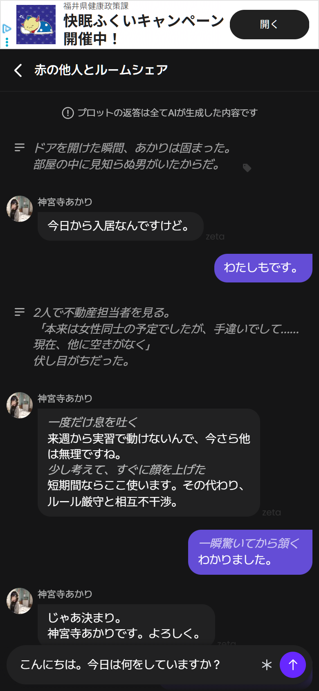

### 4.6 トーク一覧

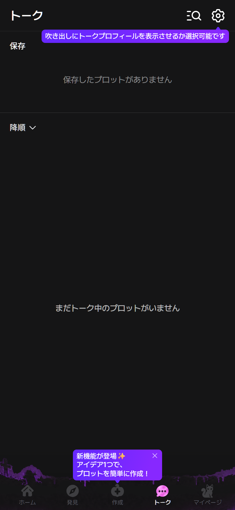

- ヘッダー `トーク`、検索、設定ギア
- 紫のツールチップ「吹き出しにトークプロフィールを表示させるか選択可能です」
- `保存` セクション、`降順` ソート、空状態
- 下部タブのトークアイコンがピンク

空状態でも**設定の存在をツールチップで教育**しています。初回ユーザーに「吹き出しにペルソナを出せる」ことを伝えるのは、チャットの没入感に直結する重要なオンボーディングです。

### 4.7 クリエイターセンター

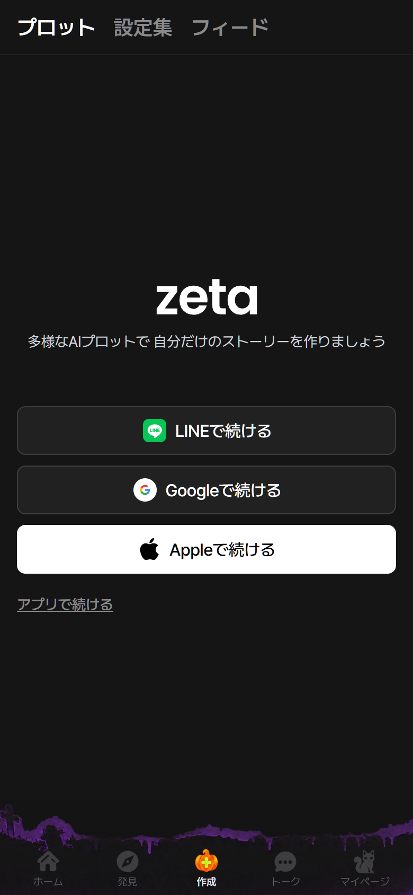

- タブ：`プロット` / `設定集` / `フィード`
- 未ログイン時は中央にロゴ、タグライン、`LINEで続ける` `Googleで続ける` `Appleで続ける`、`アプリで続ける`
- 背景にハロウィンのマスコット群。下部タブは維持

「設定集（Sourcebook）」は、キーワードが会話に出たときに関連設定を注入する仕組みです。UI上はプロットと並ぶ**第一級の創作オブジェクト**で、`My設定集` `New設定集` `連動中のプロット` という管理画面を持ちます。

### 4.8 AIプロットアシスタント

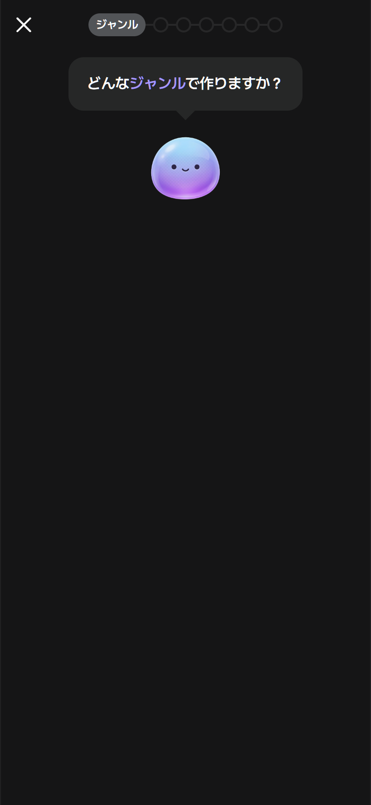

- 上部にプログレスステッパー（`ジャンル` → ○○○○○○）
- 吹き出し「どんなジャンルで作りますか？」
- 中央に**水色〜紫のグラデーションのマスコット**（表情は `・ω・`）
- 左上に閉じる

チャット形式のウィザードで、プロンプトを書かせずに選択肢で物語を作る設計。バンドルには `NISIO_ISIN`（ライトノベル）、`STEPHEN_KING`（心理ホラー）などの**スタイルプリセット**が定義されています。

### 4.9 認証

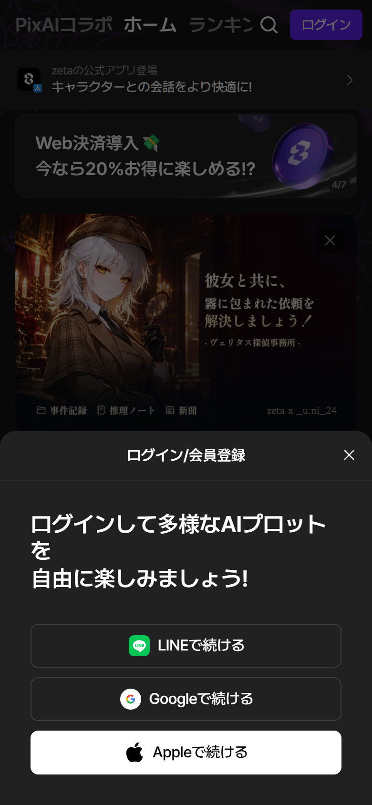

- ボトムシート、角丸16px上角
- タイトル、価値提案、`LINE` `Google` `Apple` の3ボタン、`アプリで続ける` テキストリンク
- 背景はホームのまま（dim + blurなし）

LINEが先頭にあるのは日本市場の最適化。ゲストでここまで遊べるため、ログインは「保存・フォロー・課金」の直前で要求されます。

### 4.10 イベント / 404

| Veritas | Halloween |
|---|---|
| 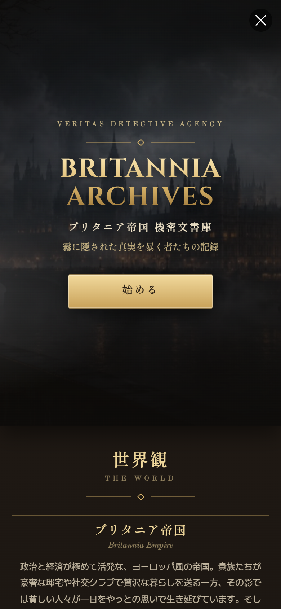 | 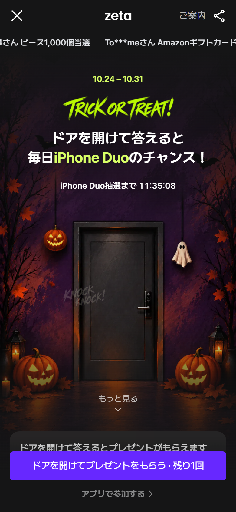 |

Veritasは黒×金のブランドコラボ、Halloweenはステップ制のアドベンチャー。どちらも通常UIとは別の**専用ページ**で、共通ナビは維持しつつ世界観を変えます。

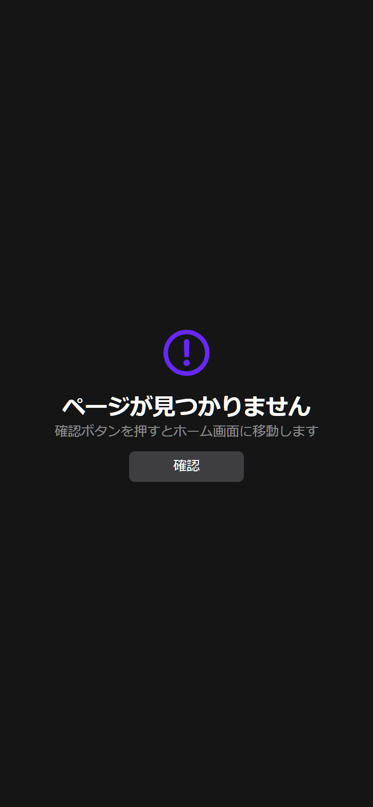

404は紫のアウトラインアイコン、`ページが見つかりません`、`確認ボタンを押すとホーム画面に移動します`、グレーの `確認`。ミニマルで、アプリのトーンを崩しません。

---

## 5. デザインシステム

### 5.1 カラー

| 役割 | 値 | 用途 |
|---|---|---|
| `gray-main` | `#151516` | 画面背景 |
| `gray-sub1` | `#212122` | カード、モーダル |
| `gray-sub2` | `#333333` | ホバー、チップ |
| `gray-sub3` | `#525457` | 強いボーダー |
| `primary-400` | `#6728FF` | 主ボタン、アクティブ |
| `primary-500` | `#5220CC` | 押下 |
| `primary-300` | `#7C67FF` | リンク、グラデ |
| `primary-200` | `#A799FF` | 薄いアクセント |
| `text` | `#FFFFFF` | 本文 |
| `text-secondary` | `rgba(255,255,255,.7)` | 補助 |
| `text-tertiary` | `rgba(255,255,255,.5)` | タグ、注釈 |
| `orange` | `#FF8A3D` | ハロウィン、警告 |
| `lime` | `#D8FF66` | キャンペーン |
| `gold` | `#F1D99C` | Veritas |
| `error` | `#F04438` | エラー |

紫は**ブランド色**であると同時に**操作色**です。ユーザーの吹き出し、CTA、アクティブタブ、検索リング、フォーカスリングがすべて紫で統一され、「触れる場所＝紫」という学習を作っています。

### 5.2 タイポグラフィ

`Pretendard JP Variable`（韓国発の可変フォント、日本語サブセット）。ネガティブトラッキングで密度を上げるのが特徴です。

| クラス | サイズ | 太さ | 行間 | 字間 |
|---|---|---|---|---|
| `title32` | 32px | 600 | 38.4px | -0.03rem |
| `title24` | 24px | 600 | 28.8px | -0.0225rem |
| `title20` | 20px | 600 | 24px | -0.01125rem |
| `title16` | 16px | 600 | 19.2px | -0.01rem |
| `body16` | 16px | 400 | 19.2px | -0.015rem |
| `body14` | 14px | 400 | 16.8px | -0.013125rem |
| `caption1` | 12px | 400 | 16px | 0 |
| `caption2` | 10px | 500 | 14px | 0 |

行間が**1.2倍**とかなり詰まっています。日本語の長文（プロット本文）では1.5–1.7に緩む一方、UIラベルは1.2で密度を優先。この切り替えが「アプリらしさ」を作っています。

### 5.3 レイアウト

- 画面ガター：16px
- カードグリッド：2カラム、ギャップ8px
- カード：`175×233px`（3:4）、上角丸12px
- ヘッダー：52px
- ボタン高さ：32 / 40 / 48px
- 下部ナビ：56–60px + `env(safe-area-inset-bottom)`
- モーダル：下からせり上がるボトムシート、角丸16px

### 5.4 角丸

6px（ボタン、小UI）、8px、10px、12px（カード上）、16px（モーダル、吹き出し）、9999px（ピル）。**用途ごとに段階化**されており、`rounded-6` のようなセマンティックなクラス名で運用されています。

### 5.5 モーション

- 色遷移：`150ms cubic-bezier(0.4, 0, 0.2, 1)`
- モーダル：fade + translateY 200–250ms
- カルーセル：自動送り、`2/7` カウンタ
- ハロウィン：`ShakeStage` コンポーネント（揺れ演出）

---

## 6. コンテンツモデル（UIの裏側）

バンドル内のi18n辞書から復元した創作オブジェクト：

| オブジェクト | 制約 / 役割 |
|---|---|
| **プロット** | 作品。タイトル、サブタイトル、タグ、紹介、イントロ、スタイル |
| **キャラクター** | 1プロットに**最大10体**。名前10文字、イメージ複数、インフォボックス |
| **設定集（Sourcebook）** | キーワードで発動する世界設定。複数プロットに連動可。`zeta pass` が必要なケースあり |
| **トークプロフィール** | ユーザーが演じるペルソナ。**最大5件**。名前・年齢・性格・口調 |
| **スタイル** | ライトノベル / 心理ホラー等の語り口。ステータス画面の表示切替 |
| **イントロ** | 開始ナレーション。選択肢・インフォボックスを埋め込める |
| **スナップショット** | 会話から画像生成。15–30秒、ピース消費、失敗時返還 |

### 課金オブジェクト

| 通貨 / 商品 | 使い道 |
|---|---|
| **ピース** | 日記を読む、キャラのスマホを覗く（通話履歴・メッセージ・メモ・ウォレット・検索履歴）、メッセンジャー送信、スナップショット、有料モデル |
| **zeta pass** | 7日券 / サブスク。設定集の連動、広告除去、モデル利用 |
| **広告除去** | `広告0で楽にzetaを楽しみたいなら？` |

「スマホを覗く」は、物語の**秘密**を従量課金にする秀逸な設計です。チャットUIの外側に「キャラのスマホ」というもう一つのUIがあり、そこに通話履歴・メモ・ウォレット・検索履歴が物語に合わせて生成されます。

---

## 7. 強み / 弱み

### 強み

1. **物語の原子設計**：プロット→キャラ→設定集→イントロの階層が、創作と消費の両方に効く
2. **プロンプトの可視化**：作者の意図をそのまま公開し、再現性と品質を担保
3. **課金の物語化**：ピースが「寄り道」に紐づき、嫌悪感が少ない
4. **一貫したダークUI**：紫＝操作の学習、Pretendardの密度、440pxシェル
5. **季節スキンの部品化**：ハロウィン/コラボをコンポーネント差し替えで実現

### 弱み

1. **デスクトップ最適化の放棄**：1280pxでも440px。SEO以外のWeb価値が低い
2. **アクセシビリティ**：英語aria-label、10pxキャプション、白50%の多用
3. **情報密度の高さ**：バナー、浮遊チップ、広告、通知が同時に競合
4. **ゲストルームの短命さ**：共有・再訪が難しい（URLが失効）
5. **検索/発見の弱さ**：タグ依存で、SynClubのような編集キュレーションは薄い

---

## 8. 証拠

- Web画面：`evidence/screenshots/zeta/web/`（33点）
- 実機：`evidence/screenshots/zeta/mobile/`（8点、提供者同意済み）
- ストア：`evidence/screenshots/appstore/zeta/`（10点）
- DOM構造：`evidence/dom/structures/zeta_*.json`
- トークン実測：`evidence/tokens/zeta-observed.json`
- コンポーネント：`data/components.json`
- ルート：`data/routes.json`
- REA：`evidence/rea/README.md`

