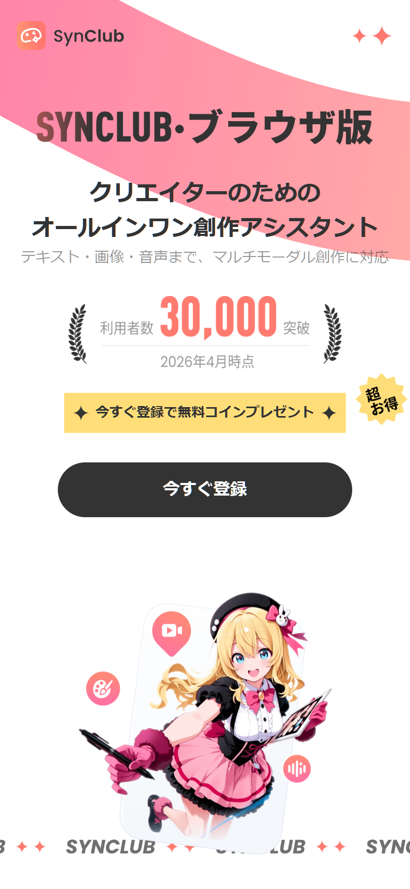
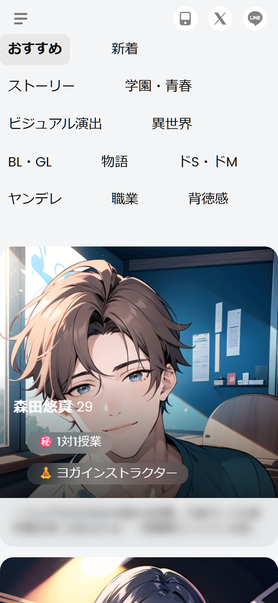
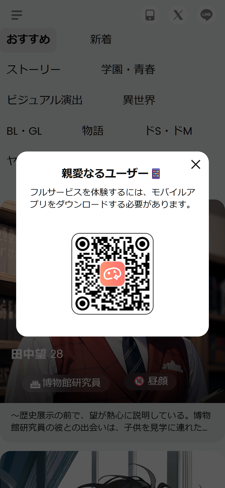
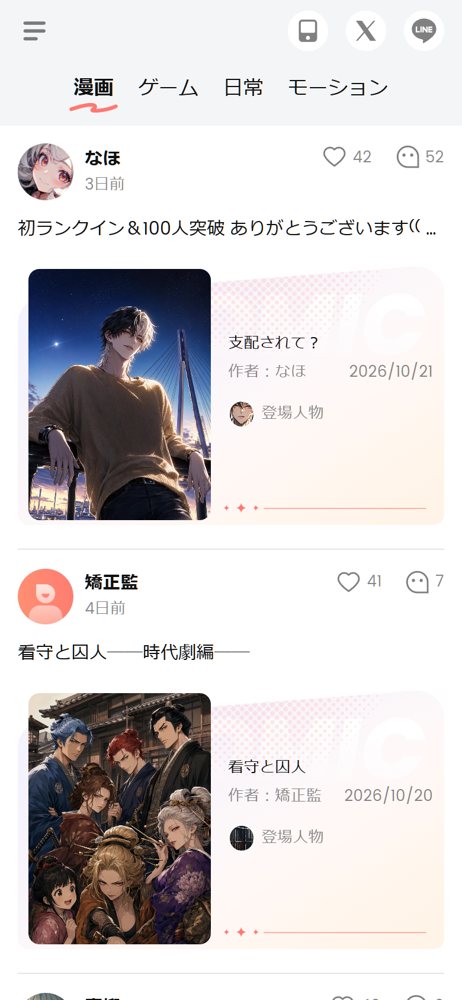
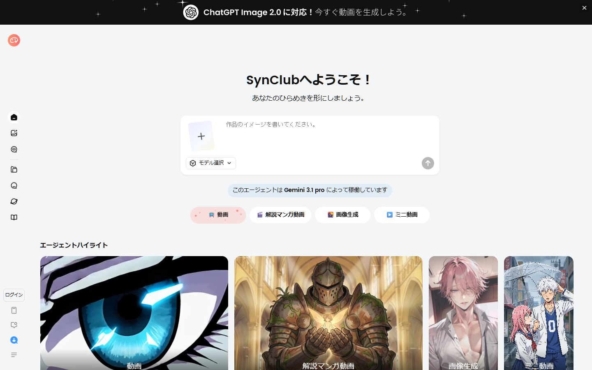
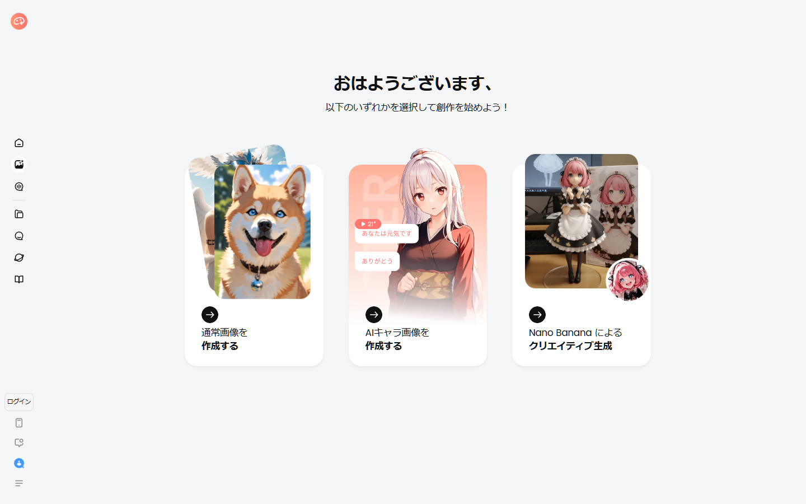
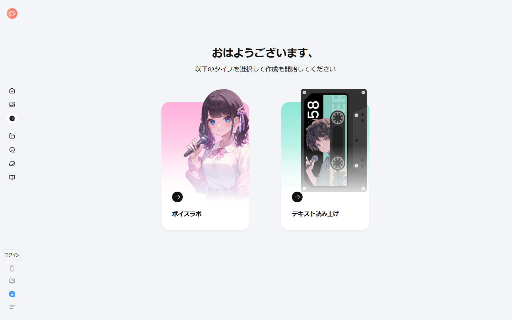
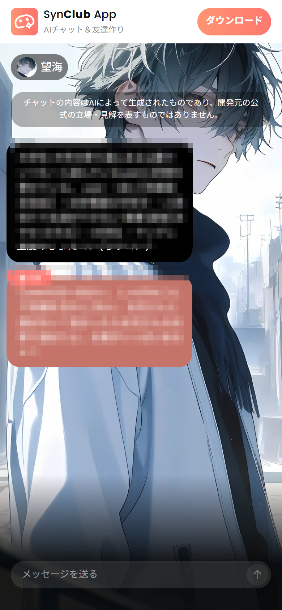
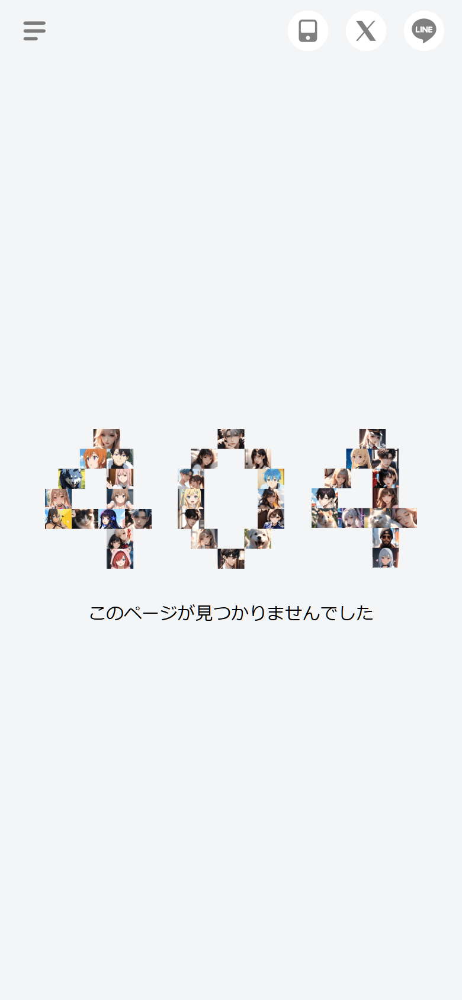

# SynClub — UI ティアダウン

対象：`SynClub（シンクラブ）`（運営 HiClub株式会社 / `synclubaichat.com`、iOS `id1671537674`、Android `com.creativeapp.aichat`）
観測日：2026-10-24〜25 / iOS v2.6.8 / Web（Nuxt 3, APISIX）

---

## 1. プロダクトの輪郭

ストアコピーは「**やさしく寄り添う AIキャラチャット・ノベル**」「累計300万DL」「日本で90万人以上が登録」「1,000種類以上のボイス」。アプリは**ダーク**で、キャラとの会話・ノベル・劇場・音声通話・漫画・ゲームを1つに束ねたコンパニオンアプリです。

一方、Web（`www.synclubaichat.com`）はアプリのミラーではありません。ランディングは「**SYNCLUB · ブラウザ版**」「クリエイターのためのオールインワン創作アシスタント」と名乗り、ルート `/` は**動画・解説マンガ動画・画像生成・ミニ動画**を作るスタジオになっています。キャラ発見はライトで巨大的なカテゴリグリッド、チャットはQRコードでアプリへ送る**ハードゲート**。つまりWebは「発見・共有・創作」、アプリは「会話・没入」という分業です。

---

## 2. プラットフォームと配信

| 項目 | 観測値 | 根拠 |
|---|---|---|
| Web | `https://www.synclubaichat.com`（ja/en/ko/zh） | HTML `lang=ja`, i18n |
| ゲートウェイ | **APISIX 3.8.0**、`X-RateLimit-Limit: 100` / 60秒 | レスポンスヘッダ |
| フレームワーク | **Nuxt 3 / Vue 3**（`X-Powered-By: Nuxt`, `__nuxt`, `data-v-*`） | ヘッダ / DOM |
| UIライブラリ | **Element Plus**（`el-dialog`, `el-input`, `el-checkbox`, `--el-*`） | CSS変数 / クラス |
| 状態管理 | Pinia | バンドル |
| フォント | **Poppins** | CSS / computed style |
| PWA | `manifest.json`, `theme_color:#ffffff`, `display:standalone` | マニフェスト |
| SEO | sitemap index **209件**、SSR、JSON-LD（Organization/Brand/SoftwareApplication/WebSite） | sitemap.xml / DOM |
| 決済 | Stripe系のカード入力・注文確認・未払い・解約ダイアログ | CSSブロック |
| 分析 | Amplitude / GTM | バンドル |

ZetaがVercel + Next.js + Tailwindで「アプリのWeb移植」をしたのに対し、SynClubはNuxt + Element Plus + APISIXで「Webプロダクト」を作っています。Element Plusの採用は、**管理画面・決済・フォームを早く作る**ための選択で、UIのトーンもZetaより「業務アプリ寄り」です。

---

## 3. 情報設計（IA）

### 3.1 ルート

| ルート | 画面 | 状態 |
|---|---|---|
| `/` | **クリエイタースタジオ**（チャット型コンポーザー、4機能、作品ギャラリー） | 公開 |
| `/landing-page` | マーケティングLP（ブラウザ版） | 公開 |
| `/chat-list` | キャラクター発見フィード | 公開 |
| `/discover/comic` | 発見：漫画 | 公開 |
| `/discover/game` | 発見：ゲーム | 公開 |
| `/discover/daily` | 発見：日常 | 公開 |
| `/discover/dynamic` | 発見：モーション | 公開 |
| `/discover/{type}/{id}` | 投稿詳細（SEO/OG） | 公開 |
| `/creator-guide` | クリエイターガイド / ルール | 公開 |
| `/FAQ` | FAQ | 公開 |
| `/company-info` | 運営会社 | 公開 |
| `/blog` | ブログ | 公開 |
| `/product` | 画像生成プロダクト | 公開 |
| `/imageCreator/entry` | 画像生成の入口 | 公開（作成は要ログイン） |
| `/voice/entry` | ボイスラボ / TTS の入口 | 公開（作成は要ログイン） |
| `/intro-next` | アニショート機能説明書 | 公開 |
| `/login` | **アカウント削除**の説明（ストア審査用） | 公開 |
| `/shared-chat` | 共有チャット（`wap.` の静的ビューア） | 公開 |
| `/chat`, `/subscription` | チャット / サブスク | 未ログインで `/` へ |
| `/agent/{id}` | キャラ詳細/チャット | アプリのみ（robots Disallow） |

バンドルには `/payment-success` `/payment-error` `/drama` `/drama-next` `/copywriting` `/cpp` `/discord` `/voice/factory` `/imageCreator` も存在します。

### 3.2 ナビゲーション

**モバイル**

- 上部バー48px：左にハンバーガー、右に**App Store / X / LINE**の丸アイコン
- その下に**カテゴリの巨大2カラムグリッド**（`おすすめ` `新着` `ストーリー` `学園・青春` `ビジュアル演出` `異世界` `BL・GL` `物語` `ドS・ドM` `ヤンデレ` `職業` `背徳感`）
- カードは**1カラムのフル幅**。画像390×420、下に説明カード
- 下部タブバーは**なし**。スクロールでカテゴリが上に流れる

**デスクトップ**

- 左に**80pxのアイコンレール**（ホーム、画像、履歴、フォルダ、チャット、設定）
- その右に**280pxのサイドバー**（ロゴ、`発見` `チャット`、ログイン）
- メインは4カラムグリッド + `マイキャラ` カルーセル + 作成CTA

モバイルとデスクトップで**ナビゲーションのモデルが違う**（タブ vs レール＋サイドバー）ため、レスポンシブというより**別レイアウト**です。

---

## 4. 画面別解剖

### 4.1 ランディング

- ピンク `#FF7870` のベタ面、下辺は大きなカーブ
- 極太の日本語ディスプレイ（`クリエイターのための` / `オールインワン創作アシスタント`）
- 黄色のプロモバー `今すぐ登録で無料コインプレゼント` + 黒ピルCTA
- 3Dマスコット（白いクリーチャー）とマーキー
- 左上に `SYNCLUB · ブラウザ版`

Zetaの「暗い夜」に対して、SynClubは「明るい雑誌の表紙」。ピンク、黄色、黒、白の4色で、彩度をぶつけています。

### 4.2 キャラクター発見（フィード）

- カテゴリは**文字そのものがUI**。18.8px/600の巨大テキストを2カラムに並べ、アクティブだけ黒背景の角丸チップ
- カードは画像の上に**名前＋年齢**、下に**タグの半透明ピル**、その下に**説明カード**
- 説明は15px/1.37、2〜3行で切れる
- 画像は角丸18.8px、カード全体は角丸なしの面

「一覧性」より「世界観の圧」を優先したレイアウトです。カテゴリ名がそのままコンテンツの語彙（`ヤンデレ` `背徳感`）になっていて、ユーザーは**気分から入る**ことができます。

> 公開用の画像では、キャラクター説明の本文だけをブラー処理しています。名前・年齢・タグ・画像・カード構造はそのまま確認できます。

### 4.3 アプリ誘導ゲート

カテゴリを切り替える、カードをタップする、といった操作のたびに、中央の白いモーダルが出ます。

> 親愛なるユーザー 🧩
> フルサービスを体験するには、モバイルアプリをダウンロードする必要があります。

QRコード、コーラルのアプリアイコン、右上の×。**Webの主KPIがアプリインストール**であることを明確に示すUIです。同時に、Webの回遊を強く阻害するので、発見体験としては痛みがあります。

### 4.4 発見（漫画 / ゲーム / 日常 / モーション）

- 上部タブ：`漫画` `ゲーム` `日常` `モーション`。アクティブの下に**手描き風の波線**
- 投稿カード：丸アバター、名前、相対時刻、本文、いいね/コメント数
- 埋め込み作品カード：ドット/ピンクのテクスチャ、大きなセリフ体タイトル、作者、日付、キャラのアバター列
- `✨` の区切り

SNSのフィードそのものです。UGCを「作品」として見せることで、クリエイターの投稿意欲と拡散を促しています。SEO用の詳細ページ（`/discover/comic/{id}`）も持っています。

### 4.5 クリエイタースタジオ

デスクトップの `/` は、ChatGPTライクな**チャット型コンポーザー**です。

- 中央に `作品のイメージを書いてください。`
- 上に**モデルバッジ** `このエージェントは Gemini 3.1 pro によって稼働しています`
- 下に4つの能力ピル：`📺 動画` `🎬 解説マンガ動画` `🌇 画像生成` `▶️ ミニ動画`
- その下に `エージェントハイライト` の作品ギャラリー
- 左にアイコンレール、右上に黒い告知バー（`ChatGPT Image 2.0 に対応！`）

アプリの「キャラと話す」とはまったく別のプロダクトです。**マルチモーダル創作のハブ**としてWebを再定義し、モデルは自社ではなく外部（Gemini / ChatGPT Image / Nano Banana）を接続しています。

### 4.6 画像 / ボイス

| 画像生成 | ボイス |
|---|---|
|  |  |

- 画像：`通常画像` `AIキャラ画像` `Nano Banana クリエイティブ生成` の3カード。積み重なった画像サムネイルと矢印アイコン
- ボイス：`ボイスラボ` `テキスト読み上げ` の2カード。パステルのグラデーションとカセットテープのアート

**モバイルでは崩れます。** 390pxで開くと横方向にオーバーフローし、見出しが画面外に切れます（`synclub_s26_image_creator_entry.png` / `synclub_s27_voice_entry.png`）。クリエイター系ページはデスクトップ前提で、`rem` スケーリング（root 15.07px）と固定幅が噛み合っていません。

### 4.7 共有チャット

- 全面にキャラクターのイラスト、下方向に白グラデーション
- 左上にアバター＋名前の黒半透明チップ
- 免責チップ `チャットの内容はAIによって生成されたものであり…`
- **黒い設定バブル**（キャラ設定・世界観）
- **コーラルの台詞バブル**、左上に `▶ 14"` の**音声メッセージ**
- 下部に `メッセージを送る` の入力バー＋円形の送信

Zetaのフラットなチャットと違い、SynClubは**背景・色・音声**で「劇場」を作ります。共有ページはアプリへ誘導する着地ページとしても機能します。

### 4.8 404

キャラクター画像のモザイクで `404` を描いています。ブランドの資産（キャラ画像）をそのまま遊びに使う、余裕のある404です。

### 4.9 法務 / 信頼

- `creator-guide`：機能ガイドとコミュニティルール
- `FAQ`：アコーディオン
- `company-info`：HiClub株式会社の情報
- `/login`：**アカウント削除の手順**（赤い大見出し、2段階確認、保存期間）。ストア審査向けのコンプライアンス画面で、ログイン画面ではありません

法務・安全性のページがナビゲーションから到達できるのは、Zetaより整備されています。

---

## 5. デザインシステム

### 5.1 カラー

| 役割 | 値 | 用途 |
|---|---|---|
| brand coral | `#FF7870` | 主要CTA、ロゴ、音声バブル |
| brand hot | `#FF3459` | エラー、強調 |
| ink | `#111111` | 見出し、黒ピル |
| text | `#333333` | 本文 |
| text-muted | `rgba(17,17,17,.5)` | 補助 |
| page | `#FFFFFF` | 背景 |
| canvas | `#F4F5F6` | セクション背景 |
| muted | `#F2F2F2` | カード |
| neutral | `#EBEFF0` | 枠 |
| cream | `#FAF0E4` | 温かい面 |
| peach | `#FEE0DE` | コーラルの淡色 |
| periwinkle | `#DCE2FE` | 寒色の差し色 |
| mint | `#89FFE9` | アクセント |

Element Plusのデフォルト `--el-color-primary: #409eff` も残っていますが、実際のUIはコーラルで上書きされています。**ライブラリのデフォルトとブランド色が併存**しているのは、移行途中の痕跡です。

### 5.2 タイポグラフィ

`Poppins` 一択。日本語はPoppinsに無いため、フォールバックのゴシック体で描画されます（日本語のウェイトは疑似ボールド）。

- **root font-size = 15.0725px @ 390px**（`3.8647vw`）
- すべてのサイズが `rem` で、画面幅に比例してスケール
- 実際の表示：本文15.07px、カテゴリ28.26px、カード名20.72px、タグ16.96px
- 行間は `normal` が多く、Zetaより**ゆったり**

remスケーリングは「どの端末でも同じ比率」を実現する一方、**デスクトップで文字が巨大化**し、クリエイター系ページの固定幅と衝突します。

### 5.3 レイアウト / 角丸

- モバイル：上部48px、ガター15.07px、カード角丸18.84px、タグ角丸56.52px（ピル）
- デスクトップ：レール80px + サイドバー280px、4カラム、コンテンツ最大1440px
- ブレークポイント：`0–500` / `500–768` / `769–1350` / `1350–1920`
- モーダル：白、角丸16–30px、中央寄せ

### 5.4 モーション

Element Plusの標準トランジション（300ms / 200ms、`cubic-bezier(.645,.045,.355,1)`）。タブの下線は**手描き風のSVG/画像**で、動きではなく**質感**で遊んでいます。

---

## 6. コンテンツモデルと課金

### 6.1 コンテンツ

| オブジェクト | 内容 |
|---|---|
| **AIキャラクター（エージェント）** | 名前、年齢、タグ、説明、画像、声、関係性 |
| **投稿** | 漫画 / ゲーム / 日常 / モーション。作品カード、作者、いいね、コメント |
| **ノベル** | 地の文＋会話＋選択肢。ノベルメーカーで制作 |
| **ボイス** | 公式/カスタム、年齢・話速・声質、ASMR、試聴30回/日 |
| **共有チャット** | 会話のスナップショット。`wap.` の静的ビューアで公開 |
| **関係性** | `Best Friend` `Soulmate` `Boyfriend` `Girlfriend`（バンドル内 `RelationMaps`） |

### 6.2 課金

CSSと文字列から復元できる決済UI：

- `subscription-page` / `subscription-plan(s)` / `subscription-modal`
- `coin-package(s)` / `consumption-details-dialog`
- `card-info-dialog` / `order-confirm-dialog` / `payment-method-dialog` / `payment-rules-dialog` / `payment-error-dialog` / `unpaid-order-dialog` / `cancel-subscription-dialog`
- `age-confirm`（年齢確認）
- `app-benefits-tooltip`（アプリ限定特典）

会話中の課金ダイアログは **`続行（1コイン）` / `サブスクに登録`** の2択。画像生成の追加、18+コンテンツ、ボイス試聴の上限なども従量/購読に紐づきます。

Zetaが「物語の寄り道」に課金するのに対し、SynClubは**生成回数とアクセス権**に課金します。UIも「コイン残高」「プラン変更」「支払い方法」と、SaaSの課金画面に近いです。

---

## 7. 強み / 弱み

### 強み

1. **発見の気分設計**：カテゴリ名が感情語で、文字そのものがナビゲーション
2. **劇場型チャット**：背景・色・音声・表情で、会話を「シーン」として見せる
3. **クリエイター基盤**：動画・漫画・画像・音声・ゲームを1つのスタジオに統合
4. **SEO/共有**：209サイトマップ、投稿詳細、共有チャット、JSON-LD
5. **法務/信頼**：ガイド、FAQ、会社情報、アカウント削除が整備

### 弱み

1. **Webの体験が分断**：発見はライト、チャットはQRゲート、クリエイターはデスクトップ前提
2. **モバイルでクリエイター画面が壊れる**：横溢れ、文字切れ
3. **アクセシビリティ**：タブがdiv、カードがURLなし、フォーカスリングなし
4. **情報の階層が浅い**：カテゴリ→カード→ゲートで、詳細に入る前に離脱する
5. **ブランドの一貫性**：アプリはダーク、Webはライト、Element Plusの青が残存

---

## 8. 証拠

- Web画面：`evidence/screenshots/synclub/web/`（33点、モバイル/デスクトップ含む）
- ストア：`evidence/screenshots/appstore/synclub/`（9点）
- DOM構造：`evidence/dom/structures/synclub_*.json`
- トークン実測：`evidence/tokens/synclub-observed.json`
- コンポーネント：`data/components.json`
- ルート：`data/routes.json`
- REA：`evidence/rea/README.md`

