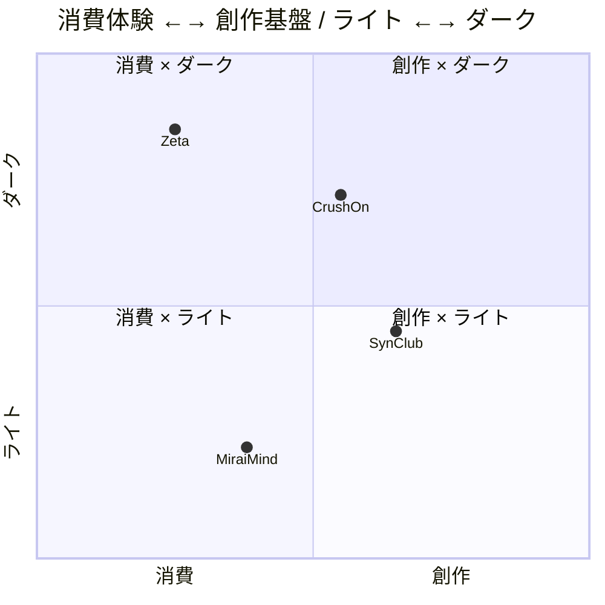
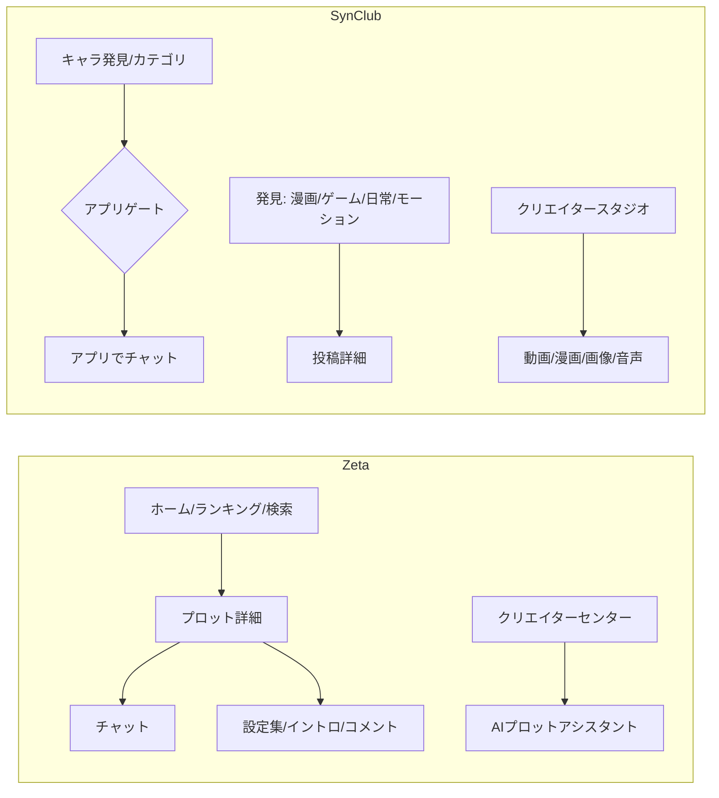

# Zeta / SynClub / MiraiMind / CrushOn — 比較

同じ「日本市場のAIキャラChat」でありながら、UIの答えはほぼ正反対です。この章では、情報設計・ビジュアル・インタラクション・課金・Web戦略を並べ、**なぜその差が生まれるのか**を整理します。

---

## 0. 4製品の位置づけ（2026-10-25）

| | Zeta | SynClub | MiraiMind | CrushOn.AI |
|---|---|---|---|---|
| 原子 | プロット（物語） | キャラクター | キャラクター＋シナリオ | キャラクター（NSFW） |
| ビジュアル | ダーク紫 | ライトコーラル／アプリはダーク | ホワイト＋パステル | マーケは黒紫／アプリは白 |
| Webの役割 | アプリ代替＋ゲストチャット | 発見＋創作スタジオ＋QRゲート | 獲得＋5リクエスト体験 | SEO＋限定チャット＋課金 |
| 通貨 | ピース | コイン | 金平糖 | Coin / Diamonds |
| サブスク | zeta pass | プラン変更/解約 | アプリ内VIP（推測） | **7段階** |
| ゲスト | チャット可 | 不可 | **5回** | 導入のみ／送信はログイン |
| UI密度 | 高 | 低 | 中 | 高 |
| 技術 | Next.js/React | Nuxt/Vue | Vue/Vite | Next.js/React |

### 4つの戦略

- **Zeta = 世界に入る**：プロット→キャラ→設定集→イントロの階層。440px固定でアプリ体験をWebに移植。ピースで「寄り道」に課金。
- **SynClub = 世界を作る**：キャラ発見＋動画/漫画/画像/音声のスタジオ。Webは「ブラウザ版」として別プロダクト。QRでアプリへ。
- **MiraiMind = 声で通じ合う**：音声バブル、心の声、「進む」で進む物語。5リクエストの体験からアプリへ。金平糖の世界観。
- **CrushOn = 課金とSEOで回す**：8M+キャラのロングテール、7段階サブスク、NSFW前提。マーケティングとアプリでトーンが分裂。

### 課金の設計差

| | 課金の単位 | 心理的な意味 | 画面のトーン |
|---|---|---|---|
| Zeta | ピース（従量） | 物語の秘密・寄り道 | 「続きを読む」 |
| SynClub | コイン（従量）＋サブスク | 生成回数・アクセス権 | 「1コインで続行」 |
| MiraiMind | 金平糖（チャージ） | 推しとの時間・限定機能 | 「キャンディを買う」 |
| CrushOn | Coin/Diamonds＋7プラン | メッセージ量・モデル・記憶 | 「プランを比較する」 |

ZetaとMiraiMindは**感情**に、SynClubとCrushOnは**機能**に課金します。前者は「もっと物語を知りたい」、後者は「もっと生成したい／強いモデルを使いたい」。UIの言葉遣いも、前者は文学的、後者はSaaS的です。

### Webの役割の差

| | Webでできること | Webでできないこと | 主KPI |
|---|---|---|---|
| Zeta | フィード、詳細、ゲストチャット、検索 | 保存、購入、作成の完了 | アプリDL＋チャット開始 |
| SynClub | 発見、共有、創作スタジオ | キャラチャット、購読 | アプリDL＋創作 |
| MiraiMind | 5リクエストのチャット、検索の一部 | 心の声、アーカイブ、履歴同期 | アプリDL＋登録 |
| CrushOn | 発見、検索、ランキング、料金、導入閲覧 | 送信、ストア、アカウント | 登録＋購読 |

Zetaだけが**Webで完結**します。SynClubとCrushOnはQR/ログインで止め、MiraiMindは5回で止める。この差は、Webを「プロダクト」と見るか「漏斗」と見るかの差です。

---

---

> 以下のセクション1〜9は、ZetaとSynClubの**深掘り比較**です。4製品の位置づけはセクション0、MiraiMindとCrushOnの詳細は [09](09-miraimind-teardown.md) / [10](10-crushon-teardown.md) を参照。

## 1. 一行で

| | Zeta | SynClub |
|---|---|---|
| ユーザーの動詞 | **入る**（物語の世界に） | **探す / 作る**（気分とキャラを） |
| 原子 | プロット（物語） | キャラクター（エージェント） |
| 画面の感情 | 夜、没入、推し活 | 昼、編集、雑誌 |
| Webの役割 | アプリの代替・SEO | 発見・共有・創作スタジオ |

---

## 2. 情報設計の比較

### ナビゲーション

| 項目 | Zeta | SynClub |
|---|---|---|
| モバイル | 上部セグメント＋**下部5タブ** | 上部バー＋**巨大カテゴリグリッド**（下部タブなし） |
| デスクトップ | 440px固定シェル（モバイルと同じ） | 左レール80px＋サイドバー280px＋4カラム |
| 階層の深さ | ホーム→詳細→チャット（3層） | カテゴリ→カード→ゲート（2層＋外部アプリ） |
| 検索 | ヘッダーの虫眼鏡、タグディープリンク | カテゴリ語彙が検索の代替 |
| 戻る | 左上シェブロン | 左上ハンバーガー（戻るではない） |

Zetaは**階層を深くして没入**させ、SynClubは**階層を浅くして離脱**させます。後者はWebではチャットできないので、深くする意味がありません。

### 詳細画面の情報順

| 順序 | Zeta（プロット） | SynClub（キャラ） |
|---|---|---|
| 1 | ヒーロー画像 | 画像 |
| 2 | タイトル / サブタイトル / タグ | 名前 / 年齢 |
| 3 | メタピル（チャット数、トークプロフィール、コメント） | タグ |
| 4 | 作者 + フォロー | 説明 |
| 5 | 応援CTA | （Webではここでゲート） |
| 6 | 紹介 | — |
| 7 | プロット（キャラ定義） | — |
| 8 | イントロ | — |
| 9 | コメント | — |
| 10 | 関連 | — |

Zetaは**作品の読み物**、SynClubは**キャラのプロフィールカード**。Zetaの方が情報量が多く、スクロールが長い代わりに、課金・共有・コメントの接点も多くなります。

---

## 3. ビジュアル言語

| 軸 | Zeta | SynClub |
|---|---|---|
| ベース | ダーク `#151516` | ライト `#FFFFFF` |
| アクセント | 紫 `#6728FF` | コーラル `#FF7870` |
| 第二アクセント | オレンジ / ライム / 金 | 黄 / パステル（クリーム、ピーチ、ペリウィンクル） |
| フォント | Pretendard JP Variable | Poppins + 日本語フォールバック |
| 字間 | ネガティブ（-0.01〜-0.03em） | 標準 |
| 行間 | 1.2（UI） / 1.5（本文） | normal（約1.37） |
| 角丸 | 6/8/10/12/16 + ピル | 18.8（カード）/ 9.4（タブ）/ ピル |
| 写真 | フルブリード＋暗いグラデ | フルブリード＋白グラデ |
| イラスト | アニメ調、彩度高 | アニメ調＋3Dマスコット |
| モチーフ | 月、夜、マスコットのシルエット | 手描き線、ドット、雑誌の組み |
| 密度 | 高（バナー、チップ、広告） | 低（余白、大きな文字） |

Zetaは**同じ色を機能に割り当てる**（紫＝触れる）。SynClubは**面の色で気分を切り替える**（ピンク＝歓迎、クリーム＝温かい、ペリウィンクル＝静か）。前者は学習、後者は空気です。

---

## 4. チャット体験

| 要素 | Zeta | SynClub |
|---|---|---|
| 背景 | フラット `#151516` | キャラクターイラスト＋グラデ |
| ナレーション | 左に `≡`、白70% | 黒い設定バブル、地の文 |
| キャラ台詞 | ダークグレーのバブル | コーラルのバブル |
| ユーザー | 紫グラデのバブル | 入力バーのみ（共有ビュー） |
| 音声 | なし（アプリは通話訴求） | `▶ 14"` の音声メッセージ、通話 |
| 表情 | なし | 感情で4表情（ストア） |
| 背景切替 | なし | シーンで背景が変わる（ストア） |
| 入力補助 | `*`（行動挿入）、スマート返信 | 音声、モデル選択 |
| 広告 | 上部に外部広告 | Webはゲート、アプリは不明 |
| 没入の作り方 | **テキストと色** | **絵と音** |

Zetaは「読む小説」に近く、SynClubは「演じる舞台」に近い。同じAIチャットでも、**情報のチャネル**が違います。

---

## 5. 課金 / グロース

| 項目 | Zeta | SynClub |
|---|---|---|
| 通貨 | ピース | コイン |
| 主な消費 | 日記、スマホ覗き見、メッセンジャー、スナップショット、有料モデル | 1コイン続行、画像生成、ボイス、18+ |
| サブスク | zeta pass（7日/月） | サブスクリプション（プラン変更/解約） |
| 広告 | あり（除去課金） | Webは目立たない |
| アプリ誘導 | ソフト（バナー/モーダル/`アプリで続ける`） | ハード（QRゲート） |
| 初回特典 | キャラ完成でピース / zeta pass抽選 | 登録で無料コイン |
| クリエイター還元 | 応援CTA、ランキング、フォロー | 投稿、いいね、コミュニティ、スタジオ |

Zetaの課金は**物語の秘密**に紐づくので、ユーザーは「続きを読むための課金」と感じます。SynClubの課金は**生成回数**に紐づくので、SaaSのクレジット感覚です。前者は感情的、後者は機能的。

---

## 6. Web戦略

| 項目 | Zeta | SynClub |
|---|---|---|
| 目的 | アプリの代替、SEO、ゲスト体験 | 発見、共有、創作、アプリ送客 |
| チャット | **できる**（ゲスト） | **できない**（QRゲート） |
| デスクトップ | 440px固定 | 本格レスポンシブ |
| クリエイター | プロット/設定集（ログイン壁） | 動画/漫画/画像/音声のスタジオ |
| SEO | プロット詳細、3言語、1サイトマップ | 投稿詳細、209サイトマップ、JSON-LD |
| 強み | 離脱が少ない、アプリと同じ | 世界観が伝わる、創作の幅 |
| 弱み | Webの価値が薄い | Webで完結しない、モバイルで壊れる |

Zetaは「Webもアプリ」。SynClubは「Webは別の入口」。この違いは、**Webに何を期待するか**の経営判断です。ZetaはWebを**コンバージョンの最後の一押し**に使い、SynClubはWebを**新規の創作市場**に使っています。

---

## 7. アクセシビリティ / 品質

| 項目 | Zeta | SynClub |
|---|---|---|
| セマンティクス | リンク/ボタンは適切 | タブ/カードがdiv/section |
| aria-label | 英語のまま（`Go back`） | 少ない |
| フォーカス | 独自リング（紫） | ほぼなし |
| 文字サイズ | 10pxのキャプション | 15px基準、拡大はrem |
| コントラスト | 白50% on #151516 | `rgba(17,17,17,.5)` on #fff |
| レスポンシブ | 固定シェルで破綻なし | クリエイター画面が破綻 |
| 法務 | 利用規約/プライバシー | ガイド/FAQ/会社/削除 |

Zetaは**壊れないが狭い**、SynClubは**広いが壊れる**。どちらも「アクセシビリティを後回しにした成長期」の典型です。

---

## 8. どちらが勝つか（仮説）

**短期（1年）**：Zeta。ゲストチャット、物語の課金、ランキング、イベントコラボが揃っており、**ARPUと滞在時間**を作りやすい。WebのSEOも効いている。

**中期（2–3年）**：SynClub。创作基盤（動画/漫画/画像/音声/ゲーム）は**IPとUGCの複利**が効く。モデルを外注している点はリスクだが、逆に言えば**モデルがコモディティ化するほど強い**。アプリの没入（音声/表情/背景）も差別化になる。

**ただし**、SynClubが勝つには次の3つが必要：

1. Webの**モバイル体験**を直す（クリエイター画面の横溢れ、ゲートの頻度）
2. **発見→チャット**の導線をWebで途切れさせない（共有チャットの強化、Webチャットの限定開放）
3. **ブランドの一貫性**（アプリはダーク、Webはライト、Element Plusの青）

Zetaが勝ち続けるには：

1. **デスクトップ**を捨てない（440px固定はSEO以外で不利）
2. **発見の編集力**（タグ依存からの脱却、キュレーション、パーソナライズ）
3. **アクセシビリティ**と**国際化**（aria-labelの日本語化、英語UIの品質）

---

## 9. お互いに学ぶなら

| ZetaがSynClubから学ぶ | SynClubがZetaから学ぶ |
|---|---|
| カテゴリを**感情語**にする（`ヤンデレ` `背徳感`） | プロット/設定集のような**創作の階層** |
| チャットに**音声/表情/背景**を入れる | Webでも**ゲストチャット**を開放する |
| クリエイタースタジオの**マルチモーダル** | ランキング/イベントの**回遊** |
| 法務/ガイドの整備 | 440pxシェルの**一貫性**（真似するなら） |
| 404の遊び | 決済UIの**体系的**な設計 |

