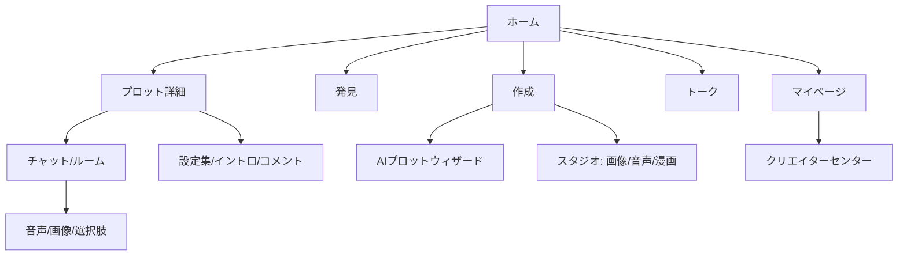

# 再構築ブループリント

ZetaとSynClubの分析から、**「物語の没入」と「創作の自由」を両立するAIロールプレイアプリ**のUI仕様を組み立てます。ゼロから作る前提で、画面・データモデル・コンポーネント・課金・アクセシビリティ・性能予算まで落とします。

---

## 1. プロダクトテーゼ

> **「プロットを選び、キャラと暮らし、その会話が作品になる」**

- Zetaの**物語の階層**（プロット→キャラ→設定集→イントロ）を採用
- SynClubの**劇場性**（背景・表情・音声）と**创作基盤**（漫画/画像/音声）を採用
- 両社の弱点（Zetaの閉じたWeb、SynClubのゲート/レスポンシブ崩れ）を回避
- 課金は**物語の寄り道**と**生成クレジット**のハイブリッド

---

## 2. 情報設計



### モバイル（下部5タブ）

| タブ | 役割 | ファーストビュー |
|---|---|---|
| ホーム | 今日の物語 | ヒーロー1本＋2カラムカード＋ランキング横断 |
| 発見 | 気分で探す | 感情カテゴリ（`甘々` `執着` `青春` `背徳`）× 編集キュレーション |
| 作成 | 作る | AIウィザード、設定集、スタジオへの入口 |
| トーク | 続きを読む | 未読、ピン留め、保存、履歴 |
| マイページ | 自分 | ペルソナ、推し、課金、設定 |

### デスクトップ（レール＋サイドバー＋2ペイン）

- 左レール：ホーム / 発見 / 作成 / トーク / 設定
- サイドバー：フィルタ、保存、最近のプロット
- メイン：フィード or チャット（右にキャラ情報/設定集）
- **チャットと設定集を同時に見せる**（Zetaの没入とSynClubの編集を両立）

---

## 3. 画面仕様

### 3.1 ホーム

```
┌─────────────────────────────┐
│ [ロゴ]  今日の物語  検索  通知 │ 52px
├─────────────────────────────┤
│ ヒーロー（1本、16:9、自動送り）│
│  タイトル / 作者 / ▶ トーク   │
├─────────────────────────────┤
│ 気分チップ: 甘々 執着 青春 背徳 │
├─────────────────────────────┤
│ 2カラムカード × 6            │
│ [画像3:4] [画像3:4]          │
│ タイトル  タイトル            │
│ #タグ     #タグ              │
├─────────────────────────────┤
│ ランキング横断（横スクロール）  │
├─────────────────────────────┤
│ ホーム 発見 作成 トーク 自分   │ 56px
└─────────────────────────────┘
```

- カードは **Zetaの3:4** を採用。画像のリズムが揃う
- 社会的証明は**チャット数**ではなく「**今日の会話数**」「**完読率**」など、物語の消費を示す指標に
- タグはSynClubのように**感情語**を混ぜる（`#ヤンデレ` `#幼馴染` `#執着`）
- バナーは**1枠だけ**。広告/イベント/通知を同時に出さない

### 3.2 プロット詳細

```
[ヒーロー 4:5、下グラデ]
 ← 戻る                     ♡
 タイトル（28/700）
 サブタイトル（15/70%）
 #タグ #タグ #タグ
 [会話数] [設定集] [コメント]
 ─────────────────────
 作者 @handle        [フォロー]
 ─────────────────────
 紹介（16/1.6）
 ─────────────────────
 キャラクター（横カード、タップで詳細）
 ─────────────────────
 イントロ（開始文、選択肢）
 ─────────────────────
 コメント / 関連
 ─────────────────────
 [ トークを始める ] 固定CTA
```

- セクション順はZetaを踏襲。物語の**読み順**がそのままUI
- キャラクターは**横スクロール**にして、詳細画面を短くする
- 設定集は**折りたたみ**（ネタバレ防止）。「設定を見る」で開く
- CTAは1つだけ。`トークを始める` の下に「ペルソナを選ぶ」を小さく

### 3.3 チャット

```
┌─────────────────────────────┐
│ ← プロット名            ⋯    │ 52px
├─────────────────────────────┤
│ 背景（キャラ/シーン、40%暗）   │
│                             │
│ ≡ ナレーション（白70%）       │
│ [アバター] キャラ名           │
│ ┌───────────────┐           │
│ │ 台詞           │  ▶ 14"    │
│ └───────────────┘           │
│              ┌────────────┐ │
│              │ ユーザー    │ │
│              └────────────┘ │
│  ↻ 再生成   ★ お気に入り      │
├─────────────────────────────┤
│ [*] [メッセージ........] [送信]│
│ 音声 画像 選択肢              │
└─────────────────────────────┘
```

- **背景はON/OFF可能**。読書モードではフラット黒（Zeta）、劇場モードではイラスト（SynClub）
- ナレーションは `≡` で区別。地の文と台詞を混ぜない
- 音声は**インラインバブル**（`▶ 14"`）。通話は別画面
- 入力補助は3つ：`*`（行動）、`音声`、`選択肢`
- 再生成は**1メッセージ単位**。全部やり直さない
- 広告は**チャット上部に1枠**、または完全除去課金。メッセージ間に挟まない
- ストリーミング表示、失敗時はピース/コインを返還

### 3.4 トーク一覧

- セクション：**ピン留め / 今日 / 過去**
- 各ルームに「最後の台詞」1行、未読、キャラの表情、背景のサムネ
- 空状態は**物語の提案**（「まずは3分で読める短編から」）
- 設定：吹き出しにペルソナを表示するか（Zetaのツールチップを踏襲）

### 3.5 作成（ウィザード＋スタジオ）

```
[ジャンル] → [関係性] → [トーン] → [キャラ] → [プレビュー]
   1/5        2/5       3/5      4/5      5/5
```

- 選択肢は**感情語**（`甘々` `執着` `すれ違い` `背徳`）
- 各ステップで**生成プレビュー**を表示。文章を書かせない
- 「上級者モード」でプロンプト/設定集を直接編集（Zetaの可視化を踏襲）
- スタジオ：画像 / 音声 / 漫画 / 動画。**Webでも動くレスポンシブ**（SynClubの失敗を回避）

### 3.6 クリエイターセンター

- プロット / 設定集 / フィードの3タブ（Zeta）
- 収益、分析、コメント管理、フォロワー
- 作品の**プレビュー**を実際のチャットUIで表示（WYSIWYG）

---

## 4. データモデル

```ts
type Plot = {
  id: string
  title: string
  subtitle?: string
  tags: string[]
  cover: Image
  intro: IntroBlock[]
  characters: Character[]      // max 10
  sourcebooks: Sourcebook[]    // keyword-triggered lore
  style: StylePreset           // light-novel / horror / ...
  visibility: 'public' | 'unlisted' | 'private'
  creatorId: string
  stats: { chats: number; completions: number; likes: number }
}

type Character = {
  id: string
  name: string
  age?: number
  appearance: string
  personality: string
  speech: string
  images: Image[]
  voiceId?: string
  expressions?: Record<'neutral'|'happy'|'sad'|'angry', Image>
}

type Sourcebook = {
  id: string
  title: string
  entries: { keywords: string[]; content: string; priority: number }[]
}

type Persona = {           // user's chat profile
  id: string
  name: string
  age?: number
  personality: string
  speech: string
}

type Room = {
  id: string
  plotId: string
  personaId: string
  messages: Message[]
  scene?: { background: Image; mood: string }
  relationship: number     // 0-100
}

type Message =
  | { role: 'narrator'; text: string }
  | { role: 'character'; characterId: string; text: string; audioUrl?: string; expression?: string }
  | { role: 'user'; text: string; image?: Image }
  | { role: 'choice'; options: string[] }
```

**重要**：`Plot` と `Character` を分ける。Zetaのように1プロット複数キャラを許すと、物語の幅が出る。SynClubのようにキャラ単体も許すなら、`Plot` を持たない `Character` を「単発プロット」として正規化する。

---

## 5. デザインシステム

### 5.1 トークン

```css
:root {
  /* dark (default) */
  --bg: #101012;
  --surface: #1A1A1E;
  --surface-2: #242429;
  --border: rgba(255,255,255,.08);
  --text: #F7F7F8;
  --text-2: rgba(255,255,255,.72);
  --text-3: rgba(255,255,255,.52);
  --brand: #7C5CFF;
  --brand-press: #5B3FE0;
  --accent: #FF8A5B;
  --success: #2ED47A;
  --danger: #FF5C5C;

  --radius-sm: 8px;
  --radius-md: 12px;
  --radius-lg: 16px;
  --radius-pill: 9999px;

  --space-1: 4px; --space-2: 8px; --space-3: 12px;
  --space-4: 16px; --space-5: 24px; --space-6: 32px;

  --header: 52px;
  --tabbar: 56px;
  --gutter: 16px;
  --max-shell: 480px;
}
```

### 5.2 タイポ

- 日本語：**Noto Sans JP**（または Pretendard JP）可変フォント
- ラテン：Inter / Poppins（見出しのみ）
- スケール：12 / 14 / 16 / 18 / 20 / 24 / 32
- 行間：UI 1.3 / 本文 1.65
- 字間：見出し -0.02em、本文 0

### 5.3 コンポーネント

| カテゴリ | 必須 |
|---|---|
| 基本 | Button, IconButton, Input, Textarea, Select, Checkbox, Switch, Tooltip, Toast, Modal, BottomSheet |
| ナビ | TopBar, TabBar, SegmentedControl, Breadcrumb, Sidebar, Rail |
| コンテンツ | PlotCard, CharacterCard, TagChip, MetaPill, AuthorRow, CommentItem, RankingBadge |
| チャット | MessageList, Narrator, CharacterBubble, UserBubble, TypingIndicator, RegenerateButton, Composer, ActionMenu, VoiceBubble, ChoiceChips |
| 制作 | WizardStepper, GenreChips, CharacterEditor, SourcebookEditor, PromptPreview, ImagePicker, VoicePicker |
| 課金 | CoinBalance, PriceTag, PurchaseSheet, SubscriptionCard, ReceiptRow |
| 状態 | EmptyState, ErrorState, Skeleton, OfflineBanner, AgeGate |

---

## 6. 課金設計

### 6.1 ハイブリッド

| 導線 | 通貨 | 例 |
|---|---|---|
| 物語の寄り道 | ピース | 日記、スマホ覗き、秘密の会話 |
| 生成 | クレジット | 画像、音声、漫画 |
| 読み放題 | サブスク | 広告なし、モデル優先、設定集無制限 |
| コスメ | コイン | 背景、衣装、表情 |

### 6.2 ルール

1. **価格を事前に出す**（「1コイン」だけでなく「¥120」も）
2. **失敗時は返還**（Zetaの `生成に失敗した場合、ピースは返還されます` を踏襲）
3. **広告は1枠**。メッセージ間・全画面インタースティシャルは禁止
4. **初回は無料**で価値を体験させる（SynClubの「無料コイン」）
5. **解約導線**を設定と同じ階層に置く（SynClubの `cancel-subscription-dialog` は良い）

---

## 7. アクセシビリティ

- すべての操作要素を `<button>` / `<a href>` に。`div` クリック禁止
- タブは `role="tablist"` / `role="tab"` / `aria-selected`
- フォーカスリングは `:focus-visible` で2px、ブランド色
- コントラストは本文4.5:1、大見出し3:1を**自動テスト**
- 画像alt、`aria-live="polite"` でAI応答を通知
- `prefers-reduced-motion` でカルーセル/揺れを停止
- 文字サイズは`rem`、200%ズームで破綻しない
- 日本語のaria-label（`戻る` `送信` `メニュー`）

---

## 8. 性能予算

| 項目 | 予算 |
|---|---|
| 初期JS（gzip） | ≤ 250KB |
| 初期CSS（gzip） | ≤ 60KB |
| LCP | ≤ 2.5s（4G） |
| CLS | ≤ 0.05 |
| INP | ≤ 200ms |
| フォント | woff2、2ウェイト、`font-display: swap` |
| 画像 | AVIF/WebP、幅指定、`loading="lazy"`、LQIP |
| チャンク | ルート単位で分割、`Link` でprefetch |

Zetaの109チャンク/5.88MB、SynClubのElement Plus 355KBは**反面教師**。使わないコンポーネントは読み込まない。

---

## 9. 分析

| イベント | 目的 |
|---|---|
| `plot_view` / `plot_start` | 詳細→チャットの転換 |
| `first_message_sent` | オンボーディングの成否 |
| `message_regenerated` | 品質のシグナル |
| `choice_selected` | 分岐の好み |
| `voice_played` / `image_generated` | マルチモーダルの利用率 |
| `paywall_shown` / `purchase` | 課金導線 |
| `creator_publish` | 供給側の成長 |
| `share_open` | 共有のループ |

---

## 10. 90日ロードマップ

### Day 0–30：MVP

- ホーム / プロット詳細 / チャット / トーク一覧
- ゲストチャット（匿名JWT）
- ペルソナ1件、プロット1件、キャラ最大3体
- 画像生成なし、音声なし
- 計測：`plot_view` `first_message_sent`

### Day 31–60：課金と創作

- ピース/コイン、購入シート、返還
- AIプロットウィザード（3ステップ）
- 設定集、イントロ、コメント
- クリエイターセンター（簡易）

### Day 61–90：差別化

- 音声（TTS/通話）、表情、背景
- 画像生成、共有チャット
- ランキング、イベント、季節スキン
- A/B：背景ON/OFF、広告位置、CTA文言

---

## 11. 避けるべきアンチパターン

| アンチパターン | 出典 | 代替 |
|---|---|---|
| カテゴリをタップするたびにQRゲート | SynClub | ティザー＋「アプリで続きを」1回だけ |
| 440px固定でデスクトップを無視 | Zeta | 2ペイン、最大1200px |
| 決済ダイアログ10種の乱立 | SynClub | 1つの `PurchaseSheet` に統合 |
| 英語のaria-label | Zeta | 日本語化、i18n |
| 10pxのキャプション | Zeta | 12px最小 |
| 白文字 on コーラル | SynClub | 黒文字 or 濃いコーラル |
| タブ/カードがdiv | SynClub | button/a |
| 広告をチャット間に挿入 | 一般 | 上部1枠 or 除去課金 |
| 生成失敗で返還しない | 一般 | 自動返還＋通知 |

---

## 12. まとめ

Zetaからは**物語の階層と没入のトーン**、SynClubからは**感情語の discovery と劇場性、创作基盤**。両社の弱点は**Webの分断とアクセシビリティ**。このブループリントは、その3つを同時に解くための最小仕様です。
