# MiraiMind — UI ティアダウン

対象：**MiraiMind（ミライマインド）**（運営 Hello Group Japan / Webアプリ `web.miraimind.ai`、公式サイト `miraimind.ai`、Android `com.immomo.miraimind`、iOS `id6502377840`）
観測日：2026-10-25 / Webアプリ（Vue 3 SPA）＋公式サイト（Astro）＋Google Play素材

---

## 1. プロダクトの輪郭

ストアコピーは「**1,000万＋の推しを独り占め。無料 AI チャット**」「「話す」から「通じ合う」へ」。公式ニュースでは**1,360万DL / 420万キャラクター登録**を掲げています。

UIを触ると、ZetaやSynClubとは別の系譜であることが分かります。

- **白＋パステル**のライトUI。ダークなZeta、雑誌的なSynClub、ネオンなCrushOnとは対照的
- **音声バブル**（`6″` `20″`）と**心の声**（`(内心：…)`）がチャットの主役
- **「進む」ボタン**でユーザー入力なしに物語が進む。ビジュアルノベルに近い
- **金平糖（こんぺいとう）**という独自通貨。キャンディのイラストで商品を並べる
- Webは**5リクエストまで**のゲスト体験。高度な機能はアプリへ誘導

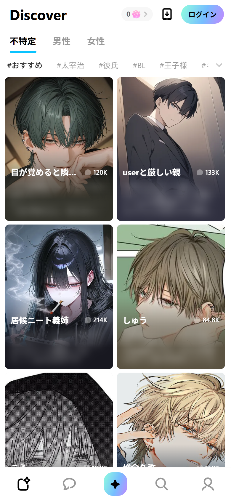

---

## 2. プラットフォームと配信

| 項目 | 観測値 | 根拠 |
|---|---|---|
| Webアプリ | `https://web.miraimind.ai`（ハッシュルーター） | `#/discover` など |
| フレームワーク | **Vue 3 + Vite** | `data-v-app`, `__vitePreload` |
| UIライブラリ | **Ant Design Vue** | `ant-layout`, `ant-btn`, `ant-input`, `ant-image` |
| 状態管理 | Pinia | バンドル |
| リアルタイム | **socket.io**（`wss://cosmos-im-ws-hw-ap.hellogroup.com/websocket/socket.io`） | コンソールログ |
| 音声 | WebRTC / TTS の痕跡 | バンドル |
| アニメーション | Rive | バンドル |
| 公式サイト | **Astro 5.17.1**（静的） | `<meta name="generator">` |
| 計測 | GTM / GA4 / Google Ads / AdSense / TikTok / Meta / AppsFlyer / X | スクリプト |
| ゲスト | 匿名セッションを自動発行（`userId=G…`） | コンソールログ |
| 無料枠 | **5リクエスト** | ランタイムログ `requestLimit: 5` |

### 2.1 モバイル専用のWeb

デスクトップ（1440×900）で開くと、アプリのルートが**空のまま**描画されませんでした。モバイルviewportでは正常に動作します。CSSも `is-mobile` クラスを前提にしており、Webは**モバイル専用**と割り切っています。

これはZeta（440px固定でデスクトップでも動く）やSynClub（デスクトップ別レイアウト）とは違う、**「Webはアプリのティザー」**という割り切りです。

---

## 3. 情報設計

### 3.1 ルート

| ルート | 画面 |
|---|---|
| `#/discover` | Discover（ホーム） |
| `#/search` | 検索（Webでは限定） |
| `#/chat-list` | チャット一覧 |
| `#/chat/{characterId}` | チャット |
| `#/personal` | ログイン / 言語 |
| `#/recharge` | 金平糖チャージ |

`#/create`、`#/settings`、`#/ranking` はルートとして存在せず、`#/discover` にフォールバックします。作成はアプリ側の機能です。

### 3.2 ナビゲーション

下部タブは5つ：

1. **Discover**（きらめくカードのアイコン）
2. **チャット**（吹き出し）
3. **作成**（中央の**70pxのグラデーション blob**）
4. **検索**
5. **マイページ**

中央の作成ボタンだけが浮き出た円形で、他の4つは線画アイコン。Zetaの「下部タブ＋マスコット」、SynClubの「カテゴリ文字」とは違い、**中央アクションを強調する**構成です。

---

## 4. 画面別解剖

### 4.1 Discover

- 白〜ラベンダーの背景、左上に極太の `Discover`（24px/700）
- 右上に金平糖残高 `0`、`ログイン` のグラデーションピル
- `不特定 / 男性 / 女性` の性別タブ（アクティブは下線）
- `#おすすめ` `#太宰治` `#彼氏` `#BL` … のハッシュタグ横スクロール
- **2カラムのカード**（183×243、角丸8px）。画像の上に名前（14px/700）とチャット数（11px/590）
- カードのタップで**直接チャットへ**（プロフィール画面を挟まない）

カードは `show-intro` モードで、説明文はカード内に保持しつつ、モバイルでは名前と数字だけを見せています。情報密度はZetaより低く、SynClubより高い「中間」。

### 4.2 チャット

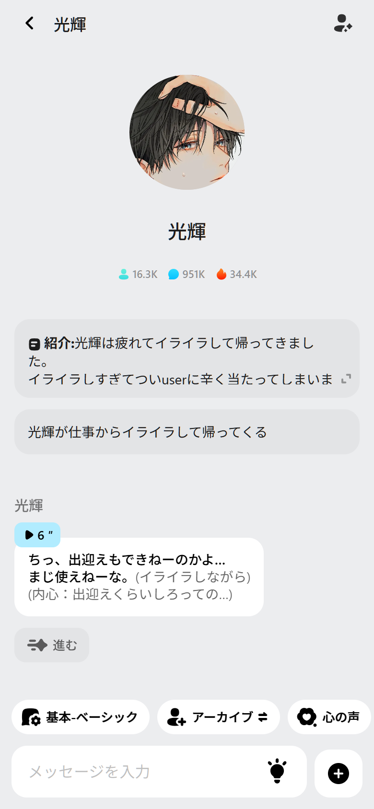

上から：

1. **ヘッダー**：戻る、キャラ名、右上に情報アイコン
2. **大きな円形アバター**、名前、統計（16.3K / 951K / 34.4K）
3. **紹介カード**：`紹介:` と長文、折りたたみ、`A`（翻訳）アイコン
4. **シナリオチップ**：`光輝が仕事からイライラして帰ってくる`
5. **音声バブル**：`▶ 6″` の再生ピル
6. **メッセージ**：白い吹き出し、`(内心：…)` の心の声
7. **`進む` ボタン**：物語を進める
8. **モードチップ**：`基本-ベーシック` `アーカイブ` `心の声`
9. **入力バー**：`メッセージを入力`、電球アイコン、`+`

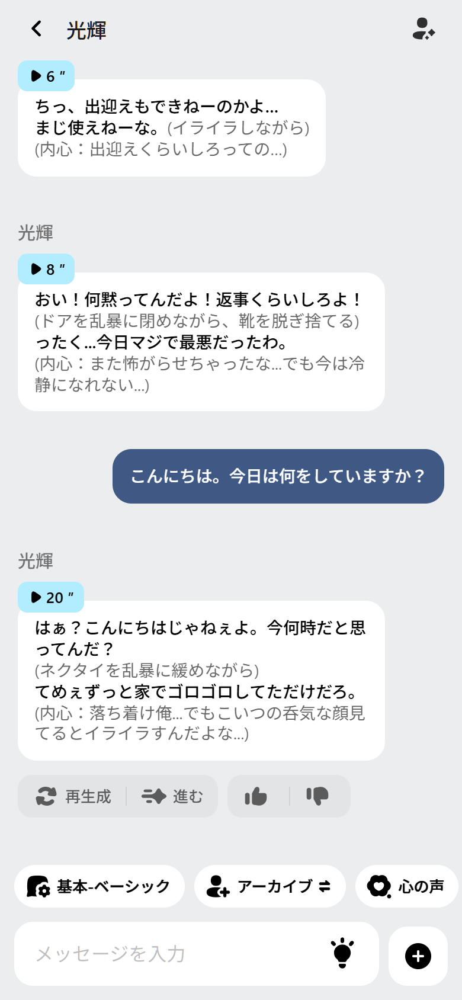

ユーザーの吹き出しは**濃いブルーグレー**、キャラは白。音声バブルは淡いブルーで、再生時間が入ります。AI応答の下には `再生成` `進む` `👍 👎` が並び、**「会話」と「物語進行」が別の操作**になっています。

`進む` を押すと、ユーザーの入力なしでキャラの次の台詞と心の声が追加されます。これはZetaの「トークを始める→AIが話す」に近いですが、**いつでも読者として進められる**点が違います。

### 4.3 キャラ情報シート

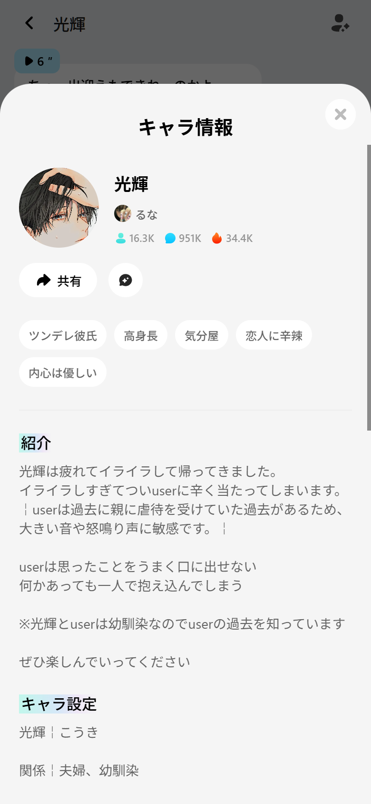

- ボトムシート、`キャラ情報`、閉じる×
- アバター、名前、クリエイター、統計
- `共有` ボタン、お気に入りの星
- 特性タグ：`ツンデレ彼氏` `高身長` `気分屋` `恋人に辛辣` `内心は優しい`
- `紹介`（ミントの下線）、長文
- `キャラ設定`：名前、関係、年齢、性格…

「紹介」と「設定」を分け、**読む情報と演じる情報**を切り替えられるのがZetaとの違いです。

### 4.4 追加アクション

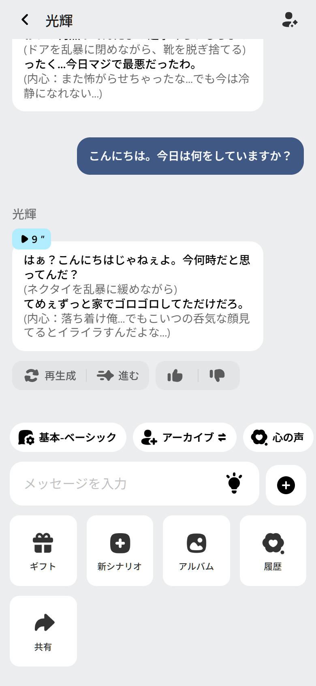

`+` を押すと、入力バーの上に5つのタイルが展開します。

- `ギフト`
- `新シナリオ`
- `アルバム`
- `履歴`
- `共有`

モーダルではなく**インラインのパネル**。会話の文脈を切らずに機能へアクセスできます。

### 4.5 アプリゲート

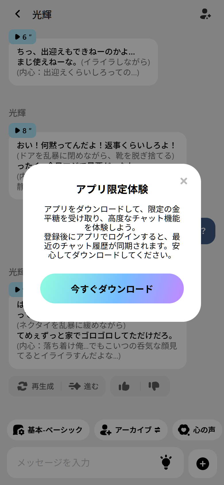

`心の声` を開くと：

> アプリをダウンロードして、限定の金平糖を受け取り、高度なチャット機能を体験しよう。
> 登録後にアプリでログインすると、最近のチャット履歴が同期されます。

グラデーションの `今すぐダウンロード` ボタン。Webの体験境界が**機能単位**で引かれているのが特徴です。SynClubのように最初から全面ゲートではなく、**5回話してから**制限に当たります。

### 4.6 ログイン / 言語

| ログイン | 言語 |
|---|---|
| 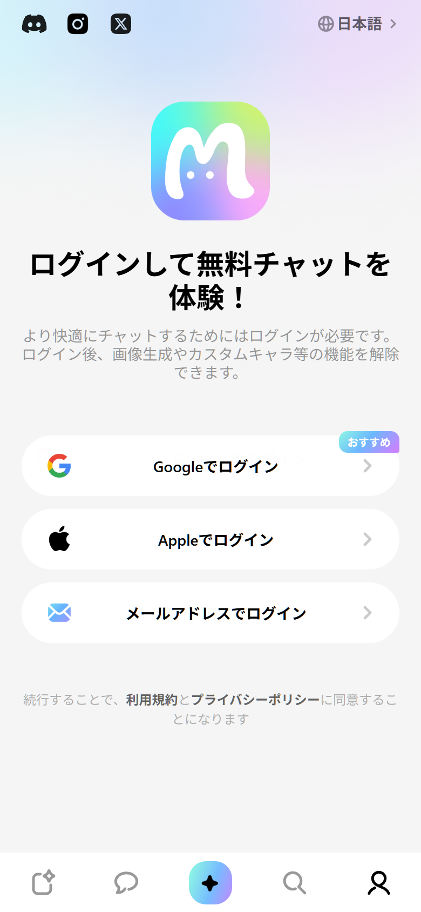 | 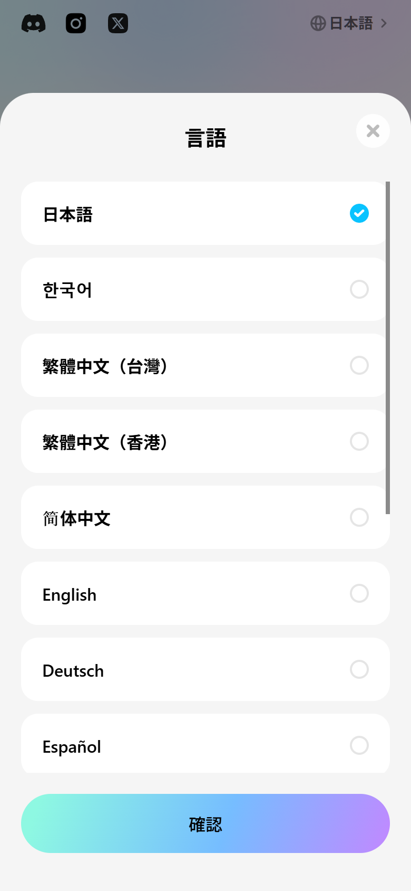 |

ログインはパステルグラデーションの背景に、3Dの「M」マスコット。`Googleでログイン` `Appleでログイン` `メールアドレスでログイン` の3択。左上にX/TikTok/Instagram/Discordの社会的アイコン。

言語は日本語 / 한국어 / 繁體中文（台灣・香港）/ 简体中文の5つ。**アジア圏のグローバル展開**が前提です。

### 4.7 金平糖チャージ

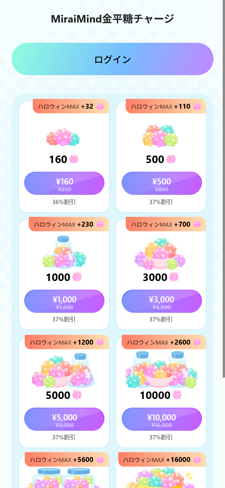

- タイトル `MiraiMind金平糖チャージ`
- 上部にグラデーションの `ログイン`
- 2カラムの商品グリッド。各商品は**キャンディのイラスト**（紫、緑、ピンク、青）と `ハロウィンMAX+32` のボーナス
- 価格は `¥160` `¥500` `¥1,000` `¥3,000` `¥5,000` `¥10,000`
- 元価格の取り消し線と `36%割引` `37%割引`

Zetaの「ピース」、SynClubの「コイン」、CrushOnの「Coin/Diamonds」に対して、MiraiMindは**金平糖**という菓子モチーフ。商品イラストと通貨名が一致した、5社で最も可愛い課金画面です。

### 4.8 チャット一覧 / 公式サイト

| チャット一覧 | 公式サイト |
|---|---|
| 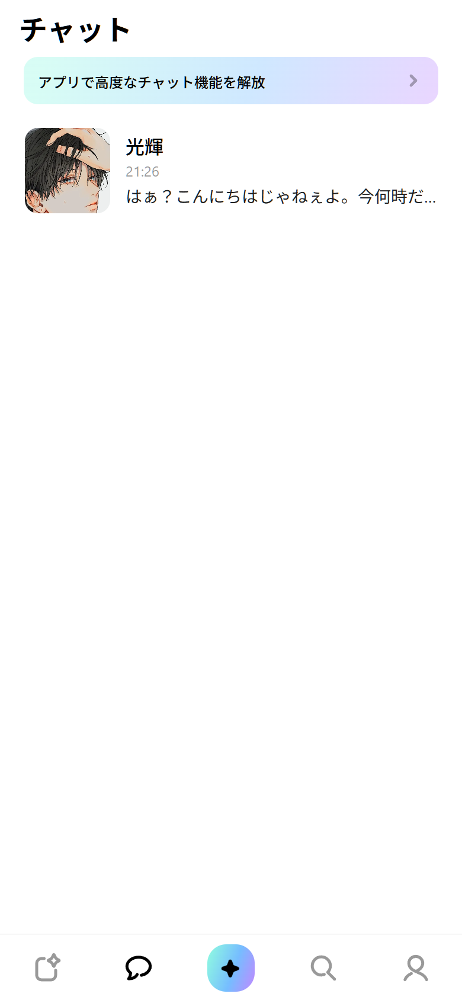 | 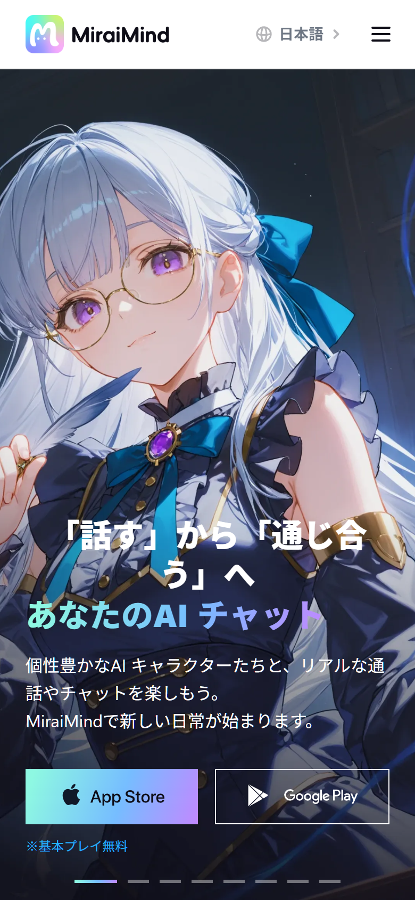 |

公式サイトはAstro製で、フルブリードのアニメビジュアル＋グラデーション見出し＋ストアボタン。ガイド記事（`3分で完全攻略`、`記憶機能`）はマンガ風バナーで、**アプリの世界観をそのままWebに持ち込む**構成です。

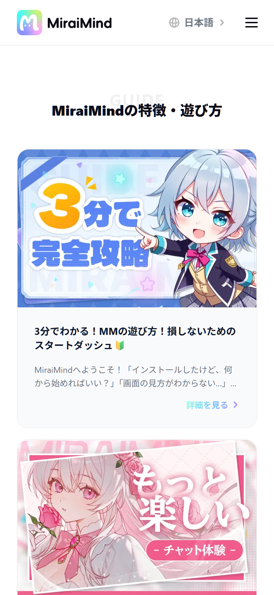

---

## 5. デザインシステム

### 5.1 カラー

| 役割 | 値 | 用途 |
|---|---|---|
| page | `#F5F5F5` | 背景 |
| surface | `#FFFFFF` | カード、シート |
| text | `#000000` | 見出し |
| text-secondary | `rgba(0,0,0,.6)` | 補助 |
| mint | `#8EF8E2` | グラデーション開始 |
| blue | `#76BDFF` | グラデーション中間 |
| purple | `#C685FF` | グラデーション終了 |
| cyan | `#09C3FF` | リンク、強調 |
| gold | `#FFC300` | ボーナス、注意 |
| orange | `#FF5C1E` | 警告 |
| danger | `#FF4D4D` | エラー |

ブランドの中心は**ミント→ブルー→パープルのグラデーション**。ログインボタン、作成タブ、課金の背景、公式サイトの見出しに一貫して使われます。

### 5.2 タイポグラフィ

**システムフォント**（SF Pro / -apple-system / PingFang SC / Segoe UI）。Webフォントを読み込まず、iOS/Androidのネイティブ感を優先しています。

| 用途 | サイズ | 太さ |
|---|---|---|
| ページタイトル | 24px | 700 |
| セクション | 18px | 700 |
| 本文 | 16px | 400 |
| カード名 | 14px | 700 |
| タグ | 13px | 590 |
| カウント | 11px | 590 |

ZetaのPretendard（-0.03emの詰め）やSynClubのPoppins（remスケール）とは違い、**ニュートラルで読みやすい**。日本語のウェイトも自然です。

### 5.3 レイアウト

| 項目 | 値 |
|---|---|
| ヘッダー | 48px |
| ガター | 12–16px |
| カード | 183×243（3:4） |
| 角丸 | 8px |
| カード間 | 8px |
| 下部タブ | 56px |

2カラムのカードグリッドはZetaとほぼ同じ比率ですが、**影を使わず、白と余白で区切る**のがMiraiMindらしさです。

### 5.4 モーション

- タブ切替は150–200msのフェード
- 中央の作成blobは**ゆっくり回転/拡縮**するグラデーション
- 音声バブルは再生時に波形/進捗
- 公式サイトはスクロール連動のフェード

---

## 6. 機能と課金

### 6.1 チャット機能

バンドル内の語彙から確認できるもの：

- **音声メッセージ**（`6″` `20″`）
- **心の声**（`内心：`）
- **シナリオ**（`新シナリオ`）
- **記憶**（`永久記憶`、公式ガイド）
- **ギフト**、**アルバム**、**履歴**、**共有**
- **再生成**、**進む**、**👍/👎**
- **モード**（`基本-ベーシック`、`アーカイブ`、`心の声`）
- **翻訳**（`A` アイコン、キャラ情報の自動翻訳）

### 6.2 課金

| 商品 | 内容 |
|---|---|
| 金平糖 | 160 / 500 / 1,000 / 3,000 / 5,000 / 10,000 |
| ボーナス | ハロウィンMAX+32〜+1200 |
| 割引 | 36–37% |
| アプリ限定 | 限定金平糖、高度なチャット機能、履歴同期 |

Webでは**チャージのみ**。VIP/サブスクはアプリ側の可能性が高い（Webのルートには見当たらず）。

---

## 7. 強み / 弱み

### 強み

1. **音声＋心の声＋進む**で、テキストチャット以上の没入を作っている
2. **白＋パステル**の明るいUIで、ダークな競合と差別化
3. **5リクエストのゲスト体験**で、価値を体験させてからアプリへ送る
4. **金平糖**の世界観が通貨・商品・イラストで一貫
5. **5言語**のグローバル展開

### 弱み

1. **デスクトップWebが空白**。PCユーザーを取り逃す
2. **検索がWebでは使えない**（人気ワードのみ）
3. **アプリゲートが機能単位**で、どこまで無料か分かりにくい
4. **ブランドの一貫性**：公式サイトはアニメ全開、アプリは白＋パステル、ロゴは3DのM
5. **アクセシビリティ**：画像alt、フォーカス、コントラストの検証が弱い

---

## 8. 証拠

- Web画面：`evidence/screenshots/miraimind/web/`（18点）
- Play Store：`evidence/screenshots/appstore/miraimind/`（5点）
- トークン：`evidence/tokens/miraimind-observed.json`（未生成の場合は `data/tokens.json`）
- ルート：`data/routes.json`
- コンポーネント：`data/components.json`
- REA：`ev_5d2ca88b…`（親）/ `ev_fb8d749c…`（summary）

- UX実測：docs/11-ux-reverse-engineering.md（2タップ、5回制限、応答2.96s）
- UXパターン：docs/12-ux-patterns.md

