# CrushOn.AI — UI ティアダウン

対象：**CrushOn.AI**（`crushon.ai` / マーケティング `chat.crushon.ai` / Android `ai.crushon.app`）
観測日：2026-10-25 / Webアプリ（Next.js）＋マーケティングサイト

> 本製品はNSFW（成人向け）前提です。本ドキュメントでは、公開ページの**UI構造**のみを扱い、本文・画像の一部は公開用にブラウザ処理でぼかしています。18歳未満向けではありません。

---

## 1. プロダクトの輪郭

CrushOn.AIは「**AI girlfriend / character AI chat / AI roleplay**」を掲げる、8M+キャラクター・10M+ユーザー（いずれもマーケティング表記）の大規模プラットフォームです。ZetaやSynClubが「日本市場の没入」を狙うのに対し、CrushOnは**英語圏のNSFWロールプレイ**が主戦場で、UIも英語のSEO資産と課金に最適化されています。

UIは**2つの人格**を持ちます。

- **マーケティングサイト（`chat.crushon.ai`）**：黒×紫のネオン。巨大な英文タイポ、ピンク→紫のグラデーションCTA、キャラクターのモザイク
- **アプリ（`crushon.ai/ja`）**：白／ライト。黒文字、紫のアクセント、2カラムのカード。**マーケティングと真逆**

この分裂が、CrushOnの最大の特徴であり、最大の弱点です。

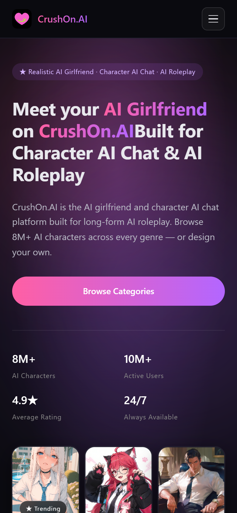

---

## 2. プラットフォームと配信

| 項目 | 観測値 | 根拠 |
|---|---|---|
| アプリ | `https://crushon.ai/ja` | redirect from `www.crushon.ai/?sfw=1` |
| マーケティング | `https://chat.crushon.ai` | 独立したNext.jsサイト |
| フレームワーク | **Next.js + React** | `Minified React error`, `_next` |
| UI | **Mantine + Tailwind + rc-dialog** | `mantine-*`, utility classes, `rc-dialog-*` |
| 状態管理 | Zustand | `*-store` のlocalStorageキー |
| 決済 | Stripe | バンドル |
| 分析 | Sentry / Amplitude / GTM / Sensors Data / Intercom | バンドル |
| コンテンツ | NSFW / 18+ / SFWクエリ `?sfw=1` | 年齢確認、`nsfw` ストア |
| 認証 | Google / Discord / SubscribeStar / メール | ログイン画面 |
| 通貨 | **CrushOn Coin** / **CrushOn Diamonds** | ストア/コイン画面 |
| プラン | **7段階**（無料〜インペリアル） | 料金プラン |

### 2.1 SFWフィルタ

`?sfw=1` を付けると、タグ一覧からBDSM系・フェティッシュ系・性的指向系のタグが消え、カテゴリが健全寄りに変わります。一方、UI上のトグルは `role="switch"` の `aria-checked="false"` のままで、ラベルも `フィルターなし`。**クエリとUIの状態が一致していない**、実装途中の挙動です。

---

## 3. 情報設計

### 3.1 ルート

| ルート | 画面 | 状態 |
|---|---|---|
| `/ja` | ホーム（キャラクター/思い出/クリエイター） | 公開 |
| `/ja/ranking` | ランキング | 公開 |
| `/ja/search?s=fantasy` | 検索 | 公開 |
| `/ja/character/{id}/chat` | キャラクターチャット | 公開（送信はログイン） |
| `/ja/pricing` | 料金プラン | 公開 |
| `/ja/store` | ストア | **ログイン必須** |
| `/ja/coin` | コイン/ダイヤ | 公開（獲得はログイン） |
| `/ja/account` | アカウント | **ログイン必須** |
| `/ja/chat/inbox` | 受信箱 | 公開（空） |
| `/ja/auth/signin` | ログイン | 公開 |
| `/ja/blog` | ブログ | 公開 |
| `/ja/terms-of-service` ほか | 法務 | 公開 |
| `chat.crushon.ai/*` | SEO/マーケティング | 公開 |

バンドルには `/character/create` `/account/income` `/account/paid-content` `/chat/group` `/coin/transaction` `/pricing/chat-package` も存在します。

### 3.2 ナビゲーション

**モバイル**

- 左上ハンバーガー、上部にフィルタ、18+バッジ、検索、翻訳、ログイン
- タブ：`キャラクター` `思い出` `クリエイター`
- ソート、性別、フィルタチップ、2カラムカード
- 下部に `Open in App` バナー（blue gradient）

**デスクトップ**

- 左サイドバー：ホーム／最近のチャット／作成／ランキング／プロフィール／料金プラン／ストア／報酬・特典／通知
- 上部：検索、モデル選択（`システム`）、言語（`日本語`）、ログイン
- 6カラムグリッド

Zetaの固定440px、SynClubのレール＋サイドバー、MiraiMindのモバイル専用とは違い、CrushOnは**デスクトップで最も情報密度が高い**。

---

## 4. 画面別解剖

### 4.1 初回オンボーディング

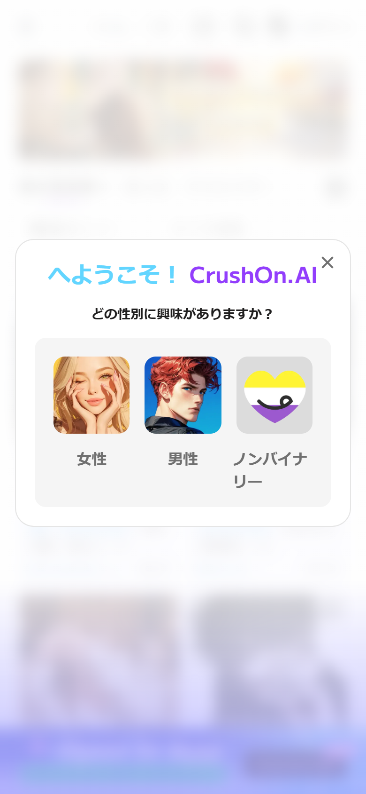

> ようこそ！CrushOn.AI
> どの性別に興味がありますか？

`女性` `男性` `ノンバイナリー` の3枚のカード。背景はぼかし。選択するとホームのフィルタに反映されます。Zetaのログインシート、SynClubのQRゲート、MiraiMindの言語＋ログインとは違い、**興味の方向性を最初に聞く**設計です。

### 4.2 ホーム

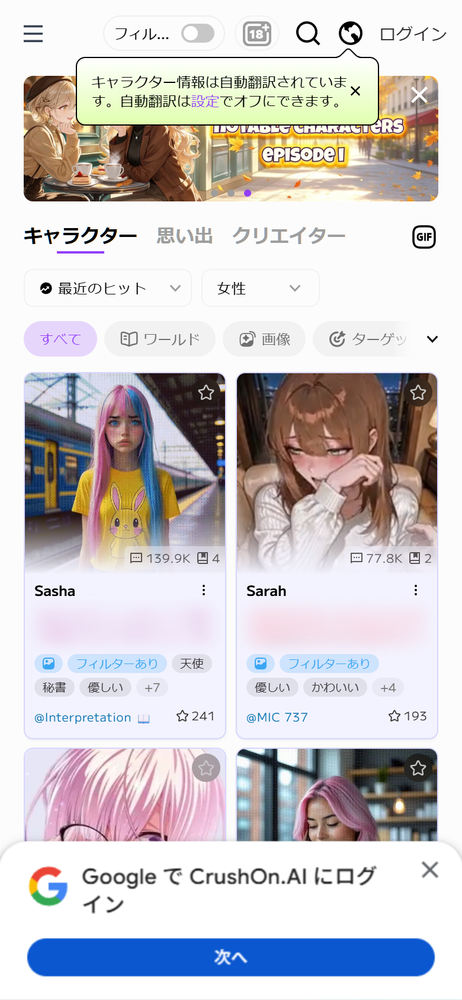

- 左上ハンバーガー、`フィルター` トグル、`18+` バッジ、検索、翻訳、ログイン
- 翻訳ツールチップ `キャラクター情報は自動翻訳されています。自動翻訳は設定でオフにできます。`
- バナーカルーセル `MOST LIKED CHARACTERS episode1`
- `キャラクター` `思い出` `クリエイター` タブ＋`GIF` ボタン
- ソート `最近のヒット`、性別 `女性`
- フィルタ `すべて` `ワールド` `画像` `ターゲット`
- 2カラムカード：画像、チャット数/いいね数、名前、説明、タグ、クリエイター、スター数
- 下部に `Google で CrushOn.AI にログイン` ボトムシート

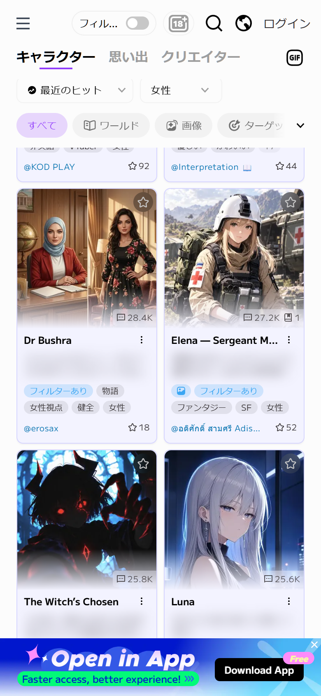

カードは**情報密度が非常に高い**。画像の下に、名前（12px/700）、説明（2行、ブラー処理）、タグ（10pxのピル）、クリエイター、スター数。Zetaの「タイトル＋タグ」、SynClubの「名前＋説明カード」より、**1枚で多くの判断材料**を出します。

### 4.3 ランキング

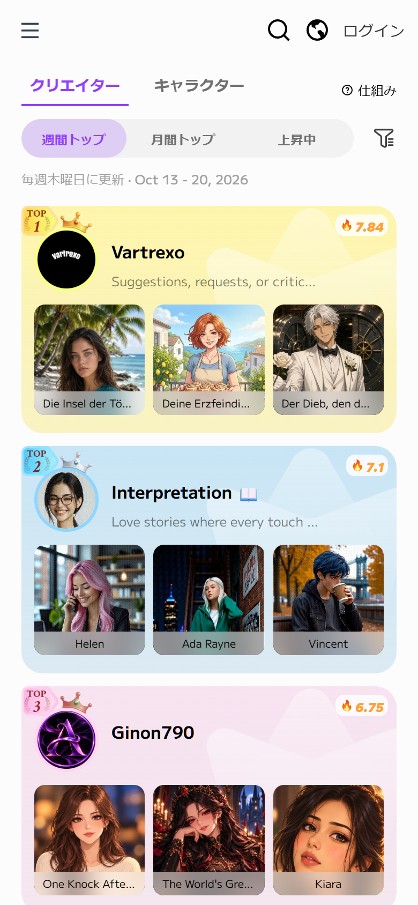

- `クリエイター` / `キャラクター`、`仕組み`
- `週間トップ` `月間トップ` `上昇中`
- 更新日 `Oct 13 - 20, 2026`
- TOP1〜3を**パステル背景の大きなカード**で表示。王冠、クリエイターアバター、説明、3キャラのサムネ、炎スコア
- 4位以降はリスト

Zetaの順位バッジ付き2カラム、SynClubのキャラ一覧とは違い、**クリエイターを主役**にしたランキングです。上位3件を大きく見せることで、クリエイターのブランドを育てています。

### 4.4 検索

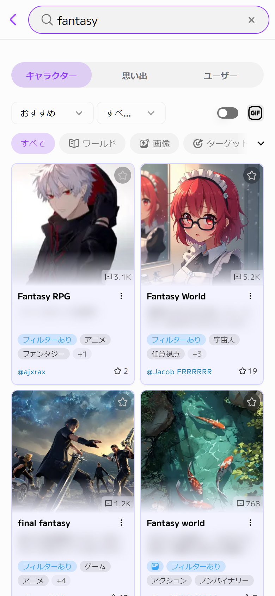

- 大きな検索ピル（紫のフォーカスリング）、戻る、クリア
- `キャラクター` `思い出` `ユーザー`
- ソート、フィルタ、GIF
- `すべて` `ワールド` `画像` `ターゲット`
- 2カラム結果。説明はブラー処理

検索結果は `?s=fantasy` のようにクエリをURLに保持します。SEOと共有の両方に効く設計です。

### 4.5 料金プラン

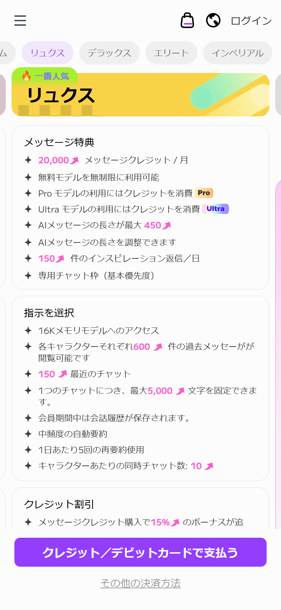

7段階のプラン：

`無料` `スタンダード` `プレミアム` `リュクス` `デラックス` `エリート` `インペリアル`

各プランに：

- メッセージクレジット / 月（100〜20,000）
- 無料モデル無制限、Pro/Ultraモデルのクレジット消費
- AIメッセージ長（225〜450）
- インスピレーション返信/日
- メモリ容量（8K〜16K）
- 過去メッセージ閲覧（200〜600）
- 最近のチャット（50〜150）
- 固定文字数（4,000〜5,000）
- 自動要約、再要約回数
- 同時チャット数（1〜10）
- クレジット割引

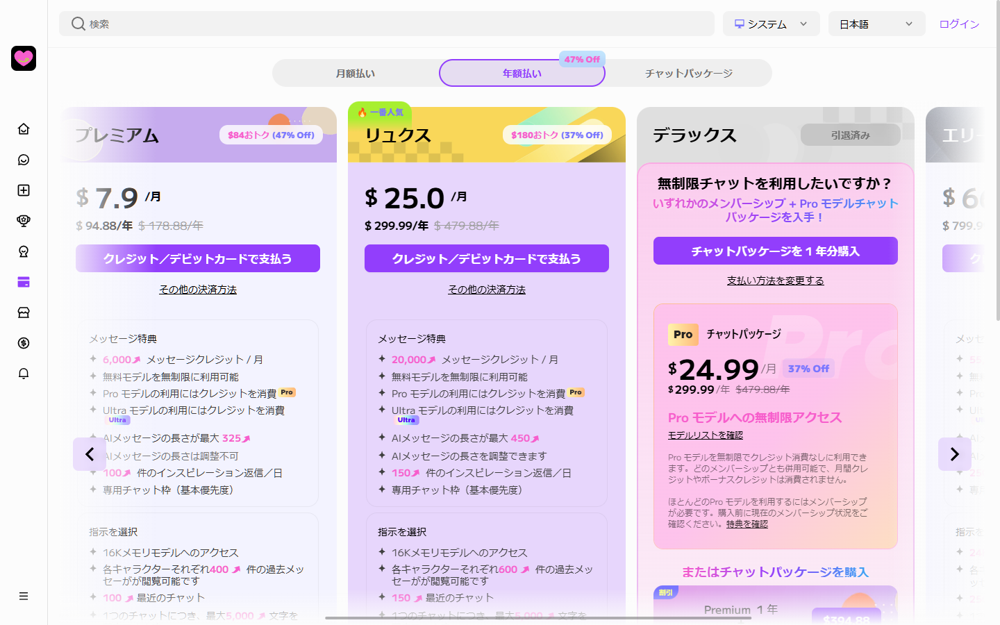

デスクトップでは**横カルーセル**でプランを比較。`月額払い / 年額払い / チャットパッケージ`、`47% Off`、`一番人気` の黄色バッジ、`$7.9/月` `$25.0/月` の価格、紫の支払いボタン。デラックスには `チャットパッケージ` のアップセル。

これは4製品の中で**最もSaaS的な課金UI**です。Zetaの「ピースで寄り道」、SynClubの「コインで続行」、MiraiMindの「金平糖チャージ」に対して、CrushOnは**プラン比較と年額割引**でLTVを取ります。

### 4.6 ストア / コイン / アカウント

| ストア（ゲート） | コイン |
|---|---|
| 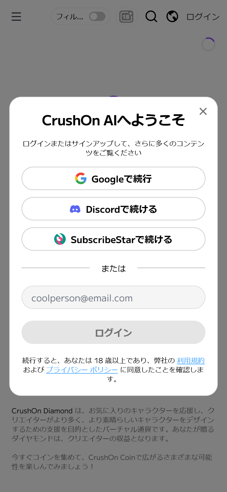 | 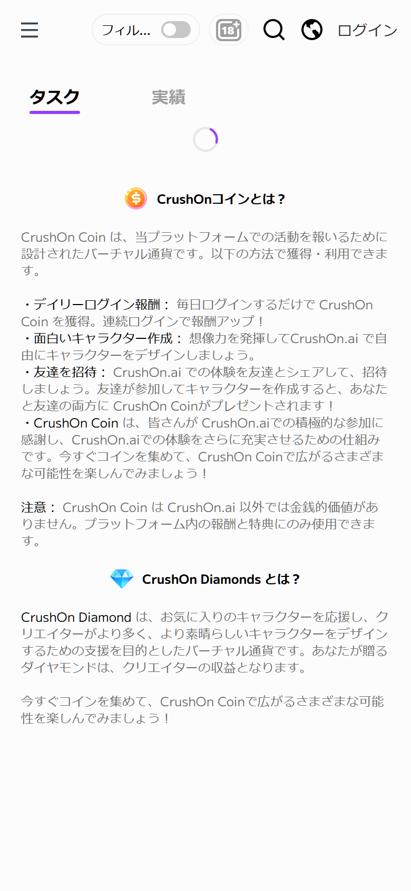 |

ストアとアカウントは**ログインモーダルでブロック**されます。コイン画面は `タスク` `実績` タブ、`CrushOn Coin` と `CrushOn Diamonds` の説明。デイリーログイン、キャラ作成、招待で獲得。

### 4.7 ログイン / 受信箱

| ログイン | 受信箱 |
|---|---|
| 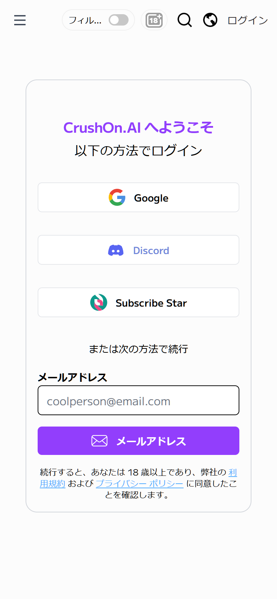 | 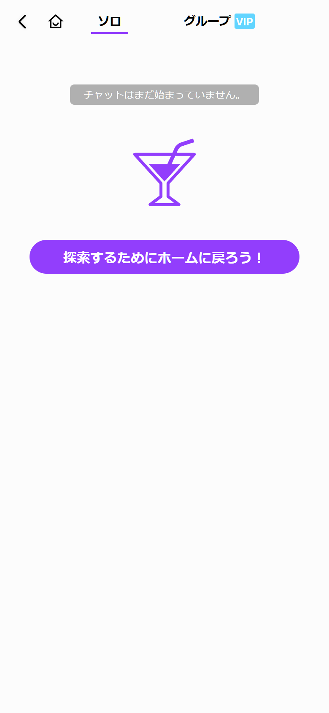 |

ログインは `Google` `Discord` `Subscribe Star` `メール`。18歳以上と規約・プライバシーへの同意。受信箱は `ソロ` `グループ（VIP）`、空状態はマティーニのアイコンと `探索するためにホームに戻ろう！`。

### 4.8 キャラクターチャット

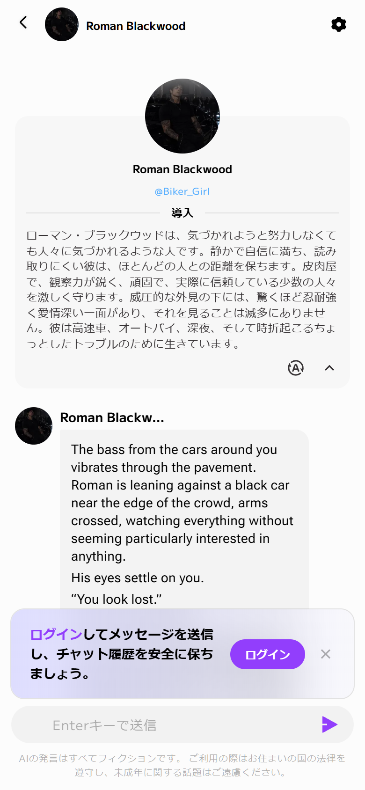

- ヘッダー：戻る、円形アバター、名前、設定ギア
- **導入カード**：大きなアバター、名前、`@Biker_Girl`、`導入` 区切り、長文、翻訳/折りたたみ
- **最初のメッセージ**：左にアバター、名前、白い吹き出し、英文のナレーション
- **ログイン誘導バナー**：`ログインしてメッセージを送信し、チャット履歴を安全に保ちましょう。`＋紫の `ログイン`
- **入力バー**：`Enterキーで送信`、紫の送信
- **免責**：AIの発言はフィクションである旨と、年齢に関する注意書き。

Zetaの紫グラデ、SynClubのコーラル、MiraiMindの音声バブルとは違い、CrushOnは**白いメッセージアプリ**に近い。背景画像や音声はなく、テキストと導入カードで世界観を作ります。

### 4.9 デスクトップ詳細モーダル

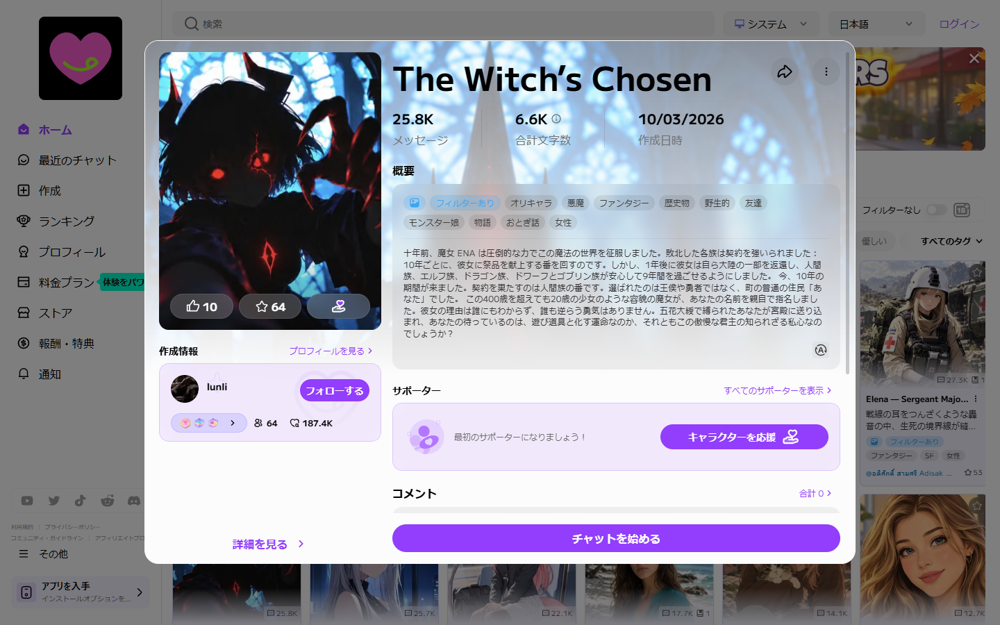

カードから開くモーダル。画像、タイトル、`25.8K メッセージ` `6.6K 合計文字数` `10/03/2026 作成日時`、タグ、`概要`、作成者、サポーター、コメント、`チャットを始める` CTA。Zetaのプロット詳細に近い情報量を、**モーダル**で出します。

### 4.10 マーケティング

| ヒーロー | Anime AI |
|---|---|
|  | 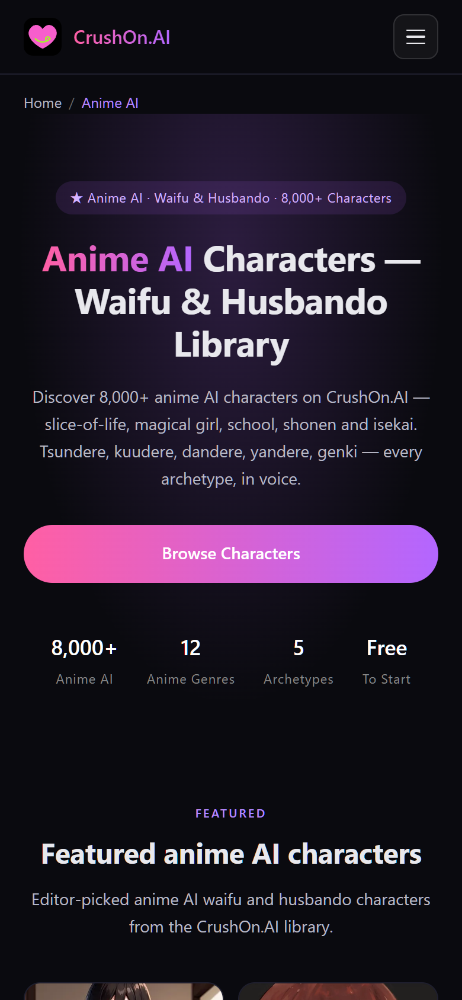 |

- 黒×紫のグラデーション、ネオンの巨大タイポ、ピンク→紫のCTA
- `8M+ AI Characters` `10M+ Active Users` `4.9★` `24/7`
- キャラクターのモザイク、カテゴリカード
- SEOページ：`/ai-girlfriend` `/ai-boyfriend` `/anime-ai` `/ai-roleplay` `/ai-companion` `/character-ai-chat`
- エディトリアル：`/creators`（ランキングのスナップショットと方法論）、`/blog`
- ツール：`/ai-character-personality-builder/`（2ステップの性格ビルダー）

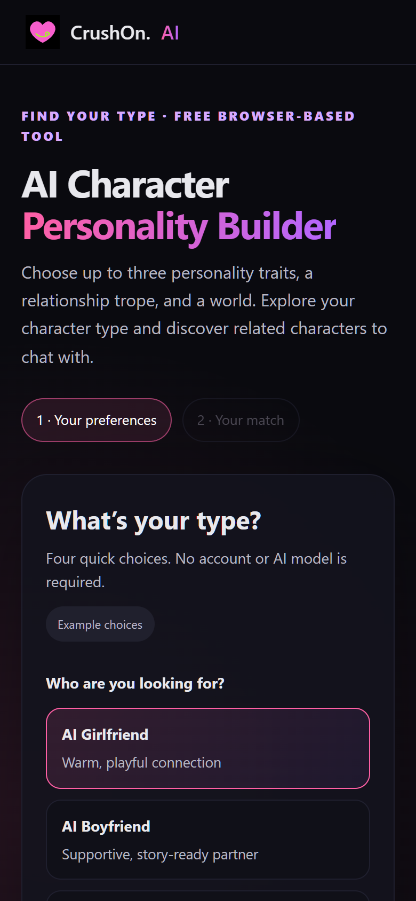

マーケティングは**コンテンツファーム**として非常によくできています。8M+キャラのロングテールSEO、カテゴリページ、クリエイター記事、インタラクティブツールを組み合わせ、検索からアプリへ送客します。

---

## 5. デザインシステム

### 5.1 カラー（アプリ）

| 役割 | 値 | 用途 |
|---|---|---|
| app bg | `#FCFCFC` | 背景 |
| surface | `#FFFFFF` | カード |
| card tint | `#F3F3FF` | カード面 |
| text | `#000000` | 見出し |
| text-secondary | `rgba(0,0,0,.6)` | 補助 |
| text-tertiary | `#707070` | 注釈 |
| pink | `#F75ECC` | ブランド |
| purple | `#923EFC` | CTA、フォーカス |
| periwinkle | `#7976FF` | タグ、リンク |
| violet | `#B376FF` | グラデーション |
| soft pink | `#FF8ADC` | アクセント |
| blue | `#3BA6F3` | 情報タグ |
| lime | `#A8EF30` | 成功、VIP |
| yellow | `#FFF1A7` | 一番人気、注意 |

### 5.2 カラー（マーケティング）

| 役割 | 値 |
|---|---|
| bg | `#202020` / `#202126` |
| text | `#FFFFFF` |
| gradient | `#FF5FA2` → `#A855F7` |
| accent | `#7976FF` |

**アプリはライト、マーケティングはダーク**。同じブランドなのに、色・トーン・タイポが別物です。

### 5.3 タイポグラフィ

- **Metropolis**（主要）
- Poppins / Montserrat / Roboto / Exo 2（併用）
- 16px基準、カード名12px/700、タグ10px、タブ16px/700

フォントが**5種類**混在しており、ページごとに印象が変わります。ZetaのPretendard一択、SynClubのPoppins一択と対照的です。

### 5.4 レイアウト

- モバイル：2カラム、カード171×310、角丸8px、タグ10pxピル
- デスクトップ：左レール72px、上部検索、6カラム
- 料金：横カルーセル、プランカード
- モーダル：`rc-dialog`、白、角丸16–20px

### 5.5 モーション

- Swiperのカルーセル
- カードのhoverでbrightness/scale
- `rc-dialog` のfade/zoom
- マーケティングのスクロールフェード

---

## 6. 機能と課金

### 6.1 機能

- キャラクター発見（8M+）、検索、ランキング（クリエイター/キャラクター）
- キャラクターチャット（長文ロールプレイ、記憶、モデル選択）
- 思い出（メモリー）、クリエイター、フォロー、スター、コメント、サポーター
- 画像付きキャラ、GIF、翻訳
- グループチャット（VIP）、受信箱
- コイン/ダイヤ、デイリーログイン、招待、実績
- クリエイター収益（`/account/income`、`/account/paid-content`）
- 性格ビルダー（アカウント不要）

### 6.2 課金

- **Coin**：プラットフォーム内の報酬通貨。デイリーログイン、キャラ作成、招待で獲得
- **Diamonds**：クリエイターへの投げ銭。クリエイターの収益になる
- **サブスク**：7段階。メッセージクレジット、モデル、記憶、同時チャット、割引
- **チャットパッケージ**：年額の追加クレジット
- **18+コンテンツ**：アプリ内課金

---

## 7. 強み / 弱み

### 強み

1. **課金UIが体系的**：7プラン、年額割引、クレジット、モデル階層、アップセル
2. **SEO/コンテンツ**：8M+キャラのロングテール、カテゴリ、クリエイター記事、ビルダー
3. **ランキング**：クリエイターを主役にしたTOP3カード
4. **デスクトップ**：サイドバー＋6カラムで情報密度が高い
5. **ゲスト導線**：導入は読める、送信はログイン

### 弱み

1. **ブランドの分裂**：マーケティングはダーク、アプリはライト、フォント5種
2. **NSFW前提**：SFWフィルタのUIと実装が不一致
3. **認証ゲートが多い**：ストア、アカウント、送信、グループ
4. **コピーの品質**：`CrushOn.AIBuilt` のように単語間のスペースが抜ける
5. **アクセシビリティ**：カードがリンクでない箇所、10pxタグ、白背景に薄い紫

---

## 8. 証拠

- Web画面：`evidence/screenshots/crushon/web/`（24点、モバイル/デスクトップ）
- トークン：`data/tokens.json`
- ルート：`data/routes.json`
- コンポーネント：`data/components.json`
- REA：`ev_2dd12452…`（親）/ `ev_9361af85…`（summary）
- UGC説明文は公開用にブラー処理。NSFW画像は選定から除外。

- UX実測：docs/11-ux-reverse-engineering.md（4タップ、3画面、送信時ログイン）
- UXパターン：docs/12-ux-patterns.md

