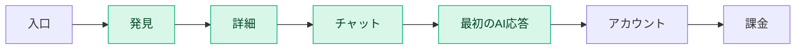
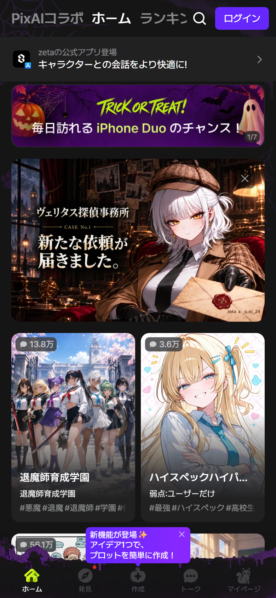
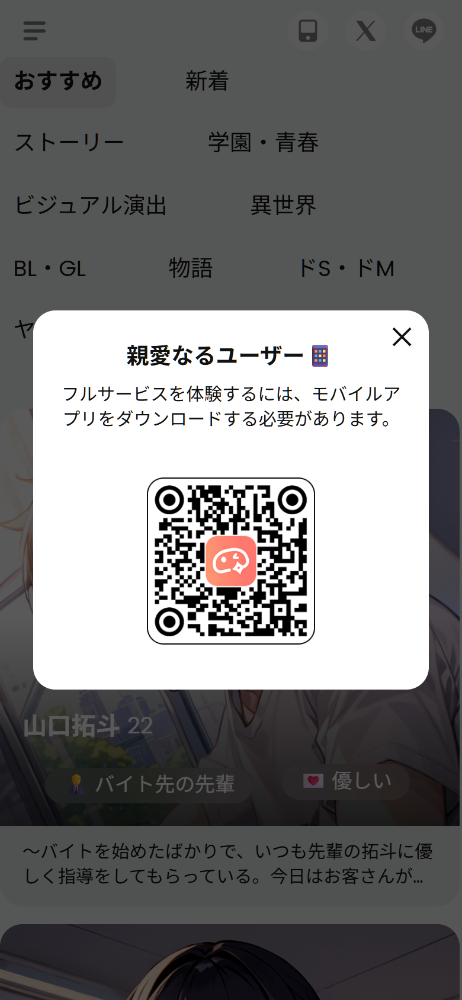
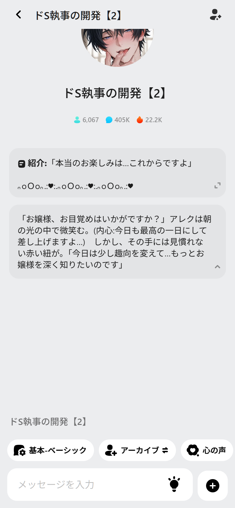
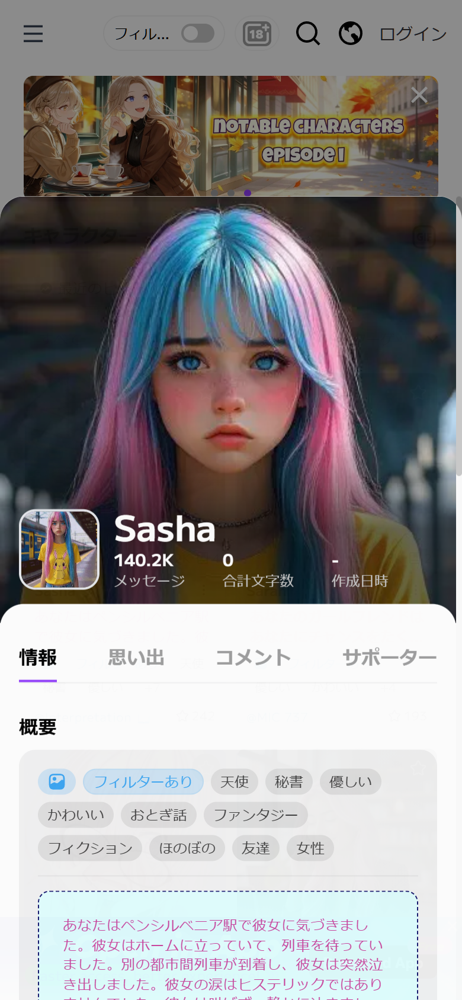
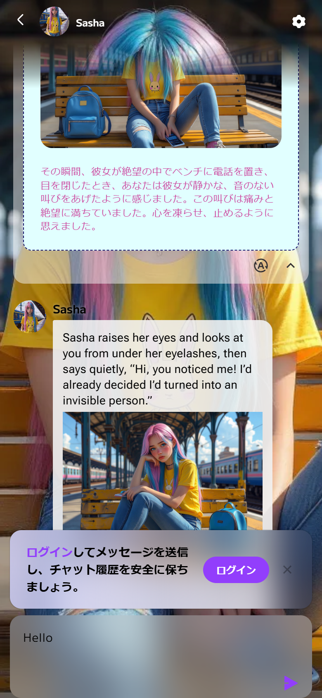
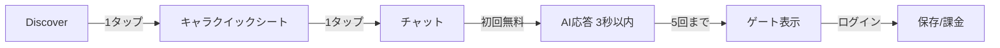

# UX リバースエンジニアリング — 4製品の導線・ゲート・操作コスト

UIの形ではなく、**ユーザーが最初の価値に到達するまでに何を強いられるか**を測定したレポートです。対象は Zeta / SynClub / MiraiMind / CrushOn.AI。同一のモバイルビューポート・同一のハーネスで、入口→キャラクター選択→チャット→最初のAI応答→アカウント→課金までを追跡しました。

> 測定日：2026-10-25 / viewport 390×844 / DPR2 / ja-JP / Chrome headful
> 生データ：`data/ux-metrics.json` / `data/ux-flows.json` / `evidence/ux/`
> 注：時間はシングルサンプルで、ネットワークやA/Bの影響を受けます。**画面遷移の差分**を中心に読んでください。

---

## 1. 測定結果サマリー

| 指標 | Zeta | SynClub | MiraiMind | CrushOn.AI |
|---|---|---|---|---|
| 最初のチャットまでのタップ | **2** | 不可 | **1** | 3 |
| 最初の送信までのタップ | **3** | 不可 | **2** | 4 |
| チャット前に挟まる画面 | 2（ホーム→詳細） | 0（ゲート） | 1（Discover） | 3（性別→ホーム→詳細） |
| カードタップ→チャット表示 | 2.13s | — | **1.05s** | 2.09s |
| 送信→最初のAI応答 | **3.19s** | — | **2.96s** | 不可（ログイン） |
| ゲストの送信 | 可（短命ルーム） | 不可 | **5回まで** | 不可（閲覧のみ） |
| ゲートの種類 | ソフトなアプリ/ログイン | **QRハードゲート** | **5回制限＋機能ゲート** | **送信時ログイン** |
| フィードのセマンティック要素 | 122 | **0** | 7 | 28 |
| 44px未満のタップ領域 | **90 / 122（74%）** | 0（要素なし） | 2 / 7 | 11 / 28 |
| 12px未満のテキスト | 6 | 0 | 0 | **94** |
| ヒューリスティックスコア（/50） | 34 | 26 | **35** | 31 |

**読み方**：MiraiMindが「最も少ないタップで価値に届く」設計。Zetaは「詳細を読ませてから入る」が、タップ領域と広告が重い。SynClubは「Webでは価値に届かない」。CrushOnは「情報を見せてからログインで止める」。

---

## 2. ファネル比較

各製品の実際の停止位置：

| 製品 | 入口→発見 | 発見→詳細 | 詳細→チャット | チャット→応答 | 応答→アカウント | アカウント→課金 |
|---|---|---|---|---|---|---|
| Zeta | ホーム | プロット詳細 | `トークを始める` | 3.19s | 保存/購入時 | ピース/pass |
| SynClub | フィード | **なし（ゲート）** | **不可** | **不可** | QR | アプリ内 |
| MiraiMind | Discover | **なし（直行）** | カードタップ | 2.96s | 5回後/機能時 | 金平糖 |
| CrushOn | ホーム | **詳細シート** | `チャットを始める` | **ログインで停止** | 送信時 | 7プラン |

### 2.1 Zeta — 読ませてから入る

ホーム→プロット詳細→チャット。詳細では 紹介→プロット→イントロ→コメント を読ませ、`トークを始める` で入ります。**世界観を理解してから会話する**設計で、離脱は多いが、入った後の没入は深い。

- タップ：カード → CTA → 送信 = **3**
- チャット表示まで：カードタップから **2.13s**
- AI応答：送信から **3.19s**
- ゲストでもここまで到達可能

**UXの罠**：AIの返答が `NarratorBubble`（地の文）で返ることがあり、キャラの台詞が来ないと「会話している感」が弱まる。スクリーンショットの `zeta_step4_reply.png` はまさにナレーション応答。

### 2.2 SynClub — 1タップでゲート

フィードのカードをタップすると、**2.79s後にQRゲート**。チャットのプレビューも、キャラの挨拶もありません。

- タップ：カード = **1**
- チャット：**不可**
- フィードのクリック可能要素：**0**（カードは `<section>` + JSハンドラ）

Webの役割が「発見と創作」であることを考えると妥当ですが、**発見→会話の体験が完全に切れている**のがUX上の最大の弱点です。カテゴリを変えるたびにゲートが出るため、回遊も阻害されます。

### 2.3 MiraiMind — 1タップで会話

Discoverのカードをタップすると、**1.05sでチャット**。詳細画面を挟まず、キャラの挨拶と音声バブルがすぐ出ます。

- タップ：カード → 送信 = **2**
- AI応答：**2.96s**
- ゲスト：**5リクエスト**まで
- 44px未満のタップ領域：**2 / 7**（非常に少ない）

**UXの強み**：価値までの距離が最短。音声・心の声・`進む` が最初の画面に並び、「何ができるか」が一目で分かる。

**UXの弱み**：5回制限が事前に表示されない。6回目で突然アプリゲート。`心の声` などの主要機能もアプリ限定で、Webの体験が途中で切れる。

### 2.4 CrushOn — 3画面＋ログイン

性別オンボーディング→ホーム→**詳細シート**→チャット→送信時にログイン。詳細シートは画像・統計・タグ・概要・コメント・CTAを1枚にまとめた良いUIですが、**チャットまでに3画面**かかります。

- タップ：性別 → カード → CTA → 送信 = **4**
- チャット表示まで：**2.09s**（シート→チャット）
- 送信→ゲート：**2.90s**
- 12px未満のテキスト：**94**（10pxのタグ）

**UXの強み**：詳細シートで「誰と話すか」を納得してから進める。ログインゲートのコピーが明確。
**UXの弱み**：オンボーディングとログインの**二重ゲート**。タイプしてからログインを求められるので、入力が無駄になる。日英混在。

---

## 3. ゲスト/ゲート設計の4類型

| 類型 | 製品 | ゲストの体験 | ゲートの出方 | UX評価 |
|---|---|---|---|---|
| **ソフト** | Zeta | チャット可（短命） | 保存・購入・アプリ誘導 | ○ 体験を壊さないが、ルームが失効 |
| **ハード** | SynClub | 閲覧のみ | カードタップ/カテゴリ変更 | △ 明快だが、体験がゼロ |
| **リミット** | MiraiMind | 5回まで | 6回目/高度機能 | ◎ 価値を体験できる。制限の事前表示が課題 |
| **ログイン** | CrushOn | 閲覧のみ | 送信時/ストア/アカウント | △ 文脈は良いが、入力後に止める |

### 3.1 ゲートのコピー

| 製品 | コピー | トーン |
|---|---|---|
| Zeta | `アプリをダウンロードしてより快適にトークしましょう` | 提案 |
| SynClub | `フルサービスを体験するには、モバイルアプリをダウンロードする必要があります。` | 宣告 |
| MiraiMind | `アプリをダウンロードして、限定の金平糖を受け取り、高度なチャット機能を体験しよう。` | 誘惑 |
| CrushOn | `ログインしてメッセージを送信し、チャット履歴を安全に保ちましょう。` | 安心 |

ZetaとMiraiMindは**ベネフィット**（快適・限定）を語り、SynClubは**必要条件**を語り、CrushOnは**安全性**を語ります。同じゲートでも、ユーザーの感情は変わります。

### 3.2 ベストプラクティス

1. **制限は事前に出す**（MiraiMindの5回を最初から「あと5回」と表示）
2. **送信前にログインを出す**（CrushOnの「入力後ゲート」を避ける）
3. **ゲートは1セッション1回**（SynClubのカテゴリごとゲートを避ける）
4. **ゲストでも1回はAIの返答を見せる**（SynClubの最大の改善点）
5. **ゲートのコピーはベネフィット＋代替手段**（QRだけでなく「メールで続ける」）

---

## 4. 操作コストとアクセシビリティ

### 4.1 タップ領域

| 製品 | ホームのクリック要素 | 44px未満 | 24px未満 | 備考 |
|---|---|---|---|---|
| Zeta | 122 | **90（74%）** | — | タグ、矢印、バッジが小さい |
| SynClub | **0** | 0 | 0 | カードが `<section>`。キーボード不可 |
| MiraiMind | 7 | 2 | 0 | 主要操作は十分なサイズ |
| CrushOn | 28 | 11 | 4 | タグ、星、メニューが小さい |

Zetaの90個は、フィードのタグ（12px）とカルーセルのドット、ヘッダーのアイコンを含みます。**指で押すには小さすぎる**ものが多い。SynClubの0個は、スクリーンリーダーでカードを認識できないことを意味します。

### 4.2 テキストサイズ

| 製品 | 12px未満のテキスト | 10px未満 |
|---|---|---|
| Zeta | 6 | 0 |
| SynClub | 0 | 0 |
| MiraiMind | 0 | 0 |
| CrushOn | **94** | 0 |

CrushOnの10pxタグは、カード1枚に5〜8個並びます。情報密度は高いですが、**視認性とタップ性**を犠牲にしています。Zetaの10pxキャプション（`2/7` など）も小さい。

### 4.3 セマンティクス

- **Zeta**：`<a>` と `<button>` が適切。ただし `aria-label` が英語（`Go back` `Send` `Insert asterisk`）
- **SynClub**：フィードのクリック要素が**0**。`<section>` + JS。URLも持たない
- **MiraiMind**：Ant Design Vueのボタン/リンク。基本は良好
- **CrushOn**：カードは `<a href>`。ただしモーダル内のタグや星は小さな `span`

---

## 5. 応答時間と体感

| 製品 | カード→チャット | 送信→AI応答 | 体感 |
|---|---|---|---|
| Zeta | 2.13s | 3.19s | 詳細を読んだ後の遷移は許容。返答はやや遅い |
| MiraiMind | **1.05s** | **2.96s** | 速い。音声バブルで「待ち」を演出 |
| CrushOn | 2.09s | 不可 | 遷移は速いが、ログインで止まる |
| SynClub | — | — | チャット不可 |

**観察**：ZetaとMiraiMindはどちらも3秒前後。MiraiMindは**音声バブルと心の声**で「考えている感」を出し、Zetaは**ナレーション**で返すことがある。同じ3秒でも、MiraiMindの方が「キャラがそこにいる」と感じやすい。

**改善**：ストリーミング表示、タイピングインジケーター、`考え中…` のキャラ別アニメーション。Zetaのナレーション応答には「キャラの一言」を必ず添える。

---

## 6. マイクロコピー

| 局面 | Zeta | SynClub | MiraiMind | CrushOn |
|---|---|---|---|---|
| 入口 | `ホーム` `ランキング` | `発見` `おすすめ` | `Discover` | `キャラクター` `思い出` |
| CTA | `トークを始める` | （ゲート） | `進む` | `チャットを始める` |
| 空状態 | `保存したプロットがありません` | ゲート | `キャラクターなし` | `チャットはまだ始まっていません。` |
| ゲート | `アプリをダウンロードして…` | `フルサービスを体験するには…` | `限定の金平糖を受け取り…` | `ログインしてメッセージを送信し…` |
| 課金 | `ピース` `zeta pass` | `コイン` `サブスク` | `金平糖チャージ` | `プラン` `クレジット` |

**トーンの違い**：

- Zetaは**文学**（`推し` `物語` `〜が気に入ったなら？！`）
- SynClubは**感情語**（`ヤンデレ` `背徳感` `親愛なるユーザー`）
- MiraiMindは**日常**（`推しも恋人も` `心の声` `進む`）
- CrushOnは**機能**（`メッセージクレジット` `合計文字数` `同時チャット数`）

CrushOnの日英混在（UIは日本語、キャラの返答は英語）は、没入を大きく損ないます。ZetaとMiraiMindは日本語で統一、SynClubはキャラ名・説明も日本語です。

---

## 7. 空状態・エラー・ローディング

| 製品 | 空状態 | ローディング | エラー |
|---|---|---|---|
| Zeta | アイコン＋コピー＋CTAなし | スピナー/スケルトン | 404はミニマル |
| SynClub | ゲートで代替 | スピナー | 404は画像モザイク |
| MiraiMind | `キャラクターなし`＋アプリCTA | スピナー | 404はDiscoverへ |
| CrushOn | マティーニ＋`ホームに戻ろう！` | スピナー | 404はテキスト＋戻る |

**ベスト**：CrushOnの空状態（アイコン＋1文＋1 CTA）とMiraiMindの空状態（アプリCTA）。**ワースト**：Zetaのトーク空状態（CTAがなく、次に何をすべきか不明）。

---

## 8. 課金UX

| 製品 | 入口 | 価格の見せ方 | 意思決定の負荷 |
|---|---|---|---|
| Zeta | バナー、ピース残高 | ピース単位。Webでは価格が見えにくい | 中 |
| SynClub | ゲート、コイン | アプリ内。Webでは不可 | 高（見えない） |
| MiraiMind | 金平糖チャージ | **¥160〜¥10,000、36〜37%割引、ボーナス** | 低（明快） |
| CrushOn | 7プラン | **$7.9〜、47% Off、年額/月額** | 高（7択＋クレジット） |

**ベスト**：MiraiMindの**商品イラスト＋価格＋割引**。一目で「いくらで何が買えるか」が分かります。
**ワースト**：SynClubの「Webでは価格が見えない」。ゲートの先に課金があるため、ユーザーは判断できません。
**改善**：CrushOnの7プランは、**3プラン（無料/スタンダード/プレミアム）＋詳細比較**に畳む。Zetaはピースの残高と消費をチャット内に常時表示する。

---

## 9. リテンションループ

| 製品 | ループ | 仕掛け |
|---|---|---|
| Zeta | 物語→続き→課金→新作 | 記憶、誕生日、記念日、ランキング、イベント |
| SynClub | キャラ→会話→創作→共有 | 関係性、音声、ノベル、投稿、ランキング |
| MiraiMind | 会話→心の声→記憶→再訪 | 永久記憶、音声、プロフィール、デイリー？ |
| CrushOn | キャラ→課金→クリエイター→ランキング | デイリーログイン、コイン、サポーター、7プラン |

ZetaとCrushOnは**ランキング/イベント**で外部トリガーを作り、SynClubは**創作/共有**でUGCループを作ります。MiraiMindは**記憶と音声**で関係性を深めるタイプ。4社とも「毎日開く理由」を模索しています。

---

## 10. ヒューリスティック評価

| 指標 | Zeta | SynClub | MiraiMind | CrushOn |
|---|---|---|---|---|
| システム状態の可視性 | 4 | 3 | 4 | 3 |
| 現実世界との一致 | 4 | 4 | 4 | 4 |
| ユーザーの制御と自由 | 3 | 2 | 4 | 3 |
| 一貫性と標準 | 4 | 3 | 3 | 2 |
| エラー防止 | 3 | 2 | 3 | 3 |
| 記憶より認識 | 4 | 3 | 4 | 3 |
| 柔軟性と効率 | 3 | 2 | 3 | 4 |
| 美的で最小限 | 3 | 3 | 4 | 3 |
| エラーからの回復 | 3 | 2 | 3 | 3 |
| ヘルプと文書 | 3 | 2 | 3 | 3 |
| **合計** | **34** | **26** | **35** | **31** |

### 各製品の講評

**Zeta（34）**：一貫性と美学は高いが、**タップ領域の小ささ**と**広告/モーダルの多さ**が制御感を下げる。`aria-label` の英語化も一貫性を損なう。

**SynClub（26）**：フィードの情報設計は良いが、**0セマンティック**、**ゲート**、**チャット不可**で、WebのUXとしては最も弱い。アプリ前提なら妥当だが、Web単体では「読むだけ」。

**MiraiMind（35）**：最短導線、十分なタップ領域、明快な課金。**5回制限の事前表示**と**デスクトップ対応**が課題。総合では最もバランスが良い。

**CrushOn（31）**：詳細シート、ランキング、課金比較は優秀。**二重ゲート**、**10pxタグ94個**、**日英混在**、**7プラン**が足を引っ張る。

---

## 11. 推奨アクション

### Zeta

1. **タップ領域を44px以上に**（90/122が小さい。タグは特に）
2. 初回のアプリモーダルを**1セッション1回**に
3. チャット上部の広告を**閉じたら記憶**（毎回出さない）
4. AIがナレーションで返す時も、**キャラの一言**を必ず添える
5. ゲストルームを**24時間保存**（URL失効を防ぐ）
6. `aria-label` を日本語化（`戻る` `送信` `アスタリスクを挿入`）

### SynClub

1. フィードのカードを **`<a href>`** に（0→28個のセマンティック要素へ）
2. カードタップ時に**3秒のチャットプレビュー**を出してからゲート
3. ゲートは**1セッション1回**。カテゴリ変更では出さない
4. モバイルのクリエイター画面の**横溢れ**を修正
5. `親愛なるユーザー` のコピーを**具体的なベネフィット**に

### MiraiMind

1. 5回制限を**最初から表示**（`あと5回` バッジ）
2. `心の声` を**1回だけ無料**で見せる（ゲート前に価値）
3. デスクトップWebの**フォールバック**（「スマホで開いてね」だけでも）
4. 検索の**結果一覧**をWebでも出す
5. 音声/心の声/進むの**初回チュートリアル**（今は発見依存）

### CrushOn

1. 性別オンボーディングに**スキップ**を（または初回のみ）
2. 詳細シートのCTAを**「チャットを始める」1つ**に（今は良い）
3. **送信前にログイン**を出す（入力後に止めない）
4. 10pxタグを**12px以上**に（94個）
5. 7プランを**3プラン＋比較表**に畳む
6. **日英の自動翻訳を統一**（UIは日本語、返答は英語をやめる）

---

## 12. Best-of UX ブループリント

4製品の良い部分を組み合わせた、最初のチャットまでの理想導線：

- **Discover → クイックシート → チャット**の2タップ（MiraiMindの速さ＋CrushOnの文脈）
- クイックシートは**画像・タグ・統計・CTA**だけ（Zetaの長い詳細画面を挟まない）
- 初回は**5回無料**、残り回数を常時表示（MiraiMind）
- 返答は**3秒以内**、音声/心の声/進むを最初の画面に（MiraiMind）
- ゲートは**送信前**、コピーはベネフィット＋代替手段（CrushOn/Zeta）
- 課金は**商品イラスト＋実価格＋割引**（MiraiMind）＋**3プラン比較**（CrushOn）
- タップ領域44px以上、本文12px以上、セマンティックな `<a>/<button>`（全社の改善点）

---

## 13. 限界

- 時間は**シングルサンプル**。ネットワーク・A/B・地域で変動
- SynClubとCrushOnは**ゲスト送信不可**のため、応答時間は測定不能
- MiraiMindの**5回制限**はランタイムログとUIから推定。6回目の実測はしていない
- CrushOnの**7プランの実購入**は未実施。表示のみ
- モバイルアプリのUXは、ストア素材とWebの範囲。実機の音声通話・通知・購入フローは未確認