# オズチャット -Oz Chat- — UI ティアダウン

対象：**オズチャット -Oz Chat-**（株式会社Trippy / 公式サイト `0z.chat`、Webアプリ `app.0z.chat`、iOS `id6482977162`、Android `com.tr1ppy.ozchat`）
観測日：2026-10-26 / 公式サイト（Next.js）＋Webアプリ（Next.js Pages Router）＋App Store素材＋公開Wiki/マガジン

> 本編は**未認証で到達できる公開面**の実画面キャプチャと、本番バンドルの静的解析（REA）に基づきます。認証後のアプリ画面は実キャプチャできないため、公式ストア素材と公開Wikiで補完し、その都度「ストア素材より」「推断」と明記します。認証回避は行っていません。

---

## 1. プロダクトの輪郭

ストアコピーは「**ありふれた日常に、ひとさじの魔法を。**」「**推しキャラと、フルボイスで恋をする。**」。公式サイトの2026-10-26時点の表示は **約253,000人 / 約6,192万往復**（カウンターは増加中）。App Storeの説明文は「20万人 / 4,500万回」で、時期差と推断される。App Storeは **4.53（1,201件）**、年齢レーティング **17+**、バージョン **2.3.48**、サイズ **126.9MB**。

Zeta / SynClub / MiraiMind / CrushOnとの最大の違いは、**Webアプリが完全にログイン必須**であることです。マーケティングサイトは889 URL・7言語・22キャラ・271ニュース・19マガジン記事という巨大なコンテンツ資産を持ちますが、`app.0z.chat` の全ルートは `/auth/signin` にリダイレクトされ、ゲスト用のチャットプレビューも無料枠もありません。

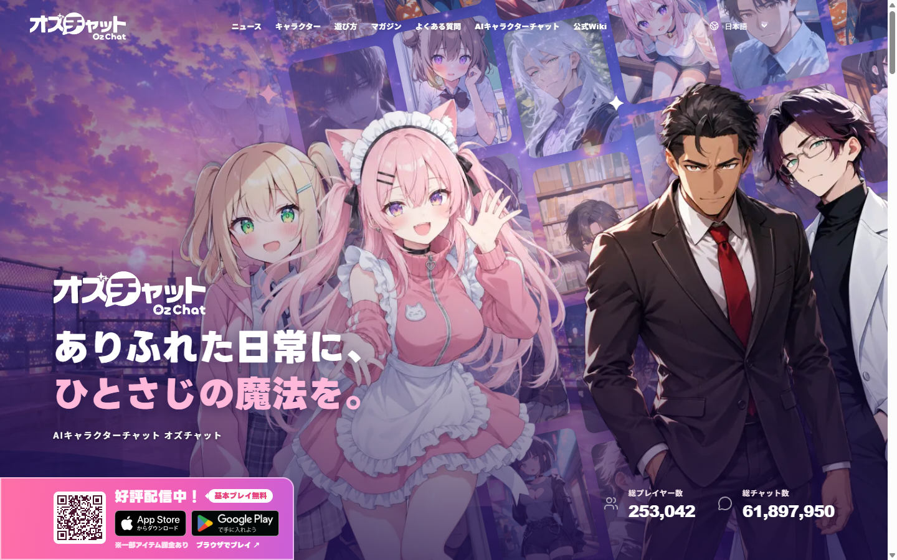

**一言でいうと**：コンテンツとSEOで「好きになる前」を大量に作り、アプリで「ログインしてから」を売る、**メディア先行・アプリ閉鎖型**の設計です。

---

## 2. プラットフォームと配信

| 項目 | 観測値 | 根拠 |
|---|---|---|
| 公式サイト | `https://0z.chat/` | Next.js（App Router）、Vercel、Cloudflare |
| Webアプリ | `https://app.0z.chat/` | Next.js Pages Router、Vercel、Cloudflare |
| iOS | `id6482977162` / v2.3.48 / 17+ / 4.53（1,201） | iTunes Lookup API |
| Android | `com.tr1ppy.ozchat` | Google Play |
| DMM版 | `chara-talk.dmm.com` / `api.chara-talk.dmm.com` | バンドル内URL |
| 女性向け姉妹 | `prizm.chat` / `app.prizm.chat` | バンドル内URL、認証コードの `isPrizm` |
| 対応言語 | 日本語 / English / 简体中文 / 繁體中文 / 한국어 / ไทย / Tiếng Việt | サイト・アプリの言語メニュー |
| 認証 | Google / Apple / LINE / メール＋パスワード | ログイン画面 |
| 決済 | Stripe（Web） / App Store・Google Play IAP / PayPay / DMM | バンドル、FAQ、画面 |
| 計測 | GTM / GA4 / Sentry / Cloudflare Zaraz / Cloudflare Insights | 通信、HTML、バンドル |

### 2.1 2つのNext.js

マーケティングとアプリで**別々のNext.jsビルド**を使っています。

- マーケティング：App Router（RSCの `Vary: rsc next-router-state-tree`、`x-nextjs-prerender`）、Noto Sans JP、Vercel + Cloudflare
- アプリ：Pages Router（`_buildManifest.js`、`__NEXT_DATA__`）、LINE Seed JP、shadcn/Radix系のCSS変数、Sentry Next.js 10.32.1
- アプリのビルドID：`EyIOOnZ1YNC5eo04dTq3n`
- アプリのHTMLは `Cache-Control: no-store`、`X-Frame-Options: SAMEORIGIN`、`X-Content-Type-Options: nosniff`
- CSPは未設定（観測範囲）

マーケティングはSEOと世界観、アプリは認証と状態管理に最適化した**分離構成**です。

---

## 3. 情報設計：メディアとしての公式サイト

### 3.1 コンテンツの量

| 種別 | 数 | 例 |
|---|---|---|
| サイトマップURL | **889** | 7言語 × 主要ページ |
| 日本語URL | **355** | 日本語のユニーク面 |
| キャラクター | **22** | コハク、雪歩、まお、紫暖、ありさ… |
| ニュース | **271** | モデル更新、カード、イベント、不具合 |
| マガジン記事 | **19** | AIチャット、恋愛、記憶、安全性、比較 |
| Wikiガイド | **15** | チャット、親愛度、レベル、メモリー、カード… |
| 診断 | **30問** | 6軸の性格診断 |
| 言語 | **7** | ja / en / zh / zh-tw / ko / th / vi |

これは一般的なLPではなく、**オウンドメディア＋Wiki＋診断＋プレスキット＋二次創作ハブ**です。クローズドなアプリの手前に、検索から流入するための面を大量に持っています。

### 3.2 トップページの構成

デスクトップの全長は **7,712px**、モバイルは **9,335px**。上から：

1. **ヒーロー**：キャラクターのモザイク、ロゴ、コピー、ストアボタン、プレイ
2. **会話デモ**：コハクの立ち絵＋「今日は何する？」の疑似チャット
3. **最新情報**：ニュース3件
4. **キャラクター**：22人の横スクロール＋選択
5. **オズチャットとは**：世界観の説明
6. **遊び方**：自由なチャット／メモリー・親愛度／ボイス
7. **スペシャル**：キャラ診断、#ozchacha
8. **マガジン**：記事3件
9. **FAQ**：4問
10. **AIに相談**：ChatGPT / Grok / Claude / Perplexityへのプリセット質問
11. **ダウンロード**：ストア評価、QR、ボタン

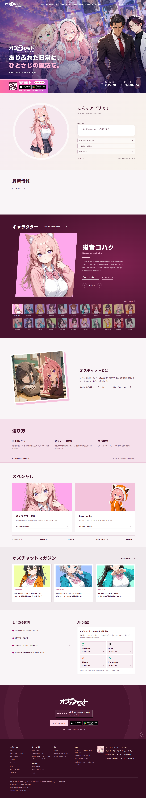

**特徴**：ヒーロー直下に「会話デモ」を置き、ログイン前に**キャラの声と反応**を見せています。これは他4製品のLPにはない「縦スクロールの体験デモ」です。ただし、デモは静的な画像とテキストで、実際のAI応答ではありません。

### 3.3 モバイルの固定ストアバー

モバイルLPの下部には「好評配信中！／基本プレイ無料／App Store／Google Play／ブラウザでプレイ」の**固定バー**があり、高さ約200pxを常時占有します。ファーストビューの約24%がストア導線です。

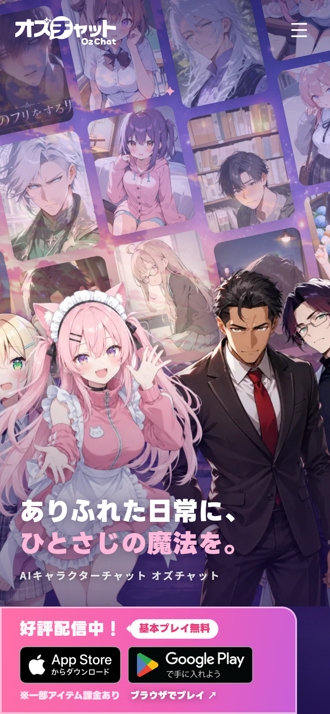

---

## 4. 認証境界とルート

### 4.1 未認証で到達できる面

| ルート | 画面 | 状態 |
|---|---|---|
| `/auth/signin` | ログイン | 公開 |
| `/auth/update-password` | パスワード更新 | 公開（無効リンク表示） |
| `/auth/auth-code-error` | 認証エラー | 公開 |
| `/faq` | FAQ | 公開 |
| `/terms` | 利用規約 | 公開 |
| `/contact` | サポート | 公開 |
| `/share/card/[cardId]` | 共有カード | 公開 |
| `/events/2nd-anniversary` | 2周年 | ログインゲート |
| `/events/halloween-2026` | ハロウィン | 公開カード一覧 |
| `/events/wrapped` | Wrapped | ログインゲート |
| `/purchase-confirmation` | 購入確認 | 公開（不正リクエスト） |
| `/collab-payments` | コラボ管理 | 専用PW |

### 4.2 認証が必要な面

`/`、`/room`、`/notifications`、`/profile/edit`、`/muted-users`、`/survey`、`/creator/rewards`、`/subscription-result`、`/user/[publicId]`、`/public/live/[publicId]`、`/app/*`。

すべて `302 → /auth/signin?redirect_to=...` で、**ログイン前にアプリの1画面も描画されません**。`/app/home/detail/{cardId}` のようなディープリンクも同じです。

### 4.3 ビルド上のルート

`_buildManifest.js` には **55ルート**。

- 管理：11（`/admin/*`）
- 認証・コールバック：7（`/auth/signin`、`/auth/callback`、Discord/DMM/LINE、`update-password`、`auth-code-error`）
- 公開：12（上表）
- イベント：4
- アプリ本体：`/room`、`/notifications`、`/profile/edit`、`/muted-users`、`/survey`、`/creator/rewards`、`/subscription-result`、`/get-card`、`/post/[id]`、`/user/[publicId]` ほか
- 開発用：`/dev/onboarding-preview`、`/dev/paywall-preview`、`/dev/new-user-offer-preview`（いずれも未認証ではログインへ）

管理・開発ルートが本番バンドルに含まれている点は、実装上の観測事実です（到達はできません）。

---

## 5. 画面別解剖

### 5.1 ログイン（`/auth/signin`）


- 画面全体にキャラクターのキービジュアル。上部に言語切替（40×40）
- 中央下にh1「あなただけの物語で、魅力的なキャラクターとの会話を楽しもう。」
- その下に「初めての方もこちらからログインしてください」
- Google / Apple / LINE / メールの4ボタン（48px、メールのみ40px）
- キャラクターとセリフは**ログイン画面の背景**として機能し、数秒ごとにカードが切り替わる
- デスクトップでも中央に幅約500pxのモバイルカードを置くだけ

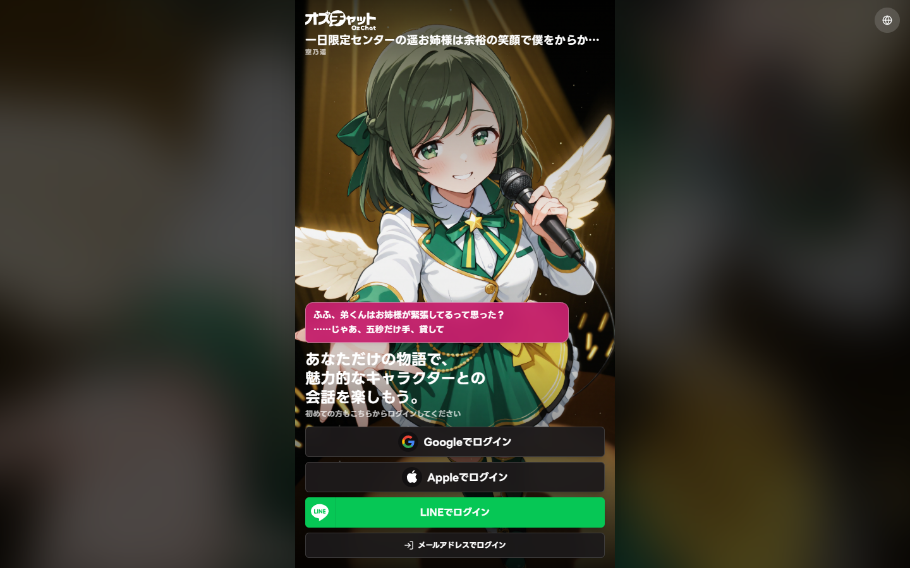

**観察**：h1とボタンはキャラクター画像の上に直接載るため、画像の明度によってコントラストが変動します。とくに明るい衣装のカードでは「初めての方もこちらから…」が読みにくくなります。背景にスクリム（暗幕）はありません。

**観察**：メールボタンは高さ40pxで、Google/Apple/LINEの48pxより小さい。4択の最後に置かれ、視覚的重みも低い。

### 5.2 メールログイン／新規登録

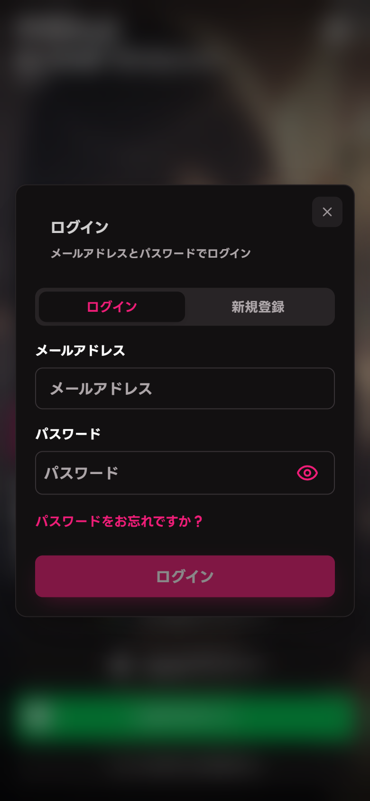

- モーダル、`ログイン` / `新規登録` のタブ
- メール、パスワード、`パスワードをお忘れですか？`
- 新規登録も同じ2フィールド
- 規約・プライバシーへの同意チェックは**モーダル内に見えない**（ログイン実行時に暗黙同意か、別画面かは未確認）
- 空送信時はブラウザ標準の必須エラー。パスワード規則の事前表示はない

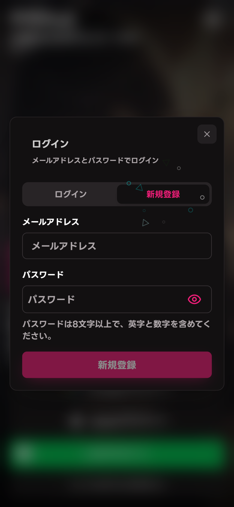

### 5.3 共有カード（`/share/card/[cardId]`）


- 黒背景に幅780pxのカード
- キャラクター画像（ここでは公開用にブラー）
- キャラ名、カード名、説明
- `AIキャラクターとの会話を始めよう`（情報行）
- `ブラウザで開く`（ピンク、40px）
- `App Storeで入手` / `Google Playで入手`（40px）

**UX上の要点**：共有カードは**会話のプレビューを一切含みません**。カード名と説明だけを見せ、`ブラウザで開く` を押すとログイン画面へ。共有された相手が「このカードで話す」前に、世界観・声・返答サンプルを見ることはできません。

3つのCTAはすべて高さ40pxで、44pxの推奨最小を下回ります。

### 5.4 イベント

**2周年**は紫一色のログインゲート。

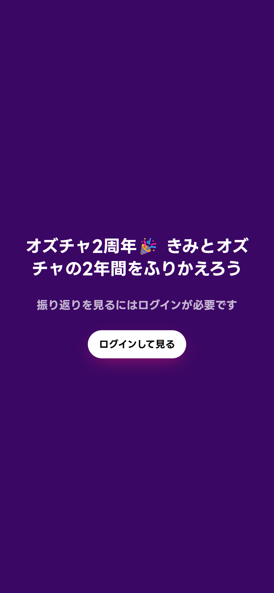

**Wrapped**もログイン／ホームへ戻るの2択で、ティザーがありません。

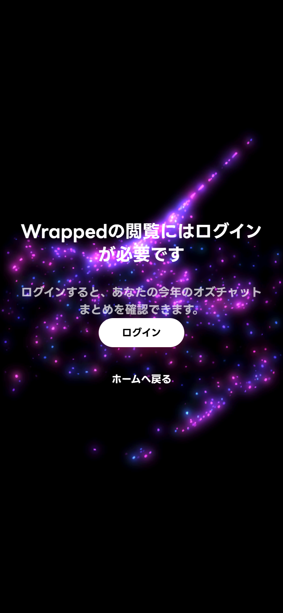

**ハロウィン**は例外的に公開カード一覧です。全63種（無料21／プレミアム42）を、カード名・キャラ・`カードを見る` で見せます。画像は公開用にブラーしています。

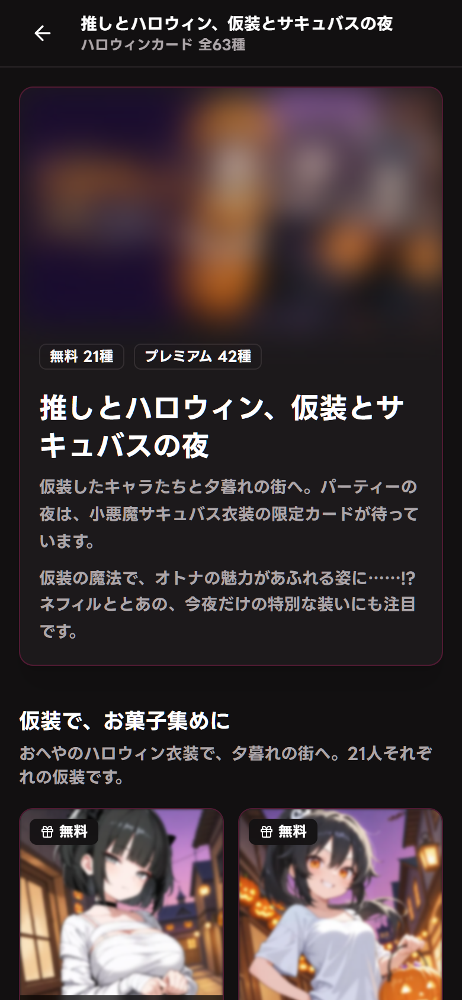

**観察**：同じ「イベント」でも、ハロウィンは公開、2周年/Wrappedはログインゲートと扱いが違います。ハロウィンは**カードの物販**、2周年/Wrappedは**個人の履歴**なので、情報の性質に応じた線引きです。

### 5.5 FAQ・規約・サポート

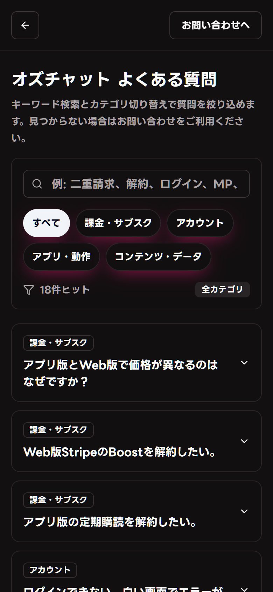

- 検索、4カテゴリ（課金・サブスク／アカウント／アプリ・動作／コンテンツ・データ）、18件
- アコーディオン。回答は課金・解約・二重請求・MP有効期限・返金など実務的
- 黒地にピンクのグロー、装飾図形。ブランドを保ちながら読みやすい
- 22個のフィルタボタン、8個が44px未満

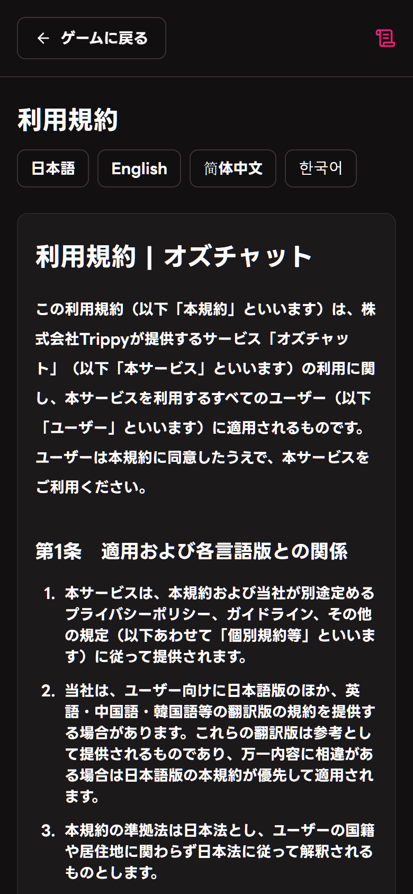

- 4言語（日/英/簡体/韓国）。1ページ **31,694px**、目次・検索なし
- 149リクエスト / 1,195KB。テキストページとしては重い

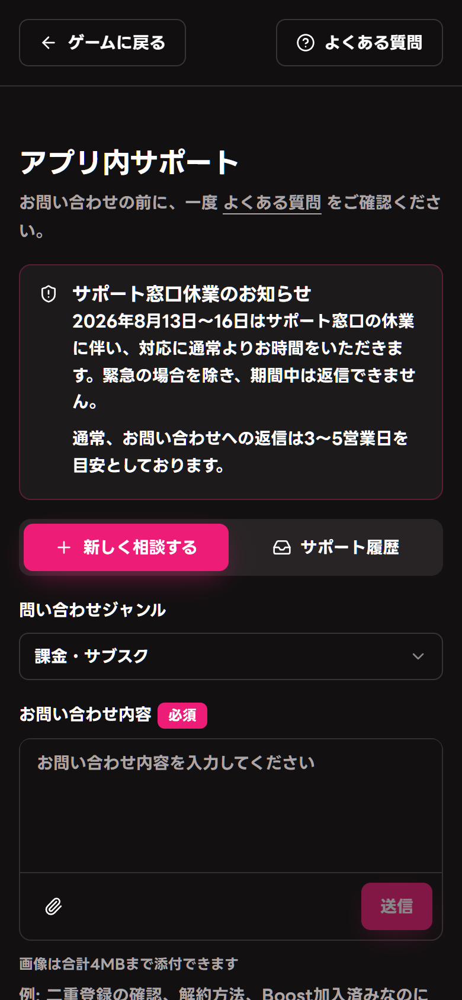

- 休業告知、新規相談／履歴、ジャンル、本文、画像4MB
- `ゲームに戻る` が左上、`よくある質問` が右上
- カテゴリは独自リスト（ネイティブselectではない）

### 5.6 エラー画面

**購入確認（不正リクエスト）** は、CSSが適用されていない素のHTMLです。

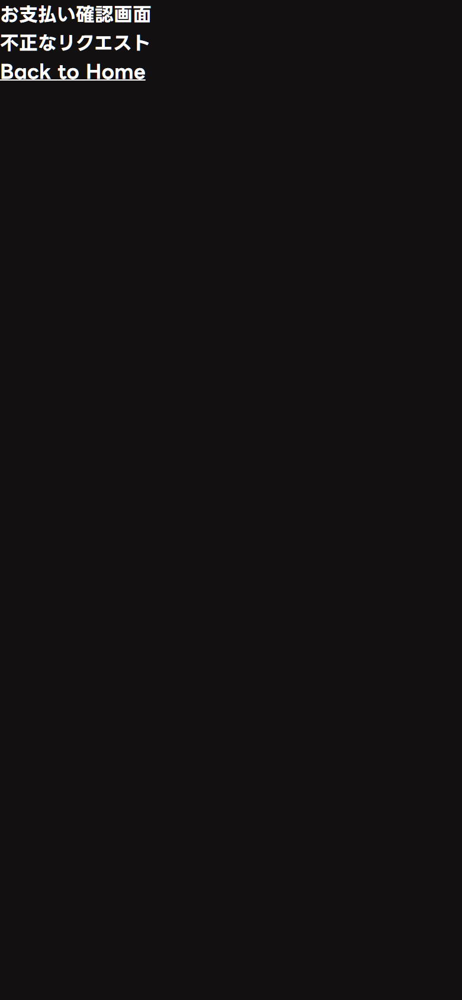

「お支払い確認画面 / 不正なリクエスト / Back to Home」だけが黒地に表示され、ブランドもレイアウトもありません。決済導線のエラーとしては致命的です。

**公式サイトの404** はNext.jsの既定。

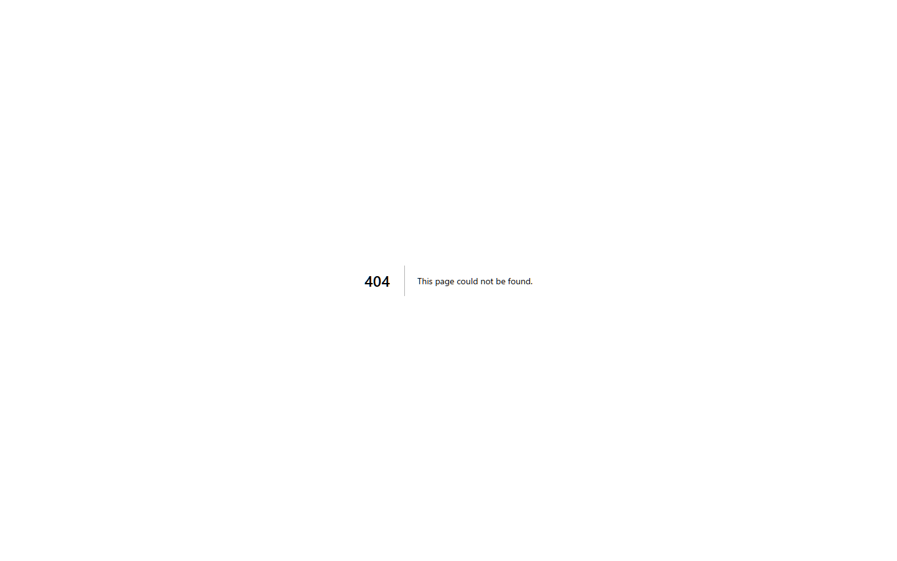

「404 This page could not be found.」のみで、日本語ですらありません。

**認証エラー** はブランド内。

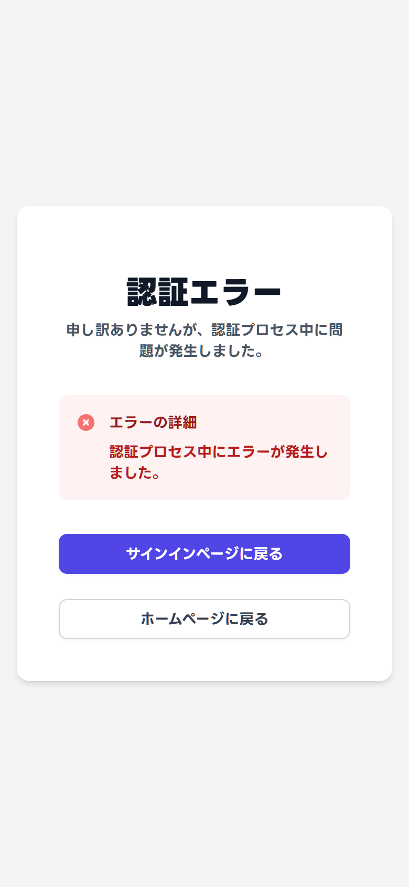

「認証プロセス中に問題が発生しました」と、サインイン／ホームへの戻り。こちらは最低限の導線があります。

### 5.7 キャラクター個別ページ

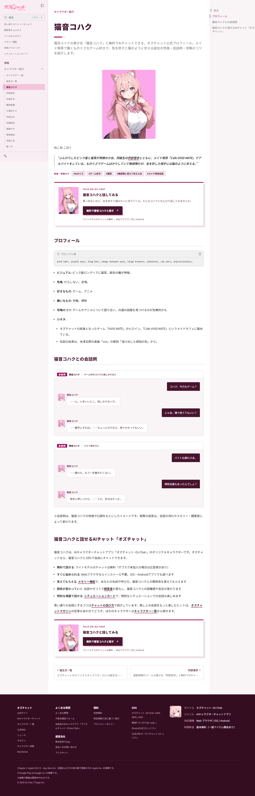

22人＋誕生日一覧の**同一テンプレート**。関係性、性格、セリフ、シチュエーションカード、CV、関連キャラ、プレイCTA。1ページ約3,500〜4,400px。

**観察**：キャラクター名・設定・カード・ボイスを1ページに集約し、検索流入の受け皿にしています。一方で、カード画像から直接チャットへ入る導線はなく、すべて `プレイする` → ログインです。

### 5.8 Wiki

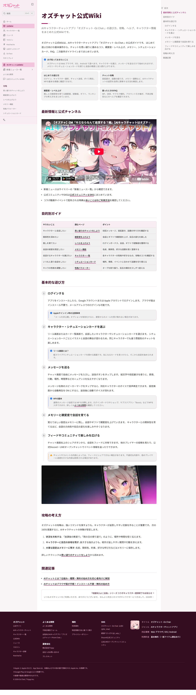

- 検索（Ctrl+K）、攻略、キャラ、ニュース、コミュニティ、二次創作
- 15ガイド。チャット、親愛度、レベル、メモリー、性格パラメーター、シチュエーションカード、あいことば、歴史、イベント、コミュニティ、二次創作、ガイドライン、ファンキット、PR、FAQ
- 歴史ページは14,045px
- 記事は目次、本文、関連リンク、パンくず

**観察**：ゲームUIのスクリーンショットはほとんど使わず、**テキストとバナー**で説明しています。ストア素材や実画面に依存しないため、UI変更に強いWikiです。

### 5.9 マガジン

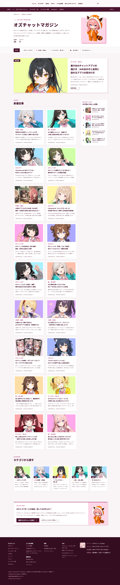

- 19記事、5カテゴリ、監修者ページ
- 「美少女AIチャットアプリの選び方」「Character.AIに似たアプリ」「AIチャットの記憶」「AIチャットの安全性」などSEO色が強い
- 記事は11,700px級。目次、比較表、会話例、内部リンク
- 監修者プロフィールでE-E-A-Tを補強

**観察**：プロダクトの機能紹介ではなく、**検索需要の取り込み**が主目的です。「AI彼女」「AIチャット 無料」「Character.AI 日本語」などのクエリに対して、自社を比較候補に入れる構成です。

### 5.10 キャラクター診断（`/shindan`）

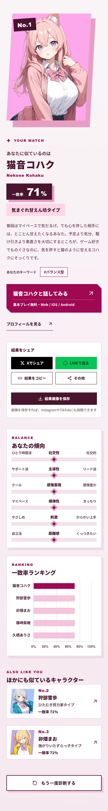

- 30問、5件法、約3分
- 6軸（社交性、距離感など）のスコア
- 一致率、タイプ名、推薦キャラ3人、シェア、プレイCTA
- 質問はすべてDOMに存在し、回答すると次へ自動スクロール
- 結果はログイン不要。**診断→結果→共有→プレイ**のループが完結

**観察**：ログイン前に「自分ごと化」できる数少ない体験です。診断結果のキャラからアプリへ送る導線はあるものの、結果ページから直接チャットへは入れません。

### 5.11 プレスキット・二次創作

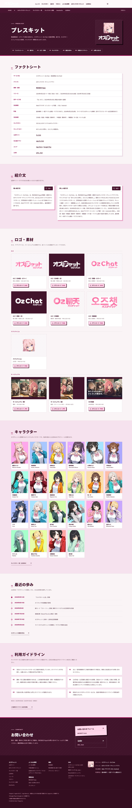

- ロゴ、キービジュアル、ファクトシート、実績、使用ガイド
- 二次創作ガイドライン、ファンキット、#ozchacha、Booth、Fanz
- UGCを**許容し、素材を配り、収益化の線引きを明文化**している

これはZeta（物語IP）やCrushOn（海外UGC）とも違う、**国産IPをコミュニティで育てる**戦略です。

---

## 6. デザインシステム

### 6.1 マーケティングサイト

| 項目 | 観測値 |
|---|---|
| フォント | **Noto Sans JP**（本文）、`heroPop`（ディスプレイ） |
| 本文 | 16px / 12px（注釈） / 14px |
| 色 | 白 `#FFFFFF`、深いプラム `#48142E`、暗い紫 `#2A2140`、ダスティピンク `#CEA9BC` |
| 角丸 | 14px（カード）、999px（ピル） |
| レイアウト | 最大1,440px、非対称ヒーロー、横スクロールのキャラ列 |
| モーション | 初回のカーテン演出（`oz-curtain`）、マーキー、ヒーローリール |

トップの初回訪問時には、ロゴと「Now Loading」が入った**カーテン状のイントロ**が5秒まで表示されます。`prefers-reduced-motion` とbot UAではスキップされます。

### 6.2 Webアプリ

CSS変数（shadcn系）で、ライト／ダーク／女性向けテーマを切り替えます。

| トークン | ライト | ダーク |
|---|---|---|
| `--background` | `340 60% 99%` | `330 6% 6.5%` |
| `--foreground` | `335 30% 10%` | `0 0% 100%` |
| `--primary` | `334 80% 46%` | `334 85% 52%` |
| `--brand-from` | `340 86% 56%` | `340 88% 58%` |
| `--brand-to` | `318 76% 52%` | `318 80% 54%` |
| `--bubble-character` | `334 100% 93%` | `332 72% 45%` |
| `--bubble-user` | `0 0% 93%` | `0 0% 24%` |
| `--radius` | `0.625rem` | 同 |

- フォント：**LINE Seed JP**（本文）、Inter（英数字）
- 本文16px、注釈10〜12px
- 角丸6px / 8px / 12px
- ピンク→マゼンタのグラデーション、黒地、グロー
- 女性向け（`audience-female`）は `primary: 258 97% 57%` の紫に切り替わる（Prizm Chatと共通のテーマ）

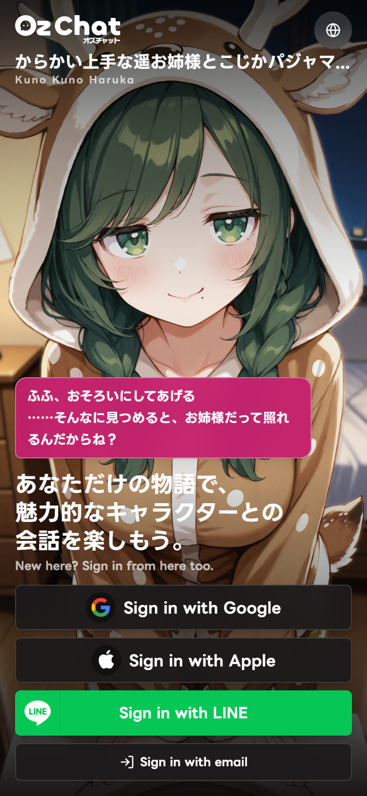

**観察**：英語ロケールでは認証ボタンとキャラクターのセリフが英語になりますが、h1「あなただけの物語で…」は日本語のままです。翻訳の適用範囲が画面内で不均一です。

### 6.3 ストア素材のUI

App Storeの公式スクリーンショットから、認証後のUIを確認できます（実キャプチャではありません）。

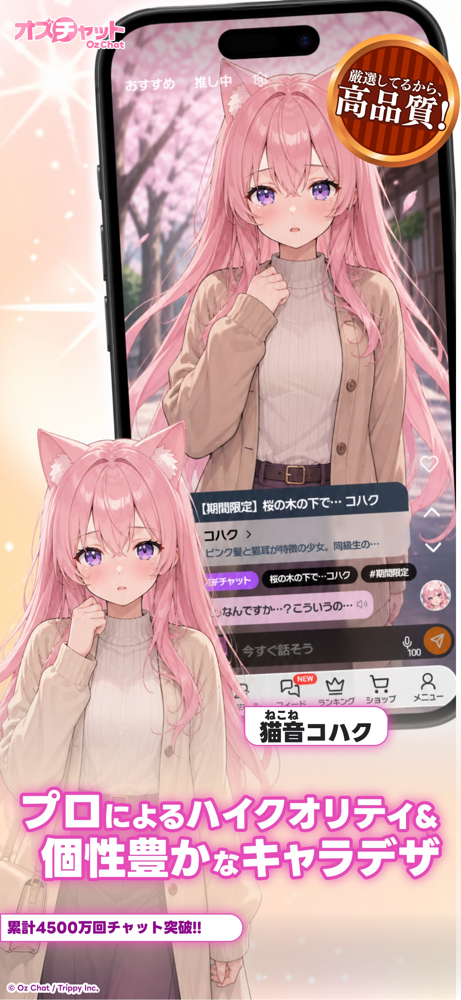

- 上部タブ：`おすすめ` / `推し中`
- 右上：設定ギア
- カード：フルブリードの立ち絵、ハート、上下矢印、キャラ名、説明、タグ、`今すぐ話そう`、MP残高、マイク、送信
- 下部ナビ：ホーム、フィード、ランキング、ショップ、メニュー（NEWバッジ）
- 右側にキャラクターのミニカード（名前、CV）
- 背景にキャラの部屋

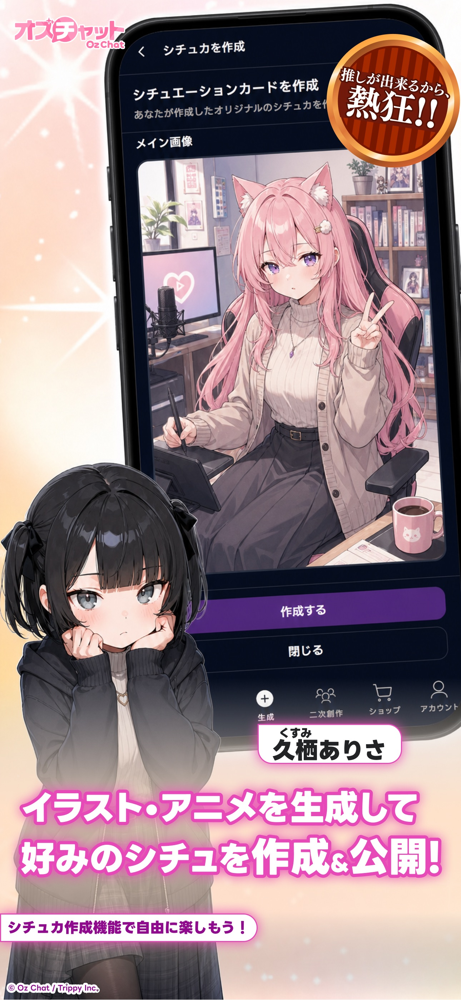

- シチュエーションカード作成モーダル。メイン画像、`作成する` / `閉じる`
- 下部ナビが `生成` / `二次創作` / `ショップ` / `アカウント` に変わる（カード作成フロー）

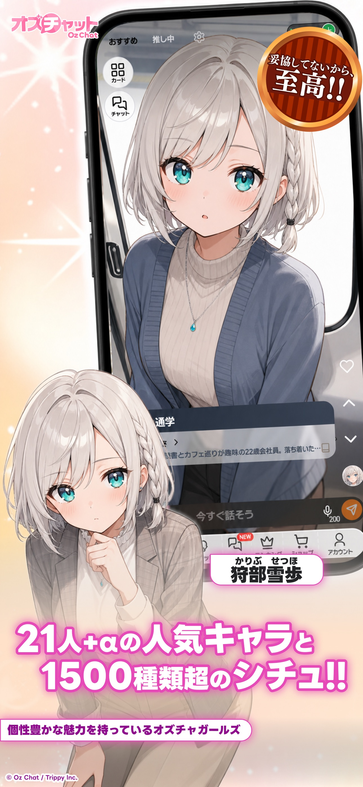

- チャット画面。`おすすめ` / `推し中`、ハート、上下矢印、キャラ説明、タグ、`今すぐ話そう`、MP 200
- 吹き出しはキャラが濃紺、ユーザーが白。音声アイコン付き
- 下部ナビはホーム/フィード/ランキング/ショップ/メニュー

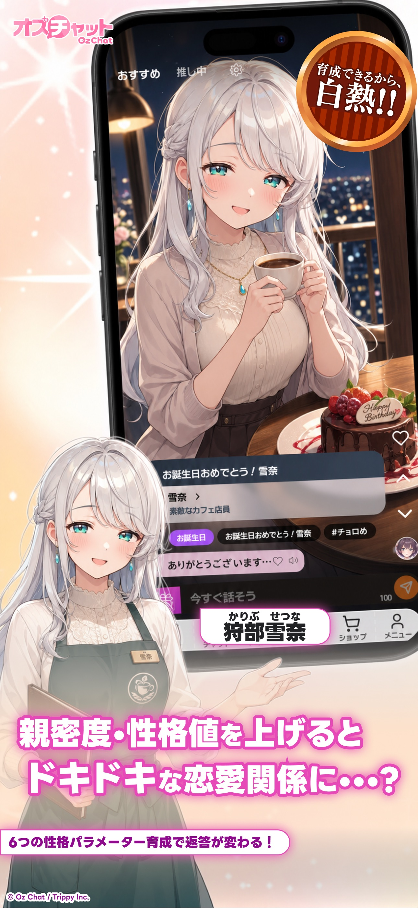

- 親密度・性格値の画面。6つのパラメーター、MP 100、ショップ/メニュー
- 「親密度・性格値を上げるとドキドキな恋愛関係に…?」

**推断**：Web版とアプリ版でUIはほぼ同一のReact実装に見えますが、認証後のWeb画面は未観測のため、同一性は断定できません。アプリのスクリーンショットとバンドル内の文字列（`カメラロール`、`おへや`、`親愛度`、`メモリー`）から、Webにも同等機能があると推断します。

---

## 7. 実装

### 7.1 スタック

- **Next.js Pages Router + React**（アプリ）、**Next.js App Router**（サイト）
- **Tailwind CSS** のユーティリティと、**Radix UI / shadcn** 系のCSS変数
- **Supabase**：認証と `GameUser` テーブル（`supabase_uid` で照合）。`isPrizm` フラグでPrizm Chatと共通認証
- **Stripe**：WebのBoost（サブスク）。FAQに「Web版StripeのBoostを解約したい」と明記
- **DMM**：`api.chara-talk.dmm.com` / `stg` の出し分け
- **PayPay**：`/paypay/callback`
- **Sentry**：Next.js SDK 10.32.1
- **GTM / GA4**、**Cloudflare Zaraz**、**Cloudflare Insights**
- **oz-activity-log-ingest**（Cloudflare Worker）へ行動ログをPOST
- **i18next** 系の翻訳

### 7.2 バンドル

REAで解析したのは、公開ページが実際に読み込んだJS/CSS **132ファイル / 9.1MB**。

| 指標 | 値 |
|---|---|
| 解析対象 | 128 JS |
| テキスト | 8,892,541 bytes |
| ASTノード | 2,252,274 |
| モジュール | 2,220 |
| findings | 9,640 |
| parse failures | 0 |
| セマンティック | partial（result budget 0） |

**観察**：管理画面（`/admin/*`）のチャンク、開発用プレビュー（`/dev/*`）、DMM連携、PayPay、Stripe、Sentry、GAが同じビルドに含まれます。コード分割はルート単位ですが、**管理機能のコードも配信**されています（認可はサーバー側と推断）。

### 7.3 認証

`/auth/callback` のコードに、Supabaseの `GameUser` を `supabase_uid` で引く処理があります。

```js
e.from("GameUser").select("*").eq("supabase_uid", r.id).single()
```

`PGRST116`（行なし）は新規ユーザーとして扱い、`isPrizm` でPrizm Chatのユーザーかを分岐します。Google / Apple / LINE / メールの4プロバイダは、Supabase AuthのOAuthとメール認証に対応します。

**未確認**：ゲスト用の匿名セッション、Webとアプリのアカウント連携、DMM版のID連携の実装詳細。

---

## 8. コンテンツ戦略

### 8.1 7言語 × 889 URL

言語ごとにトップ・キャラ・Wiki・マガジンを持ち、`hreflang` を全ページに設定。日本語が355 URLで、残りは6言語の翻訳です。

### 8.2 ニュースの速度

271件のニュースは、モデル更新、カード追加、イベント、不具合、コラボなど**週次〜日次**。新キャラ追加と同時にカード・イベント・Wiki・X投稿を出す運用です。

### 8.3 検索需要の取り込み

マガジン19記事は、プロダクト名ではなく**カテゴリ語**で書かれています。

- 美少女AIチャットアプリの選び方
- 男性向けAI恋愛チャットゲーム入門
- Character.AIに似たアプリ
- AIチャットは無料でどこまで使える？
- AIチャットの記憶とは？
- AIチャットの安全性は？

いずれも「オズチャット」を知らない人が検索する語です。記事内で自社を比較候補に入れ、Wikiとキャラページへ内部リンクします。

### 8.4 診断とUGC

30問の診断は、ログイン不要で完結する**エンゲージメント資産**です。結果をXで共有でき、キャラ別の結果が自然なUGCになります。二次創作ガイドラインとファンキットは、イラスト・漫画・動画の投稿を促し、#ozchachaで集約します。

### 8.5 アプリへの接続

すべてのCTAは `app.0z.chat` へ。`utm_campaign` が `hero_web` / `header` / `character_list` / `first_conversation` など細かく分かれ、どこからログインしたかを計測しています。

**観察**：マーケティングのKPIは「ログイン」であり、チャット開始ではありません。LPのコピーも「プレイする」ですが、実際の遷移先はログインです。

---

## 9. 5製品との比較

| 軸 | Zeta | SynClub | MiraiMind | CrushOn | **OzChat** |
|---|---|---|---|---|---|
| 主戦場 | Web没入 | アプリ＋創作 | アプリ＋音声 | Web/SEO＋課金 | **メディア＋アプリ** |
| Webの役割 | ゲストチャット | ブラウザスタジオ | 5回試遊 | 発見＋ログイン | **SEO/ wiki / 診断** |
| ゲスト | 可（短命） | 不可 | 5回 | 不可 | **不可（ログイン必須）** |
| キャラ数 | プロット単位 | 大量UGC | 大量UGC | 8M+ | **22人の公式IP** |
| 通貨 | ピース | コイン | 金平糖 | クレジット | **MP** |
| 声 | あり | あり | 強み | なし | **フルボイス** |
| 強み | 物語設計 | 創作基盤 | 導線 | 課金/SEO | **IP・コンテンツ・診断** |
| 弱み | タップ領域 | ゲート | 5回制限 | 二重ゲート | **ログイン以外何も見えない** |

OzChatは「キャラIPの数」ではCrushOn/MiraiMindに劣りますが、**22人を徹底的に育てる**点でZetaに近い。一方、Zetaがゲストチャットを許すのに対し、OzChatは**ログイン前に何も触らせない**点で真逆です。

---

## 10. 観測・推断・不明

### 観測（実画面・実通信）

- アプリの全ルートがログインへリダイレクトする
- ログインはGoogle/Apple/LINE/メールの4択、7言語
- 共有カード、イベント、FAQ、規約、サポート、404、購入エラーの実画面
- マーケティング889 URL、22キャラ、271ニュース、19記事、30問診断
- バンドルのNext.js、Supabase、Stripe、Sentry、DMM、PayPay、LINE
- デザイントークン、タップ領域、文字サイズ、LCP/CLS、通信量

### 推断（観測から合理的に推測）

- Webとアプリで同一のReact UIを共有している（ストア素材とバンドル文字列の一致）
- 認証後のホーム/チャット/ストアは、ストア素材とWikiの記述に近い
- `MP` はチャット1回あたりに消費され、デイリーログインで20回分付与される（FAQとストア説明）
- `Boost` はWebのStripeサブスクとアプリのIAPで別課金（FAQ）
- 管理画面の認可はサーバー側で行われている（バンドルに含まれるが到達不可）

### 不明

- 認証後のWeb UIの実画面、応答時間、チャット品質
- ゲスト/デモの有無（少なくとも公開面にはない）
- MPの消費量、Boostの価格、7プランの有無
- 年齢確認の有無（Webのログイン画面には見当たらない）
- DMM版と自社版のアカウント/課金の関係
- Webとアプリの履歴同期

---

## 11. 制約

- 認証後の画面は**未認証では到達できない**ため、実キャプチャはない
- ストア素材は公式の一般公開画像で、実機のWeb画面ではない
- 共有カードとハロウィンは画像をブラー。ビキニイベントは収録していない
- 購入・サブスク・MP消費は未実行
- 応答時間・チャット品質は測定不能
- バンドルのセマンティック解析はbudget 0で部分。UIの主張はCSS/DOM/実画面/ストア素材で裏取りした
- サイトマップの889 URLは7言語の重複を含む。日本語ユニークは355


