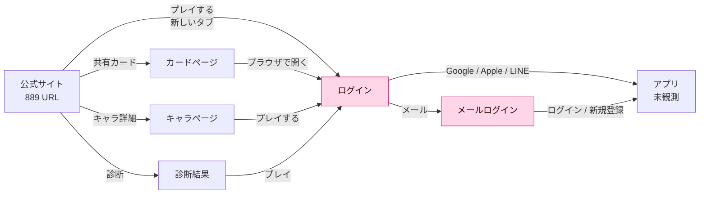
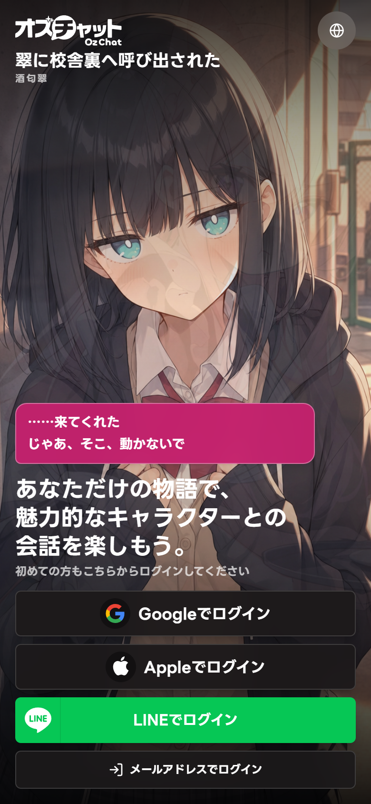
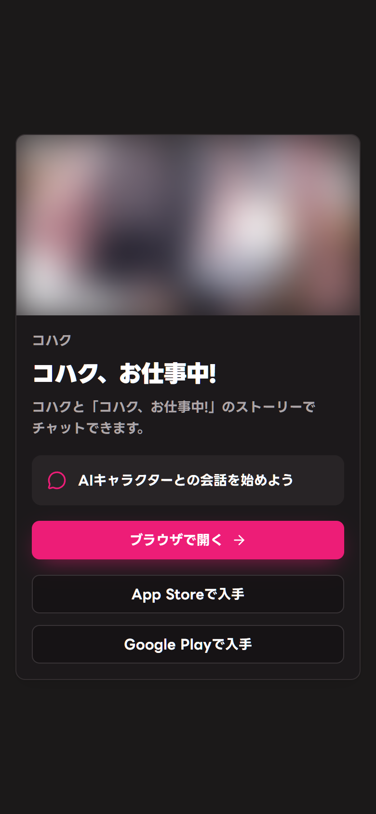
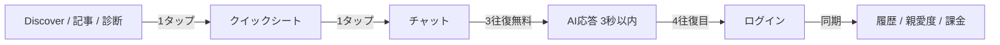

# オズチャット -Oz Chat- — UX リバースエンジニアリング

「最初の会話」に到達するまでを、他4製品と同じハーネス（Playwright + Chrome headful、390×844 / DPR2 / ja-JP）で追跡しました。OzChatは**Webアプリがログイン必須**のため、認証後のチャット応答は測定できません。代わりに、**マーケティング→アプリ→ログイン**のハンドオフ、認証UI、共有カード、イベント、エラー、コンテンツ資産を実測しています。

> 測定日：2026-10-26 / 生データ：`evidence/ozchat/ux-raw.json` / `data/ux-metrics.json` / `data/ux-flows.json`
> 認証回避は行っていません。認証後は未観測です。

---

## 1. 5製品サマリー

| 指標 | Zeta | SynClub | MiraiMind | CrushOn | **OzChat** |
|---|---|---|---|---|---|
| 最初のチャットまでのタップ | 2 | 不可 | **1** | 3 | **不可（ログイン）** |
| 最初の送信までのタップ | 3 | 不可 | **2** | 4 | **不可** |
| チャット前に挟まる画面 | 2 | 0 | 1 | 3 | **1（ログイン）** |
| カード→チャット表示 | 2.13s | — | **1.05s** | 2.09s | — |
| 送信→最初のAI応答 | **3.19s** | — | **2.96s** | 不可 | — |
| ゲスト送信 | 可（短命） | 不可 | **5回** | 不可 | **不可** |
| ゲートの種類 | ソフト | QR | 5回制限 | 送信時ログイン | **ログイン first** |
| ゲート位置 | 保存/購入 | カードタップ | 6回目 | 送信時 | **全画面の前** |
| ヒューリスティック（/50） | 34 | 26 | **35** | 31 | **32** |

OzChatは「最初のチャットまでのタップ数」が**定義できない**唯一の製品です。ログインしないとアプリの1画面も表示されないため、タップ数は0でも無限でもなく、**N/A**と表現するのが正確です。

---

## 2. ファネル

**観察**：すべての道がログインに収束します。共有カード、キャラページ、診断結果、イベントのどこから入っても、**アプリの価値に触れる前に認証**が必要です。

### 2.1 ハンドオフの実測

| 項目 | Desktop 1440×900 | Mobile 390×844 |
|---|---|---|
| 公式サイト LCP | 1.62s | 1.35s |
| CLS | 0.0004 | 0 |
| `プレイする` → アプリURL | **2.99s** | **2.80s** |
| ログインボタン表示 | **3.01s** | **2.82s** |
| 新しいタブで開く | はい | はい |
| ログイン画面の通信量 | 1,334KB / 60 req | 1,386KB / 62 req |

**観察**：新しいタブで開くため、認証後に元のキャラページへ戻れません。`redirect_to` はアプリ内のパスだけを保持し、マーケティングサイトの文脈は失われます。

**推奨**：同一タブ遷移にし、`redirect_to` に元のキャラ/カード/記事を含める。認証後に「さっき見ていたカード」へ戻す。

---

## 3. ログイン first というゲート

### 3.1 4つの認証手段

- Google / Apple / LINE / メール
- 国内向けにLINEがあるのは強い。AppleはiOSアプリとの連携、GoogleはAndroid/Webの標準
- メールは最後に置かれ、ボタン高さ40px（他は48px）
- パスワードレス（マジックリンク）はない
- 新規登録も同じモーダルで、規約同意のチェックがない

**観察**：認証手段の網羅性は5製品で最も高い。一方で「初めての人がどれを選べばいいか」の説明はなく、4択を並べるだけです。

### 3.2 メール認証の手数

| ステップ | 操作 | 時間 |
|---|---|---|
| 1 | `メールアドレスでログイン` | — |
| 2 | モーダル表示 | **1.27s** |
| 3 | メール入力 | — |
| 4 | パスワード入力 | — |
| 5 | `ログイン` / `新規登録` | — |

**観察**：2フィールドで完結するのは良い。ただし、新規登録時のパスワード規則、規約同意、メール確認の有無が事前に分かりません。空送信はブラウザ標準の「このフィールドを入力してください」で、ブランドのトーンから外れます。

### 3.3 ログイン画面のコントラスト

h1と認証ボタンはキャラクター画像の上に直接載ります。画像の明るい部分（白い衣装、肌、背景の光）では、白文字のコントラストが低下します。スクリムがないため、カードによって可読性が変わります。

**推奨**：画像の上に `linear-gradient(180deg, transparent 30%, rgba(0,0,0,.72))` のスクリムを敷く。あるいはテキストブロックだけ暗いパネルに載せる。

---

## 4. 共有カードの断絶

共有カードは、XやDiscordで拡散するための**外部向け面**です。しかし：

- 会話プレビューがない（カード名と説明だけ）
- キャラクターの声・性格・関係性が見えない
- `ブラウザで開く` → ログイン（718ms）
- CTAは3つとも高さ40px
- カード画像は`object-fit: cover`で、顔ではなく胸元が大きく見切れる場合がある

**観察**：共有された側の関心は「このカードでどんな会話ができるか」ですが、ページは**カードの説明**しか与えません。`ブラウザで開く` の先はログインで、共有の熱が最も高い瞬間に認証を要求します。

**推奨**：
1. カードページに**3往復の会話プレビュー**（公式のサンプル、AI生成でなくてよい）を載せる
2. `このカードで話す` → ログイン。認証後に**同じカードのチャット**へ直行
3. CTAを44px以上に
4. 画像の `object-position` を顔に合わせる

---

## 5. コンテンツは強いが、アプリの価値が見えない

### 5.1 ログイン前の資産

| 資産 | 数 | ログイン要否 |
|---|---|---|
| キャラクターページ | 22 | 不要 |
| Wikiガイド | 15 | 不要 |
| ニュース | 271 | 不要 |
| マガジン記事 | 19 | 不要 |
| 診断 | 30問 | 不要 |
| 共有カード | 多数 | 不要 |
| **チャット** | — | **必要** |
| **ボイス** | — | **必要** |
| **カード収集** | — | **必要** |
| **親愛度/メモリー** | — | **必要** |

**観察**：ログイン前に「世界観」は大量に渡していますが、「遊びの手触り」はゼロです。Zetaは3タップでAIの返答を見せ、MiraiMindは5回送れます。OzChatは**LPの会話デモ（静的）**しかなく、AIが返す体験はログイン後だけです。

### 5.2 診断の可能性

診断はログイン不要で、結果に一致率・6軸・推薦キャラ・シェアが出ます。これは**ログイン前の数少ない「自分ごと化」**です。

**推奨**：診断結果の推薦キャラから、**その場で1回だけ**チャットを試せるようにする。結果ページのCTAを「プレイする」ではなく「コハクと話してみる」にし、認証後に結果のキャラを引き継ぐ。

---

## 6. タップ領域・文字・セマンティクス

### 6.1 タップ領域

| 画面 | クリック要素 | 44px未満 | 割合 |
|---|---|---|---|
| 公式サイト ホーム（desktop） | 175 | **42** | 24% |
| 公式サイト ホーム（mobile） | 169 | 34 | 20% |
| ログイン | 5 | **2** | 40% |
| 共有カード | 3 | **3** | 100% |
| FAQ | 26 | 8 | 31% |
| Wiki記事 | 93 | **89** | **96%** |
| キャラクターページ | 96 | **89** | **93%** |
| マガジン記事 | 97 | 73 | 75% |
| 規約 | 5 | 5 | 100% |

**観察**：アプリの主要認証ボタンは48pxで良好ですが、**共有カードの3 CTAはすべて40px**、言語切替は40px、メールボタンは40pxです。Wiki/キャラページの96%は、ヘッダー・パンくず・フッター・タグなどの小さなリンクです。

**推奨**：共有カードとログインの補助ボタンを44px以上に。Wikiのタグは `padding` を増やして44pxのタップ領域を確保（見た目は小さくてよい）。

### 6.2 文字サイズ

| 画面 | 12px未満 | 10px未満 |
|---|---|---|
| 公式サイト ホーム | 2 | 0 |
| ログイン | **1** | 0 |
| キャラクターページ | 3 | 0 |
| マガジン記事 | 0 | 0 |
| 共有カード | 0 | 0 |

**観察**：全体に16px本文・12px注釈で、CrushOnの10pxタグ94個のような問題はありません。ログインの10pxは「初めての方もこちらからログインしてください」で、**最も大事な案内が最も小さい**のは勿体ない。

### 6.3 セマンティクス

- ログイン：`<button>`、`aria-label="言語を変更"`、h1あり
- 共有カード：`<a>` / `<button>`、見出しあり
- FAQ：`<button>` のアコーディオン、`aria-expanded` は要確認
- マーケティング：`<a>` と `<button>`、スキップリンク `本文へ移動`
- 画像：キャラクターの背景画像にaltがない（装飾扱い）
- 404：英語のみ、`lang="ja"` のページに英語

**観察**：SynClubの「クリック要素0」のような致命的な問題はありません。一方で、装飾画像のalt、FAQの`aria-expanded`、言語切替の`aria-haspopup`など、スクリーンリーダー向けの詳細は未確認です。

---

## 7. パフォーマンス

| 画面 | TTFB | LCP | CLS | 通信量 | リクエスト |
|---|---|---|---|---|---|
| 公式サイト ホーム | 0.93s | **1.62s** | 0.0004 | 2,043KB | 152 |
| 公式サイト ホーム（mobile） | 0.84s | **1.35s** | 0 | 1,816KB | 119 |
| ログイン | 0.92s | — | 0 | 1,334KB | 60 |
| 共有カード | **2.05s** | 2.32s | 0.026 | 237KB | 46 |
| FAQ | 0.37s | 0.50s | 0 | 152KB | 56 |
| 規約 | 0.32s | 0.62s | 0 | **1,195KB** | **149** |
| Wiki記事 | 0.39s | 0.67s | 0 | 206KB | 129 |
| キャラページ | 0.35s | 0.58s | 0 | 247KB | 124 |
| マガジン記事 | 0.40s | 0.72s | 0 | 295KB | 139 |

**観察**：
- LPは2MB/152リクエスト。LCP 1.6sは良好だが、画像と動画が多い
- 共有カードは237KBと軽いが、TTFB 2.05s。共有URLの初回表示が遅い
- 規約は1.2MB/149リクエスト。テキストページとしては過剰
- ログインは1.3MB。LCPは計測できていないが、背景動画/画像の読み込みが重い
- CLSは全体的に良好（0〜0.026）

**推奨**：
- 共有カードのTTFBをCDNキャッシュ（`Cache-Control: public` はあるが `s-maxage` がない）
- 規約ページのJS/CSSを分離し、テキストのみ200KB以下に
- ログインの背景動画を `preload="none"` + posterに
- LPの画像をAVIF/WebPに（Next.jsの`_next/image`は使っているが、配信サイズが大きい）

---

## 8. マイクロコピー

| 局面 | コピー | 評価 |
|---|---|---|
| ヒーロー | `ありふれた日常に、ひとさじの魔法を。` | ◎ 世界観が明確 |
| キャラ | `今日は何する？` / `いっしょにゲームしない？` | ◎ 日常感 |
| CTA | `プレイする` | △ 実際はログイン |
| ログイン | `初めての方もこちらからログインしてください` | △ 10px、矛盾（初めてなのにログイン） |
| メール | `メールアドレスとパスワードでログイン` | ○ 明確 |
| 共有 | `AIキャラクターとの会話を始めよう` | ○ |
| 共有CTA | `ブラウザで開く` | △ ログインだと分からない |
| 2周年 | `振り返りを見るにはログインが必要です` | ○ 明快 |
| 購入エラー | `不正なリクエスト` | × ユーザーを責める |
| 404 | `This page could not be found.` | × 英語のみ、ブランドなし |
| FAQ | `例: 二重請求、解約、ログイン、MP、` | ○ 具体的 |

**トーンの一貫性**：LPとキャラは「魔法」「日常」「推し」で統一されています。一方、ログインの「初めての方もこちらからログインしてください」は事務的で、世界観から降りています。`はじめまして。コハクが待っています` のように、キャラの声で迎える方がブランドに合います。

---

## 9. エラー・空状態・ローディング

| 画面 | 状態 | 評価 |
|---|---|---|
| 購入確認 | `不正なリクエスト` / 未スタイル | **致命的** |
| 404（サイト） | 英語のみ / 戻り導線なし | 弱い |
| 認証エラー | 2つの戻り導線 | 最低限 |
| パスワード更新 | 無効リンクの説明のみ | 最低限 |
| FAQ | 18件、カテゴリ、検索 | 良い |
| 共有カード | カードなし→404? | 未確認 |
| ログイン | 空送信→ブラウザ標準エラー | 普通 |

**推奨**：購入確認は必ずブランド内のエラーページに。`お支払いを確認できませんでした` + `もう一度試す` + `サポートに問い合わせる` + `注文番号`。404は日本語＋キャラのイラスト＋ホーム/キャラ一覧へのCTA。

---

## 10. 課金UX（観測＋推断）

| 項目 | 観測 | 評価 |
|---|---|---|
| 通貨 | **MP**（チャットポイント） | 独自 |
| デイリー | 毎日20回分のMP | 太い |
| Web決済 | Stripe（Boost） | 明快 |
| アプリ決済 | App Store / Google Play | 標準 |
| その他 | PayPay / DMM | 広い |
| 価格表示 | ログイン前は見えない | 不明 |
| プラン | Boost（サブスク）＋MP課金 | 2層 |
| FAQ | アプリ/Webの価格差はストア手数料 | 説明あり |

**観察**：ログイン前に価格・MP・プランが一切見えません。Zetaはピース、MiraiMindは金平糖、CrushOnは7プランをログイン前から見せています。OzChatは**課金の意思決定材料をログイン後に隠す**設計です。

**推断**：MPは1メッセージごとに消費され、高品質モデルほど消費が大きい（FAQの「最高品質のチャット」記述から）。Boostは月額でMP付与と機能解放。

**推奨**：LPかログイン画面に「基本無料／毎日20回分／Boostは月額」の3行を出す。価格は税込・月額・年額を並記。MP残高はチャット入力バーに常時表示。

---

## 11. リテンションループ

| ループ | 仕掛け | 強さ |
|---|---|---|
| 会話→親愛度→反応変化 | 親愛度 -100〜100、6パラメーター | ◎ |
| 会話→メモリー→再訪 | 名前・関係・約束を記憶 | ◎ |
| カード→収集→会話 | 1,500種類以上、季節カード | ◎ |
| ボイス→没入 | フルボイス、バイノーラルASMR | ◎ |
| ストーリー→漫画 | バックグラウンド漫画、ストーリーモード | ○ |
| デイリー→MP | 毎日20回分 | ○ |
| イベント→限定カード | ハロウィン63種、2周年、Wrapped | ○ |
| 診断→共有→流入 | 30問、結果シェア | ○ |
| 二次創作→UGC | #ozchacha、ファンキット、Booth、Fanz | ○ |

**観察**：Zetaの「物語」、SynClubの「創作」、MiraiMindの「声」、CrushOnの「課金」に対し、OzChatは**「関係性の育成」**が中心です。親愛度・メモリー・カード・ボイスを組み合わせ、同じキャラとの関係を深めることにコミットしています。

---

## 12. ヒューリスティック評価（32/50）

| 指標 | スコア | 理由 |
|---|---|---|
| システム状態の可視性 | 3 | ログイン画面は明快。認証後の状態・MP残高は未観測 |
| 現実世界との一致 | 3 | 「魔法」「日常」の世界観は良いが、`プレイする`→ログインの不一致 |
| ユーザーの制御と自由 | **2** | ゲスト不可、戻る導線なし、新しいタブ、スキップ不可 |
| 一貫性と標準 | 4 | ピンクの世界観、LINE Seed JP、Radix。404/購入エラーだけ乖離 |
| エラー防止 | 3 | 認証エラーは親切。購入エラーは最悪。規約同意が見えない |
| 記憶より認識 | 4 | キャラ、カード、診断、FAQが視覚的に分かりやすい |
| 柔軟性と効率 | **2** | 4認証は良いが、ゲスト・デモ・パスワードレスがない |
| 美的で最小限 | 4 | ログインは美しい。LPは情報量が多いが整理されている |
| エラーからの回復 | 3 | 認証/パスワードは戻れる。購入/404は弱い |
| ヘルプと文書 | 4 | FAQ18件、Wiki15、マガジン19、サポート、プレスキット |
| **合計** | **32** | MiraiMind 35、Zeta 34の次点。CrushOn 31、SynClub 26より上 |

**講評**：コンテンツとブランドは5製品で最も強い。しかし「ログインしないと何もできない」ことが、制御感・柔軟性・最初の価値の3つを同時に下げています。ゲスト3回か診断結果からの1回チャットを足すだけで、34〜36に届くポテンシャルがあります。

---

## 13. 推奨アクション

### 13.1 最優先（コンバージョン）

1. **ゲスト3往復**を導入。ログインは4往復目で出す。Zeta/MiraiMindの実績がある
2. **診断結果から1回チャット**。結果のキャラを引き継ぎ、認証後に同じキャラの続きへ
3. **共有カードに会話プレビュー**を3往復。`このカードで話す` → ログイン
4. **同一タブ遷移**にし、`redirect_to` に元のキャラ/カード/記事を保持
5. **LPのCTAを「ログインして始める」**に。`プレイする` は誤解を生む
6. **年齢確認**（17+）をログイン前に。App StoreのレーティングとWebの表示が不一致

### 13.2 信頼・品質

7. **購入確認の不正リクエスト画面**をブランド内に。注文番号、再試行、サポート
8. **404を日本語＋ブランド**に。キャラのイラスト＋ホーム/キャラ一覧
9. **認証エラー**に、原因（期限切れ/プロバイダ/通信）と再試行を追加
10. **規約ページ**を軽量化（1.2MB→200KB）、目次・検索・アンカー
11. **メール新規登録**に規約同意、パスワード規則、確認メールの説明
12. **共有カードのCTA**を44px以上に

### 13.3 UI・アクセシビリティ

13. ログインのh1に**スクリム**を敷き、画像に依存しないコントラストに
14. `初めての方もこちらからログインしてください` を12px以上に
15. 言語切替・メールボタンを44px以上に
16. Wiki/キャラページのタグ・パンくずのタップ領域を44pxに（見た目は小さくてよい）
17. 画像の`alt`、FAQの`aria-expanded`、言語メニューの`aria-haspopup`を整備
18. モバイルLPの固定ストアバーをスクロール後に縮小（200px→64px）

### 13.4 課金・リテンション

19. LP/ログインに「基本無料／毎日20回分／Boost月額」を明記
20. MP残高と消費を入力バーに常時表示
21. Boostの価格・特典・解約方法をログイン前に1画面で
22. ハロウィンのような公開カード一覧を、他のイベントにも展開（2周年/Wrappedは個人情報なので不可）
23. 診断の結果をXに共有した時、カード画像に**キャラの顔と一致率**を入れる

---

## 14. Best-of UX ブループリント（5製品版）

- **入口**：MiraiMindの速さ＋OzChatのコンテンツ深度
- **クイックシート**：CrushOnの詳細シートを3行に圧縮
- **初回**：3往復無料（Zeta/MiraiMind）＋残り回数を常時表示
- **返答**：3秒以内、音声・心の声・進む（MiraiMind）
- **ゲート**：価値の直前、送信前（CrushOn/Zeta）
- **継続**：親愛度・メモリー・カード（OzChat）
- **課金**：MiraiMindの明快な価格＋CrushOnの比較表
- **コンテンツ**：OzChatのWiki/マガジン/診断
- **品質**：44px/12px、セマンティック、ブランド404（全社）

OzChatの資産は「世界観・キャラ・読み物・診断」です。これらを**ログイン前に体験の一部として使う**だけで、5製品中最強の入口になります。今はその資産を、ログインの壁の手前に置きすぎています。

---

## 15. 制約

- 認証後のチャット応答・タップ数・MP消費は**測定不能**（認証回避なし）
- 共有カードとハロウィンは画像をブラー。ビキニイベントは未収録
- 購入・サブスク・MP消費は未実行
- マーケティングのLCP/CLSはシングルサンプル
- 共有カードのTTFB 2.05sは1回の観測
- ヒューリスティックは筆者による1-5の主観評価
- ストア素材は公式の一般公開画像で、実機のWeb画面ではない
